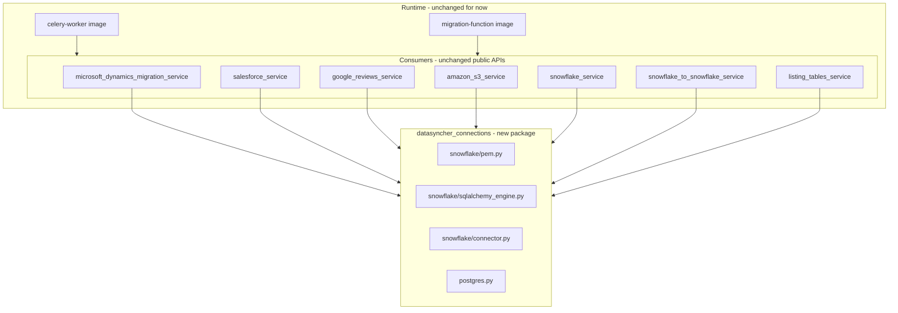
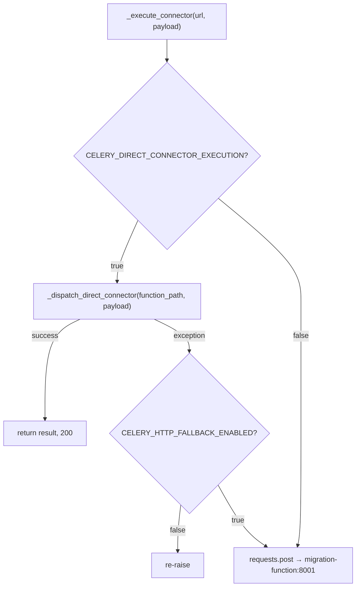

# Connection Library Extraction Plan

This document describes how to extract duplicated **connection creation logic** from the `migration-function` snapshot into a shared library **without breaking** migrations, listing, Celery direct dispatch, or HTTP fallback.

| Related docs | Topic |
|--------------|-------|
| [k8s/README.md](../k8s/README.md) | K8s architecture, Celery direct dispatch |
| [k8s/README-POOL-STRUCTURE.md](../k8s/README-POOL-STRUCTURE.md) | Worker pools, scaling |
| [k8s/README-CELERY-MIGRATION-SCALING.md](../k8s/README-CELERY-MIGRATION-SCALING.md) | Fan-out, `CELERY_DIRECT_CONNECTOR_EXECUTION` |

**Status:** Phase 0–2, 4–6 implemented — library live; consumers migrated via strangler wrappers.

---

## 1. Problem statement

Today, Snowflake and Postgres connection helpers are **copy-pasted** across multiple services inside `backend/migration-function/`. The FastAPI/Celery image also **bundles the entire migration-function tree** at build time so workers can run migrations in-process.

```dockerfile
# backend/fast-api/Dockerfile
COPY migration-function/ /migration-function/
```

At runtime, `celery_worker.py` adds that path and dynamically imports migration services:

```python
MIGRATION_FUNCTION_ROOT = os.path.abspath(os.path.join(APP_ROOT, "..", "migration-function"))
sys.path.insert(0, MIGRATION_FUNCTION_ROOT)
# → importlib.import_module("services.microsoft_dynamics_migration_service")
```

**Goals:**

1. Single source of truth for Snowflake PEM handling, SQLAlchemy engines, and `snowflake.connector` sessions.
2. Stop duplicating connection code across Dynamics, Salesforce, Google Reviews, S3, Snowflake-to-Snowflake, etc.
3. Do **not** break `CELERY_DIRECT_CONNECTOR_EXECUTION=true` (default in QA/prod).
4. Do **not** change payload shapes (`source_config`, `destination_config` dict keys).

**Non-goals (this plan):**

- Removing the migration-function snapshot from the Celery image (migration orchestration still needs full services).
- Wiring Django to open Snowflake connections directly (can be a later phase).
- Refactoring migration business logic (chunking, COPY, merge, etc.).

---

## 2. Current state — what is duplicated

### 2.1 Snowflake destination (SQLAlchemy)

| File | Function | Signature | Return |
|------|----------|-----------|--------|
| `services/microsoft_dynamics_migration_service.py` | `destination_connection_function` | `(dict, connection_id, cmp_id)` | `(engine, schema)` |
| `services/salesforce_service.py` | `destination_connection_function` | `(dict)` | `engine` |
| `services/google_reviews_service.py` | `destination_connection_function` | `(dict)` | `engine` |

Additional **inline** SQLAlchemy engine builders exist in drop-and-reload blocks inside Dynamics, Salesforce, and Google Reviews (~40 lines each).

**Behavioral differences that must be preserved:**

| Aspect | Dynamics | Salesforce / Google Reviews |
|--------|----------|-------------------------------|
| Key-pair `private_key` format | DER bytes (`PKCS8`) via local `_load_private_key_from_string` | Cryptography key object via inline `load_pem_private_key` |
| Password URL | `quote()` user/pass; schema not in URL path | `quote()`; schema + role in URL |
| Role | `USE ROLE` SQL for password auth; in `connect_args` for key_pair | In connection string |
| On failure | `insert_error_log(cmp_id, connection_id, ...)` then re-raise | Re-raise (`HTTPException` for bad creds in Salesforce) |
| Schema setup | `CREATE SCHEMA IF NOT EXISTS`, `USE SCHEMA`, `SELECT CURRENT_VERSION()` | `CREATE SCHEMA IF NOT EXISTS`, `USE SCHEMA` |

### 2.2 Snowflake connector (`snowflake.connector`)

| File | Entry point | Used for |
|------|-------------|----------|
| `services/snowflake_service.py` | `SnowflakeService.create_connection()` | Table listing, readonly validation |
| `services/snowflake_service.py` | `SnowflakeService.engine_creation()` | Auth / test-connection routers |
| `services/amazon_s3_service.py` | `sf_connect(...)` | S3 → Snowflake migration |
| `services/google_reviews_service.py` | `_sf_connect(cfg)` | Google Reviews migration |
| `services/snowflake_to_snowflake_service.py` | `_build_conn_params(config)` | Snowflake-to-Snowflake |

Several services use a **workaround**: instantiate `SnowflakeService({}, None)` only to call the private `_load_private_key_from_string` method.

### 2.3 PEM / key helpers

| File | Functions |
|------|-----------|
| `services/snowflake_service.py` | `normalize_pem_key`, `_load_private_key_from_string` (returns cryptography object) |
| `services/microsoft_dynamics_migration_service.py` | `normalize_pem_key`, `_load_private_key_from_string` (returns DER bytes) — **local copies** |

Most services import `normalize_pem_key` from `snowflake_service`; Dynamics uses its own copy in `destination_connection_function`.

### 2.4 Postgres

| File | Notes |
|------|-------|
| `utils/database_utils.py` | **Canonical** — retries, env validation, keepalive, `SELECT 1` test |
| `services/salesforce_service.py` | Local copy with `load_dotenv`, configurable keepalive |
| `services/listing_tables_service.py` | Basic copy, no retry |
| `services/microsoft_dynamics_migration_service.py` | Local copy **shadows** import from `database_utils` |
| `services/snowflake_service.py` | Basic copy |
| `services/snowflake_to_snowflake_service.py` | Copy with retry — **dead code** (never called) |
| `utils/connection_progress_utils.py` | `_postgres_connection()` — minimal, progress updates only |

---

## 3. Target architecture



### 3.1 Proposed package layout

```
backend/
  datasyncher_connections/
    __init__.py
    snowflake/
      __init__.py
      pem.py                  # normalize_pem_key, load_private_key_der, load_private_key_object
      sqlalchemy_engine.py    # create_snowflake_sqlalchemy_engine(...)
      connector.py            # create_snowflake_connector(...)
    postgres.py               # create_postgres_connection(...)
    pyproject.toml            # pip-installable; version pinned in both requirements.txt files
```

### 3.2 Library API (sketch)

```python
# snowflake/sqlalchemy_engine.py
def create_snowflake_sqlalchemy_engine(
    config: dict,
    *,
    ensure_schema: bool = True,
    validate_version: bool = False,
    on_error: Callable | None = None,   # Dynamics passes insert_error_log here
) -> tuple[Engine, str]:              # (engine, schema_upper)
    ...

# snowflake/connector.py
def create_snowflake_connector(
    config: dict,
    *,
    use_database: bool = True,
) -> snowflake.connector.SnowflakeConnection:
    ...

# snowflake/pem.py
def normalize_pem_key(key_str: str) -> str: ...
def load_private_key_der(key_str: str, passphrase: str | None) -> bytes: ...
def load_private_key_object(key_str: str, passphrase: str | None): ...

# postgres.py
def create_postgres_connection(
    *,
    retries: int = 3,
    validate: bool = True,
    env_overrides: dict | None = None,
) -> psycopg2.extensions.connection:
    ...
```

### 3.3 Strangler pattern — keep old import paths

To avoid breaking callers, **thin wrappers stay in place** during migration:

```python
# services/snowflake_service.py (after extraction)
from datasyncher_connections.snowflake.pem import normalize_pem_key as _normalize_pem_key

def normalize_pem_key(key_str):
    return _normalize_pem_key(key_str)   # re-export; same name, same module path
```

```python
# services/salesforce_service.py
from datasyncher_connections.snowflake.sqlalchemy_engine import create_snowflake_sqlalchemy_engine

def destination_connection_function(destination_connection):
    engine, _ = create_snowflake_sqlalchemy_engine(
        destination_connection,
        ensure_schema=True,
        flavor="salesforce",   # preserves URL/role/key-object behavior
    )
    return engine
```

**Rule:** No caller outside the service file should import connection helpers directly until all consumers are migrated. Existing `from services.snowflake_service import normalize_pem_key` must keep working.

---

## 4. Phased rollout (nothing breaks)

### Phase 0 — Safety net (before any extraction)

1. Add **unit tests** for PEM normalization and key loading (no live Snowflake):
   - Escaped `\n` vs real newlines
   - PKCS8 encrypted vs unencrypted
   - Empty / malformed PEM
2. Add **contract tests** that snapshot expected SQLAlchemy `connect_args` shape per flavor (Dynamics DER bytes vs Salesforce cryptography object).
3. Run existing regression suites and record baselines.

**Regression commands (no secrets):**

```powershell
# migration-function unit tests
cd backend\migration-function
pip install -r requirements.txt
python -m pytest tests\ -v -m "not integration"

# fast-api orchestration / direct dispatch tests
cd backend\fast-api
pip install -r requirements.txt
pip install pytest
$env:DATABASE_URL = "sqlite:///./test.db"
$env:REDIS_URL = "redis://localhost:6379/0"
python -m pytest tests\test_celery_orchestration.py -v
```

**Opt-in integration (requires Snowflake creds):**

```powershell
cd backend\migration-function
python -m pytest tests\test_dynamics_id_e2e_crosscheck.py -v -m integration
```

### Phase 1 — Create library + tests (no consumer changes)

1. Create `backend/datasyncher_connections/` with `pyproject.toml`.
2. Implement `pem.py` using **`snowflake_service.normalize_pem_key`** as the behavioral baseline (most callers already import it).
3. Implement `load_private_key_object` using **`SnowflakeService._load_private_key_from_string`** logic (passphrase retry, validation).
4. Implement `load_private_key_der` using **Dynamics** logic (SQLAlchemy `connect_args` expects DER bytes).
5. Add unit tests in `datasyncher_connections/tests/`.
6. **Do not** change any service files yet.

**Exit criteria:** All new unit tests pass; zero diff in service behavior.

### Phase 2 — Wire consumers one service at a time

Migrate in this order (lowest blast radius first):

| Order | Service | Risk | Notes |
|-------|---------|------|-------|
| 1 | `snowflake_service.py` | Low | Canonical PEM; re-export wrappers |
| 2 | `amazon_s3_service.py`, `snowflake_to_snowflake_service.py` | Low | Already import from snowflake_service |
| 3 | `google_reviews_service.py` | Medium | Two paths: `destination_connection_function` + `_sf_connect` |
| 4 | `salesforce_service.py` | Medium | HTTPException semantics; many call sites |
| 5 | `microsoft_dynamics_migration_service.py` | High | DER bytes, `insert_error_log`, shadows `postgres_connection` |
| 6 | `listing_tables_service.py`, `connection_progress_utils.py` | Low | Postgres only |

**Per-service checklist:**

- [ ] Replace implementation with library call behind existing function name
- [ ] Run unit + integration tests for that connector path
- [ ] Deploy to QA; smoke-test one listing job + one migration job for that source
- [ ] Monitor `error_log_entry` and Celery logs for connection failures

### Phase 3 — Postgres consolidation

1. Point all `postgres_connection()` copies at `datasyncher_connections.postgres.create_postgres_connection`.
2. **Fix shadowing bug** in `microsoft_dynamics_migration_service.py` (delete local `postgres_connection`, use `database_utils` / library).
3. Delete dead `postgres_connection` in `snowflake_to_snowflake_service.py`.
4. Keep `_postgres_connection` in `connection_progress_utils.py` as a thin wrapper (or alias) — progress updates must not fail on retry noise.

**Canonical behavior:** `utils/database_utils.postgres_connection` (retries, env validation, keepalive, `SELECT 1`).

### Phase 4 — Packaging in Docker images

1. Add to both `backend/fast-api/requirements.txt` and `backend/migration-function/requirements.txt`:

   ```
   -e ../datasyncher_connections
   ```

   Or copy + `pip install ./datasyncher_connections` in Dockerfiles (build context remains `backend/`).

2. Update Dockerfiles:

   ```dockerfile
   # fast-api/Dockerfile — add before COPY fast-api/
   COPY datasyncher_connections/ /datasyncher_connections/
   RUN pip install --no-cache-dir /datasyncher_connections
   ```

3. **Keep** `COPY migration-function/ /migration-function/` until migration orchestration is separately packaged.

4. Rebuild and verify:

   ```powershell
   cd backend
   docker build -f fast-api\Dockerfile -t datasyncher-fast-api:test .
   docker build -f migration-function\Dockerfile -t datasyncher-migration-function:test migration-function
   ```

### Phase 5 — Optional follow-ups (out of scope for initial release)

- Django calls library directly for `fetch_existing_snowflake_tables()` (skip HTTP round-trip).
- Split `migration-core` from connection lib to slim Celery image.
- Shared `requirements-constraints.txt` for fast-api + migration-function pins.

---

## 5. What must NOT change

| Item | Why |
|------|-----|
| `CELERY_DIRECT_CONNECTOR_EXECUTION=true` default | Production table work runs in-process on worker pods |
| `_dispatch_direct_connector` function paths | ~15 paths in `celery_worker.py`; HTTP fallback depends on same URLs |
| Payload dict keys (`source_config`, `destination_config`, `Snowflake`, etc.) | Django, FastAPI, and frontend all send these shapes |
| `destination_connection_function` signatures per service | Dynamics 3-arg vs Salesforce 1-arg — wrappers preserve this |
| Dynamics key-pair DER bytes for SQLAlchemy | Changing to cryptography object without testing risks silent auth failures |
| `insert_error_log` on Dynamics connection failure | UI error log depends on it |
| Salesforce `HTTPException` on missing password/key | Router layer may catch these |
| `migration-function` HTTP service | Still used for auth, listing, and HTTP fallback when direct dispatch fails |

---

## 6. Celery execution paths (unchanged)



Connection library extraction affects **what happens inside** imported modules (e.g. `SnowflakeService.create_connection()`), not this dispatch graph.

---

## 7. Test matrix

| Test | Phase | Required for release |
|------|-------|----------------------|
| `datasyncher_connections/tests/test_pem.py` | 1 | Yes |
| `datasyncher_connections/tests/test_sqlalchemy_engine.py` (mocked) | 1 | Yes |
| `fast-api/tests/test_celery_orchestration.py` | 0, 2+ | Yes |
| `migration-function/tests/test_amazon_s3_service.py` | 2+ | Yes |
| `migration-function/tests/test_amazon_s3_router.py` | 2+ | Yes |
| `migration-function/tests/test_dynamics_id_e2e_crosscheck.py` | 2+ (Dynamics) | Yes, with creds |
| Manual QA: Snowflake listing readonly | 2 | Yes |
| Manual QA: Dynamics custtable / Salesforce bulk | 2+ | Yes |

---

## 8. Rollback strategy

Each phase is independently revertible:

1. **Phase 1 rollback:** Delete `datasyncher_connections/` — no consumers changed.
2. **Phase 2 rollback:** Revert individual service file; wrappers mean one-file revert per service.
3. **Phase 4 rollback:** Remove pip install line from Dockerfiles; images use inlined code again.

**QA rollout:** Deploy with existing `scripts/build-push-k8s.ps1 -Tag qa`. If connection failures spike, rollback the specific service commit and redeploy — no schema or API changes required.

---

## 9. Key files reference

| Purpose | Path |
|---------|------|
| Celery direct dispatch | `backend/fast-api/celery_worker.py` |
| FastAPI Dockerfile (snapshot copy) | `backend/fast-api/Dockerfile` |
| Migration-function Dockerfile | `backend/migration-function/Dockerfile` |
| Canonical Postgres | `backend/migration-function/utils/database_utils.py` |
| Canonical PEM (de facto) | `backend/migration-function/services/snowflake_service.py` |
| Dynamics destination conn | `backend/migration-function/services/microsoft_dynamics_migration_service.py` |
| Salesforce destination conn | `backend/migration-function/services/salesforce_service.py` |
| PEM integration test | `backend/migration-function/tests/test_dynamics_id_e2e_crosscheck.py` |
| Direct dispatch tests | `backend/fast-api/tests/test_celery_orchestration.py` |
| Build / deploy script | `scripts/build-push-k8s.ps1` |

---

## 10. Implementation checklist (summary)

- [x] **Phase 0:** Unit tests for PEM + contract tests; baseline regression run
- [x] **Phase 1:** Create `datasyncher_connections` package with tests; no consumer edits
- [x] **Phase 2:** Migrate services one-by-one with strangler wrappers
- [x] **Phase 3:** Consolidate Postgres; fix Dynamics shadowing bug
- [x] **Phase 4:** Pip install in both Docker images; rebuild QA; smoke-test all connector types
- [x] **Phase 5 (optional):** Django direct validation (`USE_DATASYNCHER_CONNECTION_LIBRARY_DIRECT=true`)

---

*Last updated: 2026-06-05 — plan document only; implementation not started.*
