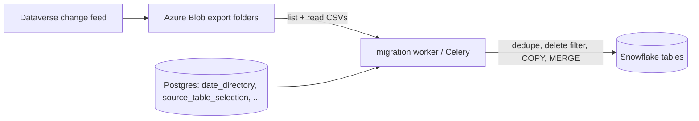

# Trace a Dynamics GUID through the full migration pipeline

Use this when the ID **appears in Azure CSV exports** (Dataverse) but you need to find **where it disappears** before or inside Snowflake (`ledgerjournaltable`, `ledgerjournaltrans`, etc.).

Example ID: `000058e2-0000-0000-4620-005001000000`

---

## Whole flow (production vs diagnostics)

Understanding **two different paths** avoids mixing up “the migration worker” with “the pytest inspector”.

### A) Production / migration worker (full pipeline)

This is what actually lands rows in Snowflake during scheduled or triggered Dynamics migration.



1. **Dataverse** writes incremental export snapshots under timestamped “date directory” folder names (UTC).
2. **Azure Blob Storage** holds `{base}/{YYYY-MM-DDTHH.MM.SSZ}/{table}/…csv` (plus `*-model.json`).
3. **Postgres** stores which folders the app has seen (`date_directory`, per-table `last_synced`, etc.).
4. **Worker** (`microsoft_dynamics_migration_service` and related) reads Azure using the same path rules as the inspector, applies transforms, then **`snowflake_migration`** (dedupe, delete filter), **COPY** to staging, **MERGE** into target.
5. **Snowflake** holds the current row (or not) depending on merge outcome and delete semantics.

If the row is **missing in Snowflake** but **present in Azure CSVs**, the loss happens in **step 4** (worker logic), not in the inspector.

### B) Diagnostic tools (do not run the full worker)

| Step | Tool | Reads from | Writes / proves |
|------|------|------------|------------------|
| B1 | `dataverse_export_window_inspector.py` | `source.json` (Azure), optional Postgres for `--date-dirs-from-db` | CSV trace: “this GUID appears in these blob shards” |
| B2 | `tests/test_dynamics_id_e2e_crosscheck.py` | Same as B1 (subprocess) + Snowflake JSON | Asserts Azure hits (optional) + `COUNT(*)` in Snowflake for `"ID"` |
| B3 | Manual SQL in Snowflake | Snowflake only | Current row / `_FIVETRAN_DELETED` / timestamps |

The **pytest integration test** is only **B1 + B2**. It does **not** replay `migrate()`, Celery, or merge logic. Use it to answer: “Is the ID still in Azure for the dirs I care about?” and “Is the row in Snowflake **right now**?” If those disagree, use **section 3** and worker logs to find the gap in **A**.

### C) pytest subprocess flow (detail for `test_dynamics_id_e2e_crosscheck.py`)

1. **Host process**: `pytest` loads env (`DYNAMICS_ID_E2E=1`, paths, optional `DB_*` for Postgres).
2. **Test 1 — Azure**: `subprocess.run` → `dataverse_export_window_inspector.py` with `--source-json`, `--connection-id`, `--date-dirs-from-db`, `--table`, `--lookup-id`, `--output-csv`.
   - Inspector opens **Postgres** (`postgres_connection()` / `utils.database_utils`) and reads `date_directory.directories` for that `connection_id`.
   - It filters folder names by optional **`--start` / `--end`** or **`--calendar-day`** (UTC day).
   - It lists/downloads **Azure** blobs for those folders only, scans CSVs for the GUID, writes the trace CSV.
3. **Test 2 — Snowflake**: same pytest process connects with `DYNAMICS_ID_E2E_SF_JSON` and runs `SELECT COUNT(*) … WHERE "ID" = %s`.

Anything that breaks **Postgres**, **Azure**, **subprocess encoding**, **scan size** (too many dirs → timeout), or **Snowflake auth** fails here—even if production migration is healthy.

---

## Symptom → likely cause → what to do

| Symptom | Likely cause | What to check / do |
|--------|----------------|-------------------|
| `subprocess.TimeoutExpired` (inspector) | Too many date dirs or huge CSVs under each dir; default pytest timeout 3600s | Set `DYNAMICS_ID_E2E_LOOKUP_CALENDAR_DAY=YYYY-MM-DD` for one UTC day; and/or `DYNAMICS_ID_E2E_LOOKUP_MAX_DATE_DIRS`; and/or `DYNAMICS_ID_E2E_INSPECTOR_TIMEOUT_SEC=0` for no cap. Run the same args manually to see progress. |
| `'charmap' codec can't encode` (Windows) | Child printing Unicode while console/pipe is cp1252 | Ensure current code: subprocess `encoding=utf-8`, env `PYTHONIOENCODING=utf-8`, `PYTHONUTF8=1`. |
| `TypeError: Password was given but private key is not encrypted` | Snowflake JSON has `passphrase` but PEM is `BEGIN PRIVATE KEY` (unencrypted) | Remove passphrase or use encrypted PEM (`BEGIN ENCRYPTED PRIVATE KEY`). Current test code only sends passphrase when PEM looks encrypted. |
| `Could not deserialize key data` | Malformed PEM in JSON (newlines, truncation) | Run through same `normalize_pem_key` as prod; ensure `\n` in JSON or real newlines. |
| Inspector `returncode != 0`, “No date_directory folders” | DB empty or wrong `connection_id` / `cmp_id` | Query `date_directory` for that connection; fix env `DYNAMICS_ID_E2E_CONNECTION_ID`. |
| Inspector finds **0** rows | GUID not in those dirs, wrong table name, or window too narrow | Widen `--calendar-day` / `--start`–`--end`; confirm table folder name matches Azure (`ledgerjournaltable` vs env). |
| Snowflake `COUNT(*) = 0` but Azure trace **has** rows | Loss in worker pipeline (dedupe, delete filter, COPY, MERGE) or different schema/database than you think | Section 3 + grep logs; confirm `DYNAMICS_ID_E2E_SCHEMA` / JSON `database` match the table you query in the UI. |
| Postgres auth errors in inspector | `DB_HOST`, `DB_USER`, `DB_PASSWORD`, `DB_NAME` not set or wrong | Match `database_utils` / worker k8s secrets. |

**Security**: keep `source.json`, Snowflake JSON, and DB passwords out of git and chat; rotate anything that was exposed.

---

## 1) Azure — prove every CSV hit (already done if you have `id_trace*.csv`)

```powershell
cd backend\migration-function

python scripts\dataverse_export_window_inspector.py `
  --source-json .\local-source.json `
  --connection-id 3 `
  --date-dirs-from-db `
  --table ledgerjournaltable `
  --lookup-id "000058e2-0000-0000-4620-005001000000" `
  --output-csv .\id_trace.csv
```

Inspect columns:

| Column | What to check |
|--------|----------------|
| `_SOURCE_DATE_DIR` / `_SOURCE_BLOB` | Which export folder and file |
| `_SOURCE_CSV_BASENAME` | Shard (`1900.csv`, `2026.csv`, `1.csv`, `2.csv`, …) |
| `_IS_DELETE_CSV_SHARD` / `_MIGRATION_FORCED_IS_DELETE` | Delete semantics on `2.csv` |
| Last rows for same `ID` | If **last** change is a delete, Snowflake may end with no row |

Narrow with `--start` / `--end` (folder timestamps) or `--calendar-day YYYY-MM-DD` (full UTC day) when you know the window.

## 2) Snowflake — is the row there now?

```sql
SELECT "ID", "_FIVETRAN_DELETED", "SINK_MODIFIED_ON"
FROM <SCHEMA>."LEDGERJOURNALTABLE"
WHERE "ID" = '000058e2-0000-0000-4620-005001000000';
```

- No row → dropped or never merged.
- Row with `_FIVETRAN_DELETED` true (if column exists) → removed by delete path after last upsert.

## 3) In-process stages (where rows can be “missed”)

All in `services/microsoft_dynamics_migration_service.py`:

1. **CSV read + buffer** (`process_file_in_chunks`) — flush order around delete shards; empty chunks skipped.
2. **`transformations`** — type coercion (`errors='coerce'`) can turn bad values into NaN; duplicate column names collapsed.
3. **`snowflake_migration`** (critical):
   - Rows sorted by `SINK_MODIFIED_ON` **descending**, then `drop_duplicates(subset=['ID'], keep='first')` keeps the **newest** row per ID for that batch.
   - **Delete filter**: `df = df[(df['IS_DELETE'] == False) | (df['ID'].isin(original_table_ids))]` — a row with `IS_DELETE == True` is **dropped** unless the ID already exists in the **target** or **staging** table (`retrieve_snowflake_ids_delete`). If a delete row arrives for an ID that was never inserted, it is stripped here (by design); an upsert-only row must not be removed by this line.
4. **`copy_function`** — `VALIDATION_MODE = RETURN_ERRORS` then `COPY` with `ON_ERROR = CONTINUE`; guard raises if DataFrame had rows but staging count is **0** after COPY.
5. **`merge_into_snowflake`** — merge SQL or transaction failure; check worker logs for `[MERGE_DEBUG]` / `merge_exception`.

## 4) Temporary per-ID debug in the worker (`MIGRATION_DEBUG_LOOKUP_ID`)

Set one GUID before running migration (local worker, K8s job env, or Celery pod):

```powershell
$env:MIGRATION_DEBUG_LOOKUP_ID = "000058e2-0000-0000-4620-005001000000"
```

Grep worker logs for **`[ID_DEBUG]`**. Stages:

| Stage | Meaning |
|-------|---------|
| `after_csv_read` | Row parsed from Azure CSV chunk |
| `after_transform` | Still present after `transformations()` |
| `before_dedupe` / `after_dedupe` | Dropped if duplicate ID with older `SINK_MODIFIED_ON` |
| `after_delete_filter` | Dropped if `IS_DELETE` and ID not already in Snowflake |
| `before_gcs_upload` | Still in DataFrame sent to GCS |
| `after_copy_staging` | `staging_count_for_id` = 0 means COPY skipped/failed that row |

Unset the variable when finished.

## 5) Logs to grep (Celery worker or migration-function)

After a repro run, search pod logs for this table / ID context:

- `[COPY_DEBUG]`, `validation_error`, `COPY loaded 0 rows`
- `[MERGE_DEBUG]`, `merge_exception`
- `[SNOWFLAKE] post_delete`, `id_overlap`, `deduped_rows`
- `[CHUNK]`, `pre_delete_csv_flush`, `FLOW_DEBUG`

Detail file logs (if enabled): `MIGRATION_TABLE_DETAIL_LOG`, GCS upload settings on `celery-worker` deployment.

## 6) Automated cross-check (pytest)

Opt-in integration test (Azure subprocess + Snowflake query): `tests/test_dynamics_id_e2e_crosscheck.py`.

See the module docstring for required environment variables (`DYNAMICS_ID_E2E`, JSON paths, `DB_*` when using `--date-dirs-from-db`). For **how this differs from the production worker**, see **“Whole flow (production vs diagnostics)”** and **“pytest subprocess flow”** at the top of this file.
