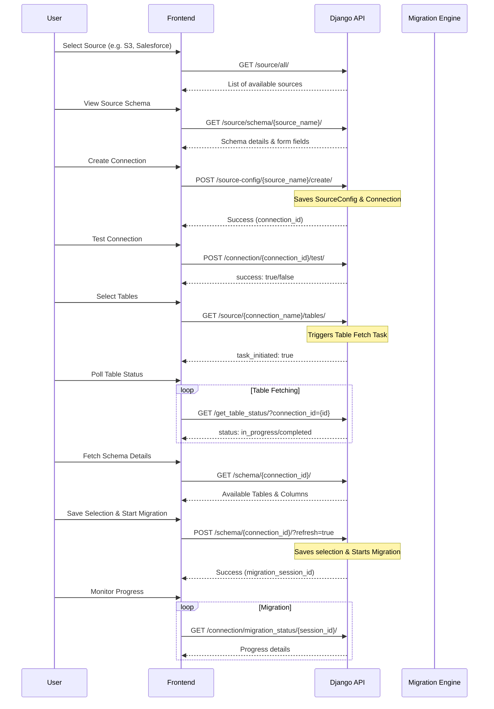

# Source and Connection API Documentation

This document provides detailed specifications for the Source and Connection related API endpoints in the Datasyncher application. It includes request methods, parameters, JSON body structures, and an overview of the data flow.

## Base Configuration
- **Base URL**: `{{baseUrl}}` (e.g., `https://qa.datasyncher.com`)
- **API Version**: `{{version}}` (e.g., `v1`)
- **Common Headers**:
  - `Content-Type: application/json`
  - `Authorization: Token {{yourToken}}`

---

## API Flow Diagram



---

## API Endpoints (In Order)

### 1. List Available Sources
- **URL**: `GET {{baseUrl}}/api/{{version}}/source/all/`
- **View**: `SourceListView`
- **Description**: Returns a list of all source platforms supported by the system.
- **Sample Response**:
```json
[
    {"src_id": 1, "name": "Salesforce"},
    {"src_id": 2, "name": "amazon_s3"},
    {"src_id": 3, "name": "Mongodb"}
]
```

### 2. Get Source Schema
- **URL**: `GET {{baseUrl}}/api/{{version}}/source/schema/{{source_name}}/`
- **View**: `SourceSchemaAPIView`
- **Path Parameters**:
  - `source_name`: The name of the source (e.g., `amazon_s3`, `Salesforce`).
- **Description**: Returns the dynamic form fields required to configure the specific source. Each field includes `type`, `label`, `required`, and `help_text`.

### 3. Get Source Config Detail
- **URL**: `GET {{baseUrl}}/api/{{version}}/source/detail/{{src_config_id}}/`
- **View**: `SourceConfigDetailAPIView`
- **Path Parameters**:
  - `src_config_id`: Integer ID of the `SourceConfig`.
- **Description**: Returns the saved configuration data for a specific source config.

### 4. Get Connection Config Detail (List View)
- **URL**: `GET {{baseUrl}}/api/{{version}}/source-config/{{source_name}}/`
- **View**: `SourceConnectionConfigAPIView`
- **Description**: This endpoint is used when initializing the creation form. If a `connection_id` is not provided, it prepares default values for a new connection of the specified source type.

### 5. Get Connection Config Detail (Edit View)
- **URL**: `GET {{baseUrl}}/api/{{version}}/source-config/{{source_name}}/{{connection_id}}/`
- **View**: `SourceConnectionConfigAPIView`
- **Path Parameters**:
  - `source_name`: String (e.g., `Salesforce`)
  - `connection_id`: Integer
- **Description**: Retrieves existing connection settings and source configuration to populate the edit form. It also includes `read_only` flags for fields that cannot be changed if data migration has already occurred.

### 6. Create Source Configuration and Connection
- **URL**: `POST {{baseUrl}}/api/{{version}}/source-config/{{source_name}}/create/`
- **View**: `SourceConnectionCreateUpdateAPIView`
- **Description**: Creates a new `SourceConfig` and an associated `Connection`.
- **JSON Body**:
```json
{
    "connection_name": "My Production Salesforce",
    "form_data": {
        "destination_schema": "salesforce_raw",
        "client_id": "...",
        "client_secret": "...",
        "environment": "production"
    },
    "action": "authorize"
}
```
- **Note**: `action` can be `authorize` (for OAuth), `test` (for credentials check), or omitted (just save).

### 7. Update Source Configuration and Connection
- **URL**: `POST {{baseUrl}}/api/{{version}}/source-config/{{source_name}}/{{connection_id}}/update/`
- **View**: `SourceConnectionCreateUpdateAPIView`
- **Description**: Updates an existing source and connection. Same JSON structure as Create.

### 8. Initiate Table Fetching
- **URL**: `GET {{baseUrl}}/api/{{version}}/source/{{connection_name}}/tables/`
- **View**: `SelectTableAPIView`
- **Path Parameters**:
  - `connection_name`: The `name` field of the `SourceConfig`.
- **Description**: Triggers a background Celery task to list all available tables/objects from the source system.

### 9. Test Source Connection
- **URL**: `POST {{baseUrl}}/api/{{version}}/connection/{{connection_id}}/test/`
- **View**: `TestSourceConnectionAPIView`
- **Description**: Performs a comprehensive validation of both source and destination connectivity using saved credentials.

### 10. Salesforce Callback (Production)
- **URL**: `GET {{baseUrl}}/api/{{version}}/salesforce/callback/`
- **View**: `SalesforceCallbackAPIView`
- **Description**: OAuth2 redirect handler for Salesforce production environments.

### 11. Salesforce Callback (Sandbox)
- **URL**: `GET {{baseUrl}}/api/{{version}}/salesforcesandbox/callback/`
- **View**: `SalesforceCallbackAPIView`
- **Description**: OAuth2 redirect handler for Salesforce sandbox environments.

### 12. Get Table Fetching Status
- **URL**: `GET {{baseUrl}}/api/{{version}}/get_table_status/?connection_id={{connection_id}}`
- **View**: `ConnectionTableStatusAPIView`
- **Query Parameters**:
  - `connection_id`: Integer.
- **Response**:
```json
{
    "status": "completed",
    "table_statuses": "completed",
    "total_tables": 150
}
```

### 13. Get Connection Schema & Save Selection
- **URL**: `GET {{baseUrl}}/api/{{version}}/schema/{{connection_id}}/`
- **URL (Save)**: `POST {{baseUrl}}/api/{{version}}/schema/{{connection_id}}/?refresh=true`
- **View**: `ConnectionSchemaAPIView`
- **POST JSON Body**:
```json
{
    "table_order": "Account,Contact,Opportunity,Lead"
}
```
- **Description**: GET returns the full tree of tables and fields. POST saves the user's table selection for migration. If `?refresh=true` is appended, the migration starts immediately.

### 14. Discard Schema Changes
- **URL**: `POST {{baseUrl}}/api/{{version}}/connection/{{connection_id}}/discard/`
- **View**: `DiscardSchemaChangesAPIView`
- **Description**: Reverts the current draft selection of tables to the last saved state.

### 15. Get Connection Schema Info
- **URL**: `GET {{baseUrl}}/api/{{version}}/connection/schema-info/{{connection_id}}/`
- **View**: `ConnectionSchemaInfoAPIView`
- **Description**: Returns high-level schema metadata like the target database and schema name.

### 16. Get Connection Setup Detail
- **URL**: `GET {{baseUrl}}/api/{{version}}/connection/setup/{{connection_id}}/`
- **View**: `ConnectionDetailAPIView`
- **Description**: Returns the full setup configuration, including synchronization frequency and safety intervals.

### 17. Get Connection Usage Stats
- **URL**: `GET {{baseUrl}}/api/{{version}}/connection/{{connection_id}}/usage/`
- **View**: `ConnectionUsageAPIView`
- **Description**: Provides data for usage charts, including record counts for the last 7 days and several months.

### 18. Get Connection Activity Logs
- **URL**: `GET {{baseUrl}}/api/{{version}}/connection/{{connection_id}}/activity/`
- **View**: `ConnectionLogsAPIView`
- **Query Parameters**:
  - `days`: (Optional) Filter logs by recent days.
- **Description**: Returns a list of high-level event logs (e.g., "Migration Started", "Connection Updated").

### 19. Get Session Detail
- **URL**: `GET {{baseUrl}}/api/{{version}}/connection/{{connection_id}}/session/{{session_id}}/`
- **View**: `SessionDetailAPIView`
- **Description**: Retrieves technical logs and row-level details for a specific migration run.

### 20. Toggle Connection (Pause/Resume)
- **URL**: `POST {{baseUrl}}/api/{{version}}/connection/{{connection_id}}/toggle/`
- **View**: `ConnectionToggleAPIView`
- **Description**: Switches the connection status between Active ('A') and Paused ('P').

### 21. Delete Connection
- **URL**: `DELETE {{baseUrl}}/api/{{version}}/connection/{{connection_id}}/delete/`
- **View**: `DeleteConnectionAPIView`
- **Description**: Soft-deletes a connection. The connection must not have an active migration running.

### 22. Migration Status
- **URL**: `GET {{baseUrl}}/api/{{version}}/connection/migration_status/{{migration_session_id}}/`
- **View**: `MigrationStatusAPIView`
- **Description**: Provides real-time progress of an active migration session.
- **Response Example**:
```json
{
    "migration_session_id": 45,
    "status": "in_progress",
    "total_progress": 65,
    "tables": [
        {
            "table_name": "Account",
            "status": "completed",
            "migrated_rows": 5400,
            "total_rows": 5400
        },
        {
            "table_name": "Contact",
            "status": "syncing",
            "migrated_rows": 1200,
            "total_rows": 2000
        }
    ]
}
```
