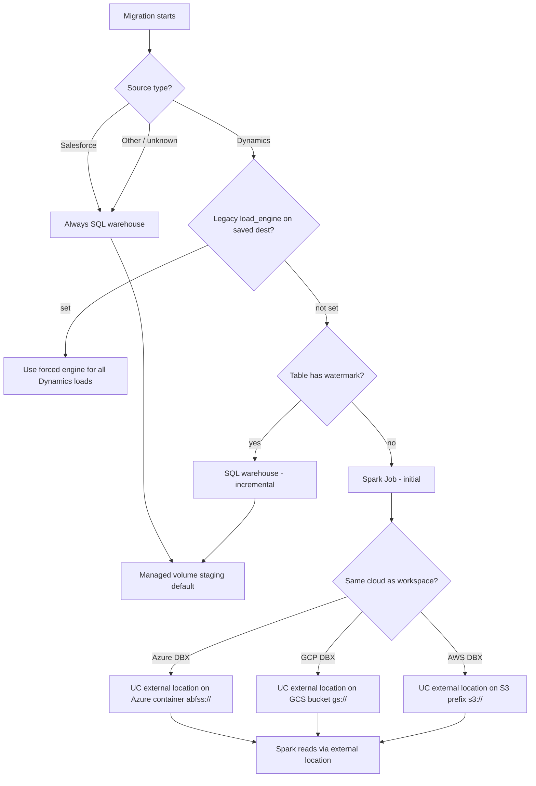

# Databricks load scenarios — Dynamics F&O, Salesforce, and edge cases

> **Folder index:** [README.md](./README.md) · **All Databricks docs:** [../databricks/](../databricks/)

Reference for how Datasyncher chooses **Spark Job vs SQL warehouse**, where data is read from, what permissions are required, and how edge cases behave.

**Related docs**

| Topic | Doc |
|--------|-----|
| **Platform S3/buckets/containers + zero-manual setup** | [datasyncher-platform-staging-and-permissions.md](./datasyncher-platform-staging-and-permissions.md) |
| Managed volume staging (SQL path default) | [databricks-managed-volume-staging-setup.md](./databricks-managed-volume-staging-setup.md) |
| GCP external location (legacy SQL staging) | [databricks-gcp-unity-catalog-setup.md](./databricks-gcp-unity-catalog-setup.md) |
| Client-cloud hybrid staging (future / SQL) | [databricks-client-cloud-staging-setup.md](./databricks-client-cloud-staging-setup.md) |
| Spark bulk load example (`dimensionfocusbalance`) | [dimensionfocusbalance-spark-bulk-load.md](./dimensionfocusbalance-spark-bulk-load.md) |

---

## Destination form (what users configure)

The Databricks **destination** form only needs four fields:

| Field | Purpose |
|-------|---------|
| Server Hostname | Databricks workspace |
| HTTP Path | SQL warehouse **or** all-purpose compute (`/sql/protocolv1/...`) |
| Access Token | PAT / OAuth for SQL + Files API |
| Catalog | Unity Catalog for target tables |

Everything else (load engine, staging method, Spark landing, GCS/ADLS UC names) is **automatic at runtime** or **ops-only** via env vars / legacy saved config.

The **destination schema** (`dst_schema` on the connection) is set on the connector, not the destination form.

---

## Core principle — same-cloud external location (no cross-cloud)

Datasyncher and Databricks should **always stay in the same cloud** as the Databricks workspace. Databricks reads staged/export data through a Unity Catalog **external location** on cloud-native object storage — **not** by reading across clouds (e.g. Azure Databricks reading a GCS bucket, or GCP Databricks reading Azure ADLS).

| Databricks workspace | Staging / read storage | UC external location URL example |
|---------------------|------------------------|----------------------------------|
| **Azure** | Azure Data Lake / Blob **container** | `abfss://<container>@<account>.dfs.core.windows.net/<prefix>/` |
| **GCP** | **GCS** bucket prefix | `gs://<bucket>/datasyncher/...` |
| **AWS** | **S3** bucket prefix | `s3://<bucket>/datasyncher/...` |

**Do not use cross-cloud reads** for production loads. If F&O export lives on Azure but Databricks is on GCP, land/copy into a **GCP GCS** staging prefix first, register UC on that GCS path, then Spark/SQL reads there — never point Azure Databricks at GCS or GCP Databricks at Azure ADLS.

### Typical same-cloud flow (recommended ops model)

```text
F&O export (customer Azure — read-only)
    ↓  Datasyncher lists folders + copies CSVs (when staging copy is used)
Same-cloud staging container/bucket (Datasyncher- or client-owned)
    ↓  UC storage credential + external location on that prefix
Databricks Spark Job or SQL COPY INTO (READ FILES on external location)
    ↓  MERGE
Target Delta table in Unity Catalog
```

**Source export is never modified** — copy is read from export, write goes to staging and Databricks only.

---

## High-level decision flow



**Implementation:** `resolve_databricks_load_engine()` in `services/databricks/load_helpers.py`, called from Dynamics `process_table()` in `services/dynamics/as_source/to_databricks.py`.

**External location setup:** `ensure_databricks_adls_external_location_once()` (Azure), `ensure_databricks_gcs_external_location_once()` (GCP) in `load_helpers.py` / `spark_job_client.py`.

---

## Scenario matrix — load engine

| Source | Load phase | Engine | How `is_initial_load` is determined |
|--------|------------|--------|-------------------------------------|
| **Salesforce** | Any (initial or incremental) | `sql_warehouse` | N/A — Spark resolver never used |
| **Dynamics F&O** | Initial (no per-table watermark) | `spark_job` | `not last_checked_date[table_name]` at `process_table` time |
| **Dynamics F&O** | Incremental (watermark exists) | `spark_job` | Watermark filters which date folders are copied; `is_initial_load=false` in Spark notebook |
| **Other / unknown** | Any | `sql_warehouse` | Safe default |

Override Dynamics to legacy pandas chunks with `destination_config.load_engine=sql_warehouse` or env `DYNAMICS_DBX_LOAD_ENGINE=sql_warehouse`.

### Per-table routing in one migration

Each Dynamics table runs through `process_table()` independently. All tables use **bulk Spark** by default (initial and incremental). Watermark per table controls how many date folders are staged.

---

## Scenario matrix — Spark data path (Dynamics initial and incremental)

When `spark_job` is selected, landing cloud is resolved by `resolve_spark_landing_cloud()` from the workspace hostname. All paths use a **same-cloud UC external location**; Spark never reads cross-cloud.

| Databricks workspace | Inferred `landing_cloud` | Spark notebook | External location | Data path |
|---------------------|--------------------------|----------------|-------------------|-----------|
| `*.azuredatabricks.net` | `azure` | `dynamics_fo_adls_merge` | **ADLS** — Azure container `abfss://...` | See Azure variants below |
| `*.gcp.databricks.com` | `gcs` | `dynamics_fo_gcs_merge` | **GCS** — `gs://<bucket>/dynamics_fo/...` | **Bulk (default):** parallel copy all pending folders → one Spark job; **per_folder** optional |
| `*.cloud.databricks.com` (AWS) | `s3` | `dynamics_fo_s3_merge` | **S3** — `s3://<bucket>/dynamics_fo/...` | **Bulk (default):** parallel copy all pending folders → one Spark job; **per_folder** optional |
| Unknown host | `gcs` (default) | `dynamics_fo_gcs_merge` | GCS | Prefer fixing hostname inference; avoid cross-cloud |

### Azure → Azure Databricks (two supported variants)

Both use **UC external location on an Azure container** (`abfss://`). No GCS, no cross-cloud.

| Variant | When used | Datasyncher | External location URL | Spark reads |
|---------|-----------|-------------|----------------------|-------------|
| **A — Staging container (recommended ops)** | Databricks cannot read F&O export directly; or policy requires Datasyncher-owned storage | Lists F&O folders, **copies CSVs** to Datasyncher Azure staging container | `abfss://staging@<account>.dfs.core.windows.net/datasyncher/...` | Landed prefix in **staging container** |
| **B — Export container (in-place)** | UC + READ FILES already granted on F&O export path (current batch behaviour when configured) | Lists folders only (**no byte copy**) | `abfss://<export-container>@<account>.dfs.core.windows.net/<base-folder>/` | F&O export path **in same Azure cloud** via external location |

Variant B is what logs show as `DBX|spark_direct_discover` — still **Azure external location**, still **same cloud**, but Spark reads the export container in place instead of a separate staging container.

**One-time Azure UC setup (both variants):**

1. Storage credential in Databricks (managed identity or Entra ID SP)
2. External location on the Azure container prefix (export or staging)
3. `GRANT READ FILES ON EXTERNAL LOCATION ...` to job / serverless principal
4. Datasyncher write access on staging container (variant A only)

Default UC names (ops/env): `datasyncher_fo_export_cred`, `datasyncher_fo_export` — override via legacy destination keys or `DATABRICKS_ADLS_*` env vars.

### GCP → GCP Databricks

| Step | Detail |
|------|--------|
| Land (bulk, default) | `land_table_bulk_to_gcs_staging` — parallel copy all pending F&O date folders → `gs://<bucket>/dynamics_fo/<connection_id>/<table>/...` |
| Land (per_folder) | `land_table_date_dir_to_gcs` + manifest — one Spark run per date folder |
| External location | UC on `gs://<bucket>/dynamics_fo/<connection_id>/` (connection-scoped) |
| Spark | `dynamics_fo_gcs_merge` reads table-level (bulk) or date-level `gs://` prefix |
| Cleanup | `cleanup_gcs_staging_after_spark_merge` after successful MERGE (`DYNAMICS_DBX_GCS_STAGING_CLEANUP_AFTER_MERGE`) |
| **Not allowed** | Pointing GCP Databricks at Azure `abfss://` (cross-cloud) |

### AWS → AWS Databricks

| Step | Detail |
|------|--------|
| Land (bulk, default) | `land_table_bulk_to_s3_staging` — parallel copy → `s3://<bucket>/dynamics_fo/<connection_id>/<table>/...` |
| Land (per_folder) | `land_table_date_dir_to_s3` — one Spark run per date folder |
| External location | UC storage credential (IAM role) + location on `s3://<bucket>/dynamics_fo/<connection_id>/` |
| Spark | `dynamics_fo_s3_merge` reads table-level (bulk) or date-level `s3://` prefix |
| Cleanup | `cleanup_s3_staging_after_spark_merge` (`DYNAMICS_DBX_S3_STAGING_CLEANUP_AFTER_MERGE`) |
| Worker env | `S3_BUCKET_URL` / `S3_BUCKET_NAME`, `AWS_ACCESS_KEY_ID`, `AWS_SECRET_ACCESS_KEY`, `AWS_REGION` |
| UC env | `DATABRICKS_S3_IAM_ROLE_ARN`, `DATABRICKS_S3_CREDENTIAL_NAME`, `DATABRICKS_S3_LOCATION_NAME` |

Same-cloud rule: Spark never reads Azure ADLS from an AWS workspace.

### Cross-cloud — avoid

| Pattern | Status |
|---------|--------|
| Azure Databricks reading **GCS** | **Do not use** |
| GCP Databricks reading **Azure ADLS** | **Do not use** |
| Azure F&O → GCS when Databricks is **Azure** | **Wrong cloud** — use Azure container + ADLS external location |
| Azure F&O → GCS when Databricks is **GCP** | **Acceptable only** because GCS is same cloud as GCP workspace (land first, then UC on GCS) |

Legacy code may still infer GCS landing on unknown hosts; ops should set `DYNAMICS_DBX_SPARK_LANDING_CLOUD=azure` for Azure workspaces.

---

## Scenario matrix — SQL warehouse staging (Salesforce + Dynamics incremental)

When `sql_warehouse` is selected, staging is resolved by `resolve_databricks_staging_method()`:

| Condition | Staging method | Default volume |
|-----------|----------------|----------------|
| Explicit `staging_method` on saved destination | As set | From config |
| `volume_name` on saved destination | `managed_volume` | From config |
| Legacy GCS UC fields on saved destination | `external_location` | N/A (GCS path) |
| **New / core-only destination (nothing set)** | `managed_volume` | `datasyncher_stage` (auto-created) |

**Flow:**

```text
F&O export CSV (Azure Blob SDK) → pandas chunks in Celery worker
  → upload to UC managed volume (/Volumes/.../datasyncher_stage/...)
  → SQL warehouse COPY INTO staging Delta
  → MERGE into base → truncate staging
```

Salesforce → Databricks always uses this path (Bulk API extract → same staging/MERGE pattern).

---

## Source data safety

| Action | F&O export (customer Azure) | Same-cloud staging (ADLS / GCS / S3 / volume) | Databricks target |
|--------|----------------------------|-----------------------------------------------|-------------------|
| Spark Azure (export or staging via UC) | **Read only** | Read via external location (staging: Datasyncher **writes** copies) | Write (MERGE) |
| Spark GCP (GCS land) | **Read only** from export | **Write** landed CSVs to GCS | Write (MERGE) |
| SQL warehouse | **Read only** via Blob SDK | **Write** chunk files (managed volume or same-cloud external location) | Write (MERGE) |

**F&O export files are never modified, moved, or deleted** by any path.

---

## Permissions by scenario

### Datasyncher (Dynamics connector — always required)

- Azure storage **read/list** on the Dataverse export container (`connection_string` on source config)
- Used to: list date folders, check table directories, discover CSV paths, copy or download CSVs depending on path

### Databricks — Azure workspace (Spark, same-cloud ADLS external location)

Applies to **both** export-container (variant B) and staging-container (variant A) models:

| Component | Permission |
|-----------|------------|
| UC **storage credential** | Azure managed identity or SP trusted by storage account |
| UC **external location** | URL = Azure container prefix (`abfss://...`) |
| Job / serverless principal | **READ FILES** on external location |
| Target catalog/schema | **CREATE TABLE**, **MODIFY** for MERGE |

Datasyncher may log `ensure_databricks_adls_external_location` if auto-provision is not supported — configure credential + location manually in Catalog Explorer, then re-run.

**Variant A (staging container) additionally requires:**

- Datasyncher SP/account: **Storage Blob Data Contributor** (write) on staging container/prefix
- External location URL points at **staging** prefix, not F&O export root

### Databricks — GCP workspace (Spark, same-cloud GCS external location)

| Party | Permission |
|-------|------------|
| Datasyncher | Azure export **read** + **GCS write** on platform bucket |
| Databricks UC | Storage credential + external location on `gs://...` staging prefix |
| Job / serverless | **READ FILES** on GCS external location |
| Target catalog/schema | Write for MERGE |

Data is landed into **GCS (GCP)** before Spark — same cloud as workspace, not cross-cloud read from Azure inside Databricks.

### Databricks — AWS workspace (Spark, same-cloud S3 external location)

Same pattern: land to **S3**, UC external location on `s3://...`, READ FILES for Spark, write on target tables.

### Databricks — SQL warehouse (managed volume — default)

- SQL warehouse PAT/OAuth (destination form)
- **READ/WRITE VOLUME** on `datasyncher_stage` (or configured volume name)
- **Write** on target tables

### Salesforce → Databricks

- Salesforce API credentials (source)
- SQL warehouse + managed volume only — **no Spark, no F&O export permissions**

---

## Edge cases and special behavior

### 1. `drop_and_reload=True`

- Clears table watermarks and folder cursor before processing
- Drops Databricks base tables (best effort)
- Treated as **initial load** → **Spark** for Dynamics (per table, after watermark cleared)

### 2. Databricks base table dropped but Postgres watermark remains

**Problem:** Without fix, incremental cursor would skip historical folders.

**Behavior (`_force_full_folder_scan_for_missing_base_tables`):**

- If base table missing in Databricks **and** no resumable staging checkpoint → clear table watermark, clear folder cursor → **full folder scan** → **Spark** (initial)
- If resumable staging exists → keep cursor, resume SQL warehouse path

### 3. Table absent from early export folders

- Migration lists all date directories (can be 10k+ folders)
- Folders without `{date}/{table}/` are skipped (`directory_exists_in_date_directory`)
- First Spark job runs when table data first appears (e.g. 2025-01-07 while export starts 2024-11-18)
- **Expected** — not an error

### 4. Mixed initial + incremental tables in one Dynamics job

| Table A (no watermark) | Table B (has watermark) |
|------------------------|---------------------------|
| Spark per folder | SQL warehouse chunked path |

### 5. `initial_load_mode` at migration start

When **every selected table** has no watermark (or `drop_and_reload`):

- Connection-level folder cursor is cleared
- All table watermarks cleared
- Full history folder list built

Individual tables still pick Spark vs SQL at `process_table` based on **per-table** watermark after prechecks.

### 6. Safety interval / folder cutoff

- Recent export folders newer than `safety_interval` may be excluded from the folder list
- Prevents reading in-progress F&O export snapshots
- Log: `DBX|date_directories_ready | safety_cutoff=...`

### 7. Spark: bulk (default) vs per-folder

- **Bulk (default for Azure/GCS/S3 staging):** copy all pending date folders in parallel, then **one** Databricks Job run for the whole table
- **Per-folder:** one Spark job run per date folder (legacy / `spark_*_load_strategy=per_folder`)
- Large initial loads: prefer bulk — avoids thousands of short Spark submits
- Logs: `DBX|spark_staging_bulk_*`, `DBX|spark_job | run_submitted`, `DBX|spark_job | run_success`

### 8. Dedicated serverless Lakeflow job per Databricks destination (Dynamics → Databricks)

When **Dynamics F&O: dedicated serverless Lakeflow job** is set to **Dedicated serverless job for this destination** on a Databricks destination (`create_dedicated_dbx_serverless_job=true` in encrypted `config_data`):

1. On **destination save**, DataSyncher calls `Databricks-Provision-Dynamics-Spark-Job` with `dst_config_id` and creates or updates a **destination-scoped** job named `datasyncher_dynamics_fo_dst_<dst_config_id>`.
2. The job task uses **serverless workflow compute** (no `job_clusters` in the job definition) when UC **external location** staging is available.
3. `spark_job_id`, `spark_job_name`, and `spark_compute_mode=serverless` are written back into the same destination `config_data`. All Dynamics F&O connectors using that destination share this job.

**Default (option off):** one shared workspace job name per landing cloud (`DYNAMICS_DBX_SPARK_*_JOB_NAME` env defaults).

**Scoped-credential fallback:** if staging resolves to scoped credentials, the dedicated job may still use a **classic** single-user cluster (same as shared-job behavior).

**Permissions:** PAT needs Jobs create/run plus UC external location setup (see [platform staging doc](./datasyncher-platform-staging-and-permissions.md)).

### 9. Legacy destination config overrides

Saved destinations may still contain keys removed from the UI form. Backend honors:

| Key | Effect |
|-----|--------|
| `load_engine=spark_job` | Force Spark for **all** Dynamics loads (initial + incremental) |
| `load_engine=sql_warehouse` | Force SQL for **all** Dynamics loads |
| `spark_landing_cloud=azure\|gcs\|s3` | Override hostname inference |
| `spark_staging_load_strategy` / `spark_gcs_load_strategy` / `spark_s3_load_strategy` | `bulk` (default) or `per_folder` |
| `staging_method`, `volume_name`, GCS/ADLS/S3 UC fields | Override staging defaults |
| `spark_job_id`, `spark_job_name`, `spark_notebook_path` | Override auto-provisioned job |

New destinations only store core four fields; overrides are ops/legacy only.

### 10. Environment variable overrides (platform ops)

| Env var | Effect |
|---------|--------|
| `DYNAMICS_DBX_LOAD_ENGINE` | Force `spark_job` or `sql_warehouse` for Dynamics when destination has no `load_engine` |
| `DYNAMICS_DBX_SPARK_LANDING_CLOUD` | Force `azure`, `gcs`, or `s3` landing |
| `DYNAMICS_DBX_SPARK_STAGING_LOAD_STRATEGY` / `DYNAMICS_DBX_GCS_SPARK_LOAD_STRATEGY` / `DYNAMICS_DBX_S3_SPARK_LOAD_STRATEGY` | Force `bulk` or `per_folder` |
| `DYNAMICS_DBX_SPARK_COMPUTE_MODE` | `serverless` (default) or `classic` |
| `DYNAMICS_DBX_SPARK_NODE_TYPE`, `NUM_WORKERS`, `SPARK_VERSION` | Classic cluster sizing |
| `DYNAMICS_DBX_SPARK_JOB_TIMEOUT_SECONDS` | Spark job poll timeout (default 129600s / 36h) |
| `DYNAMICS_DBX_SPARK_BULK_JOB_TIMEOUT_SECONDS` | Bulk MERGE poll timeout (defaults to job timeout) |
| `CELERY_MIGRATION_HTTP_TIMEOUT_SECONDS` | Job worker → migration-function HTTP wait (default 133200s / 37h) |
| `DYNAMICS_DBX_SPARK_*_JOB_NAME`, `*_NOTEBOOK_PATH` | Job/notebook name overrides (ADLS / GCS / S3) |
| `GCS_BUCKET_URL` / `GCS_BUCKET_NAME` | Required for GCS landing path |
| `S3_BUCKET_URL` / `S3_BUCKET_NAME` | Required for S3 landing path |
| `DYNAMICS_DBX_GCS_STAGING_CLEANUP_AFTER_MERGE` / `DYNAMICS_DBX_S3_STAGING_CLEANUP_AFTER_MERGE` | Delete landed objects after MERGE (default on) |

### 11. External location warnings during Spark / SQL setup

| Log | Meaning |
|-----|---------|
| `ensure_databricks_adls_external_location` | UC setup for **Azure** external location — required for same-cloud Spark read |
| `ensure_databricks_gcs_external_location` | UC setup for **GCS** external location — required for GCP same-cloud path |
| `manual_mode: storage credential ... not found` | Admin must create UC credential + external location once in Databricks |
| `auto_mode: Azure ADLS credential auto-provisioning is not supported yet` | Use manual UC setup on Azure container prefix |

On Azure Spark runs, GCS external-location ensure may still log — it targets SQL **legacy GCS staging**, not the ADLS Spark path. Non-blocking if Spark ADLS UC is configured separately.

Spark can succeed when UC was configured manually even if auto-provision logs warnings.

### 11. Incremental after successful Spark initial

After initial Spark load completes:

- `last_checked_date[table]` updated to latest processed folder
- Next run: watermark present → **SQL warehouse** automatically
- No user action required

### 12. Salesforce → Databricks

- **Never** uses `resolve_databricks_load_engine`
- **Never** uses Spark Job path
- Always: Bulk API → SQL warehouse COPY/MERGE → managed volume default `datasyncher_stage`
- Destination `load_engine` (if present on old configs) is **ignored**

### 13. Pipeline / Celery execution context

- Dynamics migrations run in per-job / per-flow Celery workers (`celery-worker-flow-*`)
- Spark job submission uses Databricks REST API from the worker (token from destination config)
- Long-running initial loads hold the worker until all folders complete

### 14. Same-cloud staging vs export read (Azure)

| Approach | Cloud alignment | External location on | Code status |
|----------|-----------------|----------------------|-------------|
| F&O export → **Datasyncher Azure staging container** → Spark | **Azure → Azure** (recommended when export not readable by DBX) | Staging `abfss://...` | **Target ops model** — see [client-cloud staging](./databricks-client-cloud-staging-setup.md) |
| F&O export → **in-place Spark read** via UC on export container | **Azure → Azure** | Export `abfss://...` | **Implemented** — `discover_table_date_dir_for_spark_direct` |
| F&O export → **Datasyncher GCS** → Spark | **Land to GCP** (only valid if DBX is GCP) | `gs://...` | **Implemented** — `land_table_date_dir_to_gcs` |
| Azure Databricks reading **GCS** or GCP DBX reading **ADLS** | **Cross-cloud** | — | **Do not use** |

Why staging copy exists: F&O export often cannot grant Databricks READ directly; copying into a **same-cloud** Datasyncher container/bucket lets UC external location point at storage Databricks is allowed to read.

### 15. Failure and resume

| Failure point | Typical behavior |
|---------------|------------------|
| Spark run fails for one folder | Error logged; migration may fail or retry depending on job config |
| SQL chunk fails | Checkpoint / staging may allow resume |
| Base missing + orphans staging | SQL resume path |
| Base missing + no staging | Force initial (Spark) on next run |

---

## Log grep cheat sheet

| Log pattern | Meaning |
|-------------|---------|
| `DBX\|migrate_folder_plan \| initial_load=True` | Full folder scan planned |
| `DBX\|spark_job\|process_table_start \| is_initial_load=True` | Spark path chosen |
| `DBX\|spark_direct_discover` | Azure UC path — Spark reads export `abfss://` (same cloud, no staging copy) |
| `DBX\|spark_land_ok` | Azure → **GCS** land completed (GCP workspace only — same cloud as DBX) |
| `DBX\|ensure_adls_external_location` | UC external location ensure on Azure container |
| `DBX\|ensure_external_location` | UC external location ensure on GCS bucket |
| `DBX\|spark_job \| run_submitted` | Databricks Job started for one folder |
| `DBX\|spark_job \| run_success` | Folder MERGE completed |
| `DBX\|process_table_connected` | SQL warehouse path (incremental) |
| `DBX\|managed_volume_ready` | Staging volume ready |

**Watch live (batch cluster):**

```powershell
cd k8s/batch-cluster
.\watch-flow-jobs.ps1 -PipelineRunId <run_id>
# or
kubectl --context=gke_datasyncher-batch_us-central1_datasyncher-batch-cluster logs -n default `
  -l "datasyncher.com/pipeline-run-id=<run_id>" --tail=200 --follow=true
```

---

## Quick reference — “which path am I on?”

| Question | Answer |
|----------|--------|
| Salesforce destination? | SQL warehouse only |
| Dynamics first sync for this table? | Spark (unless legacy `load_engine=sql_warehouse`) |
| Dynamics table synced before? | SQL warehouse |
| Azure Databricks initial? | Spark via **ADLS external location** on Azure container (`abfss://`) — export in-place or staging copy |
| GCP Databricks initial? | Land to **GCS**, UC external location, Spark read — **same cloud, no ADLS** |
| AWS Databricks initial? | Land to **S3**, UC external location — same cloud pattern |
| Cross-cloud read? | **No** — do not point DBX at storage in another cloud |
| Does source export change? | **No** — read-only |
| Default SQL staging volume? | `datasyncher_stage` |
| User sets load engine in UI? | **No** — backend decides |

---

## Code references

| Component | File |
|-----------|------|
| Engine resolver | `backend/migration-function/services/databricks/load_helpers.py` — `resolve_databricks_load_engine()` |
| Staging resolver | `load_helpers.py` — `resolve_databricks_staging_method()`, `resolve_databricks_staging_settings()` |
| Landing cloud | `load_helpers.py` — `resolve_spark_landing_cloud()` |
| Dynamics routing | `backend/migration-function/services/dynamics/as_source/to_databricks.py` — `process_table()`, `_process_table_spark_job()` |
| GCS land | `backend/migration-function/services/dynamics/source_common.py` — `land_table_date_dir_to_gcs()` |
| ADLS discover | `source_common.py` — `discover_table_date_dir_for_spark_direct()` |
| ADLS UC ensure | `load_helpers.py` — `ensure_databricks_adls_external_location_once()` |
| GCS UC ensure | `load_helpers.py` — `ensure_databricks_gcs_external_location_once()` |
| Spark job client | `backend/migration-function/services/databricks/spark_job_client.py` |
| ADLS Spark notebook | `backend/migration-function/spark/dynamics_fo_adls_merge.py` |
| GCS Spark notebook | `backend/migration-function/spark/dynamics_fo_gcs_merge.py` |
| Salesforce path | `backend/migration-function/services/salesforce/as_source/to_databricks.py` |

---

*Last updated: backend-driven engine routing + same-cloud UC external location model (Azure container / GCS / S3 — no cross-cloud reads).*
