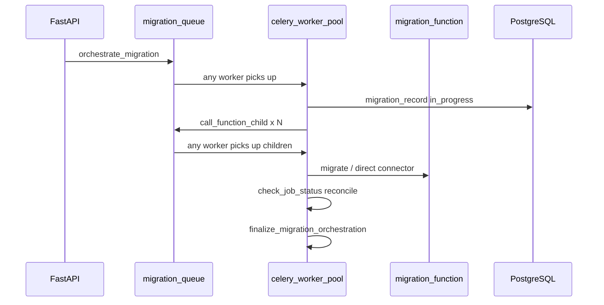
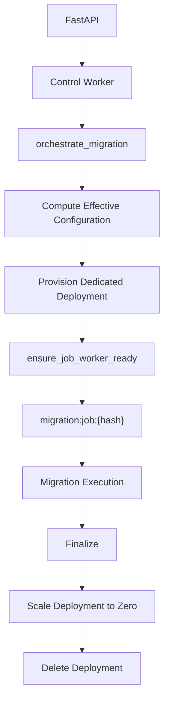
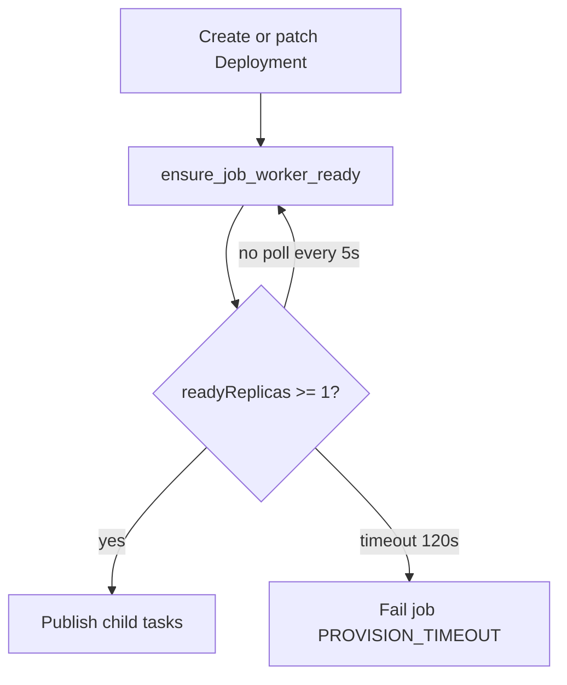
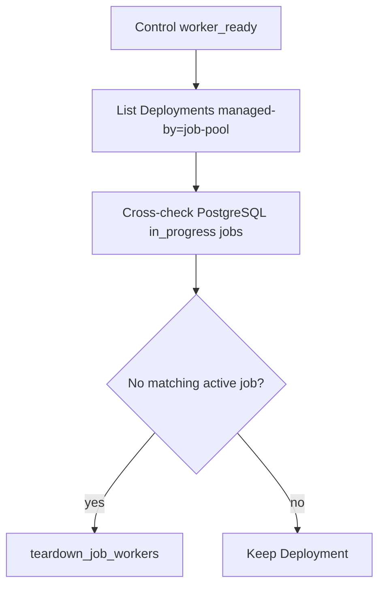
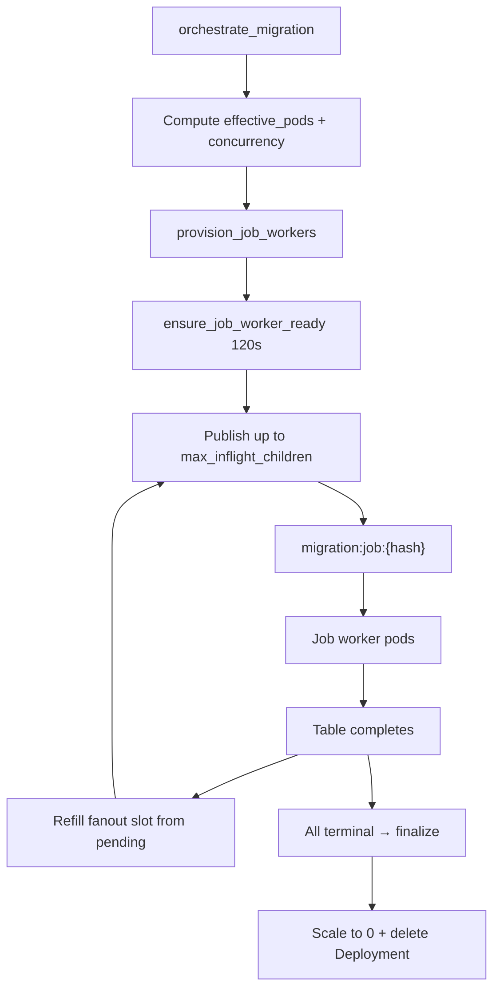
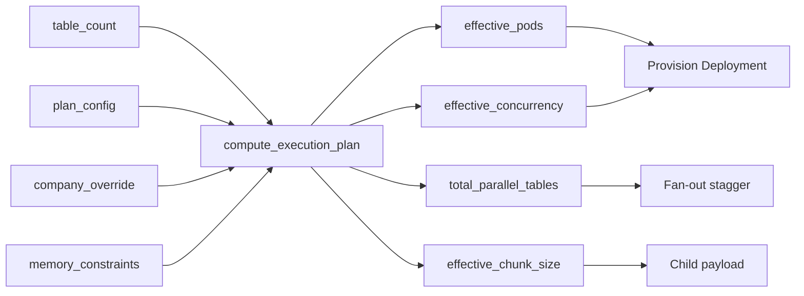
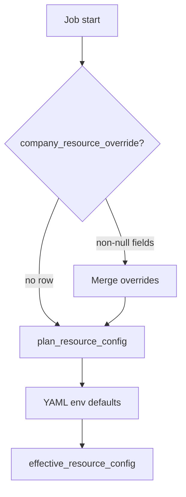
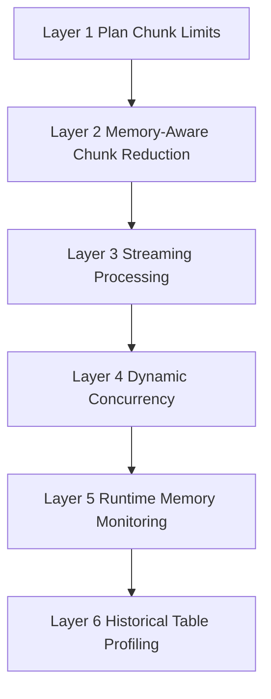
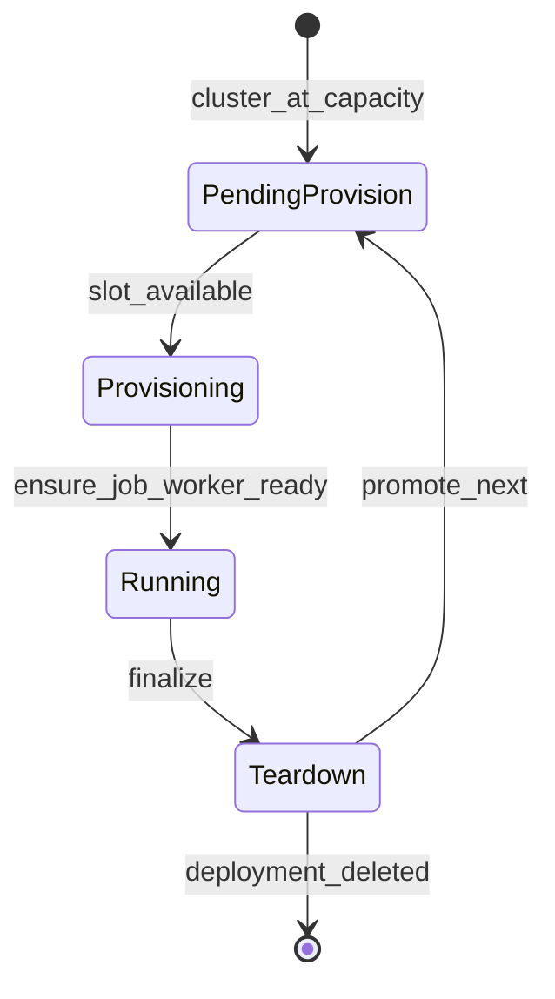
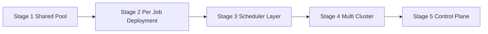

# RFC-001: Per-Job Worker Deployment Isolation, Resource Planning, and OOM Prevention

| Field | Value |
|-------|-------|
| **Status** | Proposed |
| **Version** | 1.2 |
| **Authors** | Platform Engineering |
| **Created** | 2026-06-08 |
| **Audience** | Engineering, platform architects, technical leadership, investors (technical diligence), future DataSyncher engineers |

**Related documents**

| Document | Topic |
|----------|-------|
| [k8s/README-POOL-STRUCTURE.md](../k8s/README-POOL-STRUCTURE.md) | Current pool model (shared KEDA) |
| [k8s/README-JOB-ISOLATION.md](../k8s/README-JOB-ISOLATION.md) | Per-job isolation rollout and ops |
| [k8s/monitoring/README-METRICS.md](../k8s/monitoring/README-METRICS.md) | RFC §11 Prometheus metrics (implementation) |
| [backend/fast-api/celery_job_metrics.py](../backend/fast-api/celery_job_metrics.py) | Metrics module (`datasyncher_*` series) |
| [k8s/README-CELERY-MIGRATION-SCALING.md](../k8s/README-CELERY-MIGRATION-SCALING.md) | Fan-out and stagger |
| [k8s/README-SCALE-DOWN-PROTECTION.md](../k8s/README-SCALE-DOWN-PROTECTION.md) | Idle-first scale-down |
| [backend/fast-api/celery_worker.py](../backend/fast-api/celery_worker.py) | Orchestration implementation |
| [apps/elttool/models.py](../apps/elttool/models.py) | Current plan / company models |

---

## Table of contents

1. [Executive Summary](#1-executive-summary)
2. [Current Architecture](#2-current-architecture)
3. [Proposed Architecture](#3-proposed-architecture)
4. [Resource Planning](#4-resource-planning)
5. [Dynamic Pod Allocation and Execution Planning](#5-dynamic-pod-allocation-and-execution-planning)
6. [Database Configuration Model](#6-database-configuration-model)
7. [Company Overrides](#7-company-overrides)
8. [OOM Prevention Strategy](#8-oom-prevention-strategy)
9. [Cluster Protection](#9-cluster-protection)
10. [Enterprise Differentiation](#10-enterprise-differentiation)
11. [Monitoring and Operations](#11-monitoring-and-operations)
12. [Rollout Strategy](#12-rollout-strategy)
13. [Risks and Mitigations](#13-risks-and-mitigations)
14. [Future Roadmap](#14-future-roadmap)
15. [Final Recommendation](#15-final-recommendation)

---

## 1. Executive Summary

DataSyncher is a multi-tenant SaaS data integration platform. Customers replicate operational data from sources such as **Salesforce**, **Microsoft Dynamics 365**, **MySQL**, **PostgreSQL**, and **MongoDB** (roadmap) into analytical warehouses including **Snowflake** and **BigQuery**.

The platform runs on **FastAPI**, **Celery**, **Redis**, **PostgreSQL**, and **Google Kubernetes Engine (GKE)** with **KEDA** autoscaling. Migration workloads are orchestrated in `celery_worker.py` and executed via `migration-function` or direct connector dispatch.

### Problem

Today, all migrations share a **single KEDA-scaled Celery worker pool** and one Redis queue (`migration`). Plan tiers influence how many pods KEDA adds to the cluster, but **do not bind workloads to dedicated compute**. This causes:

- Tenant resource leakage (Free-tier jobs on Enterprise-scaled pods)
- Weak plan enforcement and difficult cost attribution
- Worker pods that outlive the migration that triggered them
- Job starvation during large migrations
- Unpredictable memory consumption and OOM-driven operational incidents

### Proposal

Adopt **Per-Job Deployment Isolation**: each migration job receives a dedicated Kubernetes Deployment, dedicated Celery queue, DB-resolved resource profile, explicit lifecycle, and dedicated monitoring. A small **control-plane worker** handles orchestration, finalization, provisioning, and teardown.

### Core formulas

```
required_pods          = ceil(table_count / plan_concurrency)
effective_pods         = max(1, min(required_pods, plan_max_pods))
effective_concurrency  = max(1, min(plan_concurrency, safe_concurrency))
total_parallel_tables  = effective_pods × effective_concurrency
effective_chunk_size   = min(user_requested, plan_max_chunk, memory_safe_chunk)
```

### Recommendation

Implement **Stage 2** (per-job isolation) behind feature flag `CELERY_JOB_ISOLATION_MODE=per_job`. Pair with a **six-layer OOM prevention strategy**. Defer scheduler layers and multi-cluster control planes until customer scale justifies the complexity.

**Business outcomes:** enforceable SaaS tiers, per-job cost attribution, elimination of cross-tenant compute leakage, fast worker teardown after job completion, and a credible Enterprise SLA path.

---

## 2. Current Architecture

### 2.1 Technology stack

| Layer | Technology | Role |
|-------|------------|------|
| API | FastAPI | Trigger migrations, enqueue orchestration |
| Orchestration | Celery (`celery_worker.py`) | Fan-out, finalizer, reconcile loop |
| Broker / cache | Redis | Celery broker, KEDA signals, fan-out stagger |
| Execution | migration-function | Table-level ELT (HTTP or direct) |
| Metadata | PostgreSQL | Jobs, connections, plans, `migration_record` |
| Warehouse | Snowflake, BigQuery | Destination |
| Compute | GKE worker node pool | `celery-worker`, `migration-function` |
| Autoscaling | KEDA + HPA | Shared pool, 1–10 replicas |

### 2.2 Supported and planned connectors

| Source | Destination | Status |
|--------|-------------|--------|
| Salesforce | Snowflake, BigQuery | Production |
| Microsoft Dynamics 365 | Snowflake | Production |
| MySQL | Snowflake | Production |
| PostgreSQL | Snowflake | Production |
| MongoDB | Snowflake | Roadmap |
| Additional connectors | TBD | Future |

### 2.3 Migration execution flow (today)



### 2.4 Shared pool scaling model

From `k8s/README-POOL-STRUCTURE.md` and `celery_worker.py`:

```
per_job_base   = ceil(table_count / worker_concurrency)
per_job_pods   = min(per_job_base, plan_pod_cap)
cluster_desired = sum(per_job_pods for all in_progress jobs)
KEDA replicas   = LLEN(celery:keda:desired-replicas)
```

KEDA reads a Redis list (`celery:keda:desired-replicas`) whose length equals desired pod count. Entries are opaque; the scaler does not know which job owns which pod.

**Critical limitation:** `plan_pod_cap` affects **cluster-wide replica math**, not **pod ownership**. Any `celery-worker` pod can execute any job's `call_function_child` tasks.

### 2.5 Current plan model

The `plans` table (`apps/elttool/models.py`) stores `plan_id`, `name`, and `pod_count` only. `Company.get_effective_pod_count()` returns `max(plan.pod_count, company.pod_count)` when the company override exceeds the catalog cap.

Code fallback in `celery_worker.py`: Free=1, Standard/Discounted=2, Enterprise=3 pods.

### 2.6 Documented problems

| Problem | Operational impact |
|---------|-------------------|
| Tenant resource leakage | Free jobs consume Enterprise-scaled infrastructure |
| No strict workload isolation | Cannot guarantee plan fairness |
| Workers outlive migrations | `minReplicaCount: 1`, 600s HPA stabilization |
| Weak plan enforcement | Cap is a KEDA sum input, not a routing rule |
| Cost attribution | Cluster-level billing only |
| Job starvation | Large jobs monopolize prefork slots |
| Unpredictable memory | No per-job memory budget |
| Scale-down stuck risk | Pod eviction mid-task without clean recovery |

---

## 3. Proposed Architecture

### 3.1 Design principles

1. **Isolate by job** — each migration is a first-class compute unit.
2. **Configure by database** — commercial tiers live in PostgreSQL, not YAML.
3. **Lifecycle-bound compute** — provision on orchestration start; teardown on finalize.
4. **Defense in depth for OOM** — six layers (Section 8).
5. **Fail closed** — no child publish until workers are ready.

### 3.2 End-to-end flow



### 3.3 Per-job resource naming

| Resource | Format | Example |
|----------|--------|---------|
| Deployment | `celery-worker-job-{sha256(job_name)[:12]}` | `celery-worker-job-a3f9c2e81b4d` |
| Celery queue | `migration:job:{sha256(job_name)[:12]}` | `migration:job:a3f9c2e81b4d` |
| Redis meta | `celery:job-worker:{hash}:meta` | JSON lifecycle state |

**Kubernetes labels:** `datasyncher.com/company-id`, `datasyncher.com/plan`, `datasyncher.com/job-hash`, `datasyncher.com/managed-by=job-pool`

Each migration receives: **Dedicated Deployment · Dedicated Queue · Dedicated Resources · Dedicated Lifecycle · Dedicated Monitoring**

### 3.4 Control plane vs job workers

| Deployment | Replicas | Queue | Tasks |
|------------|----------|-------|-------|
| `celery-worker-control` | 1 (fixed) | `migration-control` | `orchestrate_migration`, `finalize_migration_orchestration`, `check_job_status`, provision/teardown |
| `celery-worker-job-{hash}` | dynamic | `migration:job:{hash}` | `call_function_child` only |

Job workers start with:

```
celery worker -A celery_worker.celery_app -Q migration:job:{hash} --concurrency={effective_concurrency}
```

Legacy shared `celery-worker` Deployment remains behind `CELERY_JOB_ISOLATION_MODE=shared` for rollback.

### 3.5 Provisioning readiness gate

Child tasks must **not** be published until at least one job worker pod is ready to consume them. Without this gate, tasks accumulate in Redis while pods pull images or fail scheduling—appearing as "stuck PENDING" jobs.



#### `ensure_job_worker_ready(job_name)`

Implemented in `celery_job_worker_pool.py`.

| Property | Value |
|----------|-------|
| Idempotent | Safe to call multiple times |
| Poll interval | 5 seconds |
| Timeout | **120 seconds** (`CELERY_JOB_WORKER_READY_TIMEOUT`) |
| Success | `Deployment.status.readyReplicas >= 1` |
| On success | Log `JOB_WORKER_READY`; Redis meta → `ready` |
| On timeout | Fail job; do **not** publish children; teardown partial Deployment |

#### Orchestration order (`orchestrate_migration`, `per_job` mode)

1. `resolve_effective_resource_config(company_id, connection_id)`
2. `provision_job_workers(job_name, effective_pods)`
3. **`ensure_job_worker_ready(job_name)`** — block until ready or timeout
4. `_init_fanout_stagger` / `_publish_child_task` — only after step 3 succeeds

### 3.6 Teardown policy

On `finalize_migration_orchestration` (success or terminal failure):

1. Patch Deployment `replicas: 0`
2. Wait for in-flight tasks (`terminationGracePeriodSeconds: 120`)
3. Delete Deployment after drain confirmed (≤ 60s)
4. Remove Redis registry keys; release cluster capacity slot
5. Promote next job from deferred provision queue (if any)

Job-scoped Deployments do **not** use KEDA's 600s cooldown. Teardown is explicit and fast.

### 3.7 Control worker startup orphan sweep

On **control worker** `worker_ready` (not job workers), run once per process start:



| Step | Behavior |
|------|----------|
| List | `labelSelector=datasyncher.com/managed-by=job-pool` |
| Cross-check | Active hashes from `migration_record.status=in_progress` + `celery:job-worker:active` |
| Orphan action | `teardown_job_workers(fast=True)` |
| Log | `STARTUP_ORPHAN_SWEEP \| found=N \| deleted=M` |
| Rate limit | Max 10 deletes per startup |

**Protects against:** Redis restart, control worker restart, cluster restart, failed finalize teardown, crashed orchestrator.

Complements the periodic sweeper in `check_job_status` (Section 11.6).

---

## 4. Resource Planning

### 4.1 Plan resource matrix

| Plan | Max Pods | CPU (req/limit) | Memory (req/limit) | Concurrency | Max Chunk | Max Parallel Tables |
|------|----------|-----------------|---------------------|-------------|-----------|---------------------|
| Free | 1 | 2 | 8 GB | 3 | 25,000 | **3** |
| Standard | 2 | 2 | 8 GB | 3 | 50,000 | **6** |
| Premium | 3 | 4 | 16 GB | 4 | 100,000 | **12** |
| Enterprise | 4 | 8 | 32 GB | 6 | 200,000 | **24** |

```
max_parallel_tables (upper bound) = max_pods × concurrency
```

Actual parallelism is further limited by dynamic replicas (Section 5) and dynamic concurrency (Section 8, Layer 4).

### 4.2 Why concurrency increases by plan

Concurrency is Celery prefork slots **per pod**. Higher plans sell **parallel table throughput**:

- Free: 1 × 3 = 3 concurrent table pipelines
- Enterprise: 4 × 6 = 24 concurrent table pipelines

This is a quotable metric for sales and SLA discussions.

### 4.3 Why CPU increases by plan

Migration work is CPU-bound: JSON parsing, type coercion, compression, Parquet encoding, and cryptographic operations. Additional CPU reduces per-table wall time and supports higher sustainable concurrency without kernel throttle.

### 4.4 Why memory increases by plan

Wide Salesforce objects (ContentVersion, EmailMessage, Case with long text fields) and large chunks require RAM headroom. Memory scales from 8 GB (Free/Standard) to 32 GB (Enterprise) to support larger safe chunks and more concurrent in-memory pipeline stages per pod.

### 4.5 Why Enterprise must differ on more than pod count

Enterprise buyers run 100–500+ tables, wide objects, and multiple concurrent jobs. Differentiation spans **pods × concurrency × memory × CPU × chunk × priority × concurrent job limit**—not pod count alone. Premium bridges Standard and Enterprise for mid-market upsell.

---

## 5. Dynamic Pod Allocation and Execution Planning

This section defines how DataSyncher converts **table count**, **plan configuration**, **concurrency**, and **memory constraints** into **effective pod count**, **execution parallelism**, **predictable resource consumption**, **tenant isolation**, and **cost control**.

Each migration job runs in **per-job deployment isolation**: a dedicated `celery-worker-job-{hash}` Deployment, dedicated queue `migration:job:{hash}`, and lifecycle-bound teardown on finalize.

### 5.1 Planning inputs

| Input | Source |
|-------|--------|
| `table_count` | Selected tables for this migration job |
| `plan_max_pods` | `plan_resource_config.max_pods` |
| `plan_concurrency` | `plan_resource_config.concurrency` (prefork slots per pod) |
| `plan_max_pods` (override) | `company_resource_override.max_pods` if set |
| `safe_concurrency` | Layer 4 OOM formula (Section 8) |
| `effective_chunk_size` | Layers 1–2 OOM (Section 8) |

### 5.2 Plan matrix (reference)

| Plan | Max Pods | CPU | Memory | Concurrency |
|------|----------|-----|--------|-------------|
| Free | 1 | 2 | 8 GB | 3 |
| Standard | 2 | 2 | 8 GB | 3 |
| Premium | 3 | 4 | 16 GB | 4 |
| Enterprise | 4 | 8 | 32 GB | 6 |

### 5.3 Pod allocation formula

Pods must **not** be allocated from table count alone. Each pod already runs multiple concurrent table tasks via Celery prefork.

```python
required_pods = ceil(table_count / plan_concurrency)

effective_pods = max(
    1,
    min(required_pods, plan_max_pods),
)

effective_concurrency = max(
    1,
    min(plan_concurrency, safe_concurrency),
)

total_parallel_tables = effective_pods * effective_concurrency

max_inflight_children = min(
    total_parallel_tables,
    table_count,
)
```

**Waiting tables at start:** `max(0, table_count - max_inflight_children)` queued in `celery:fanout-pending:{job}` until slots free.

### 5.4 Why not `min(plan_max_pods, table_count)`?

The naive formula treats **one table = one pod**, ignoring that each pod already supports `plan_concurrency` parallel table workers.

| Approach | Enterprise, 12 tables | Pods provisioned | Parallel slots | Idle pods |
|----------|----------------------|------------------|----------------|-----------|
| **Naive** `min(4, 12)` | 12 tables | **4** | up to 24 | 0–3 pods may sit idle early |
| **Correct** `ceil(12/6)=2` | 12 tables | **2** | **12** | 0 |

**Resource savings (Scenario 10):** 2 pods × 8 CPU × 32 GB vs 4 pods — **50% pod-hour cost** with identical parallelism (12 tables at once).

| Approach | Standard, 2 tables | Naive pods | Correct pods |
|----------|-------------------|------------|--------------|
| Naive `min(2, 2)` | 2 | **2** | **1** (concurrency 3 covers both) |

**Resource savings (Scenario 4):** One pod runs 2 tables concurrently — **50% pod cost** vs provisioning 2 pods.

### 5.5 Execution flow (per job)



1. Resolve effective config (plan → company override → YAML fallback).
2. Compute `required_pods` and `effective_pods`.
3. Provision Deployment with `replicas=effective_pods`.
4. Wait until `readyReplicas >= 1` (readiness gate).
5. Publish at most `max_inflight_children` `call_function_child` tasks.
6. On child completion, refill from `celery:fanout-pending:{job}` until all tables terminal.
7. Finalize and teardown Deployment.

### 5.6 Scenario analysis

Each scenario lists: inputs, allocation math, execution flow, waiting tables, utilization, and cost impact.

---

#### Scenario 1 — Free, 1 table

| Field | Value |
|-------|-------|
| Plan | Free (max_pods=1, concurrency=3) |
| Table count | 1 |
| required_pods | ceil(1/3) = **1** |
| effective_pods | **1** |
| total_parallel_tables | 1 × 3 = **3** |
| Waiting tables | 0 |
| Execution | Single table on 1 pod; 2 prefork slots idle |
| Cost | Minimum Free tier footprint |

---

#### Scenario 2 — Free, 2 tables

| Field | Value |
|-------|-------|
| Table count | 2 |
| required_pods | ceil(2/3) = **1** |
| effective_pods | **1** |
| total_parallel_tables | **3** |
| Waiting tables | 0 |

**Why 1 pod:** Concurrency 3 means one pod runs **both tables in parallel**. Provisioning 2 pods would waste resources with no throughput gain.

---

#### Scenario 3 — Free, 20 tables

| Field | Value |
|-------|-------|
| Table count | 20 |
| required_pods | ceil(20/3) = **7** |
| effective_pods | max(1, min(7, 1)) = **1** |
| total_parallel_tables | **3** |
| Waiting tables | 17 initially |

**Batch execution:** Fan-out publishes 3 tables at a time. As each completes, pending queue refills. ~7 batches of 3 (last batch of 2). Plan cap forces serialization beyond 3 parallel — Free tier tradeoff.

**Cost:** 1 pod for entire job; long wall time vs Enterprise.

---

#### Scenario 4 — Standard, 2 tables

| Field | Value |
|-------|-------|
| Plan | Standard (max_pods=2, concurrency=3) |
| Table count | 2 |
| required_pods | ceil(2/3) = **1** |
| effective_pods | **1** |
| total_parallel_tables | **3** |

**Why not 2 pods:** `required_pods=1`. Two pods would each run 1 table while each pod supports 3 — **50% wasted pod capacity**.

---

#### Scenario 5 — Standard, 5 tables

| Field | Value |
|-------|-------|
| Table count | 5 |
| required_pods | ceil(5/3) = **2** |
| effective_pods | **2** |
| total_parallel_tables | **6** |
| Waiting tables | 0 at start (5 ≤ 6) |

**Distribution:** Up to 3 tables on pod A, 2 on pod B via shared queue and prefork workers.

---

#### Scenario 6 — Standard, 20 tables

| Field | Value |
|-------|-------|
| Table count | 20 |
| required_pods | ceil(20/3) = **7** |
| effective_pods | **2** |
| total_parallel_tables | **6** |
| Waiting tables | 14 initially |

**Queueing:** 6 run in parallel; 14 in `fanout-pending`. Refill as slots complete. Plan caps parallelism at 6 despite needing 7 pods ideally.

---

#### Scenario 7 — Premium, 8 tables

| Field | Value |
|-------|-------|
| Plan | Premium (max_pods=3, concurrency=4) |
| Table count | 8 |
| required_pods | ceil(8/4) = **2** |
| effective_pods | **2** |
| total_parallel_tables | **8** |
| Waiting tables | 0 |

Full parallelism — all 8 tables can start immediately across 2 pods.

---

#### Scenario 8 — Premium, 100 tables

| Field | Value |
|-------|-------|
| Table count | 100 |
| required_pods | ceil(100/4) = **25** |
| effective_pods | **3** |
| total_parallel_tables | **12** |
| Waiting tables | 88 initially |

**Plan enforcement:** Ideal 25 pods reduced to 3 — max **12 parallel** tables. ~9 batches minimum. Premium caps throughput vs theoretical demand.

---

#### Scenario 9 — Enterprise, 2 tables

| Field | Value |
|-------|-------|
| Plan | Enterprise (max_pods=4, concurrency=6) |
| Table count | 2 |
| required_pods | ceil(2/6) = **1** |
| effective_pods | **1** |
| total_parallel_tables | **6** |

**Why 1 pod:** Both tables fit in one pod's concurrency budget. Four pods would be **75% idle capacity**.

---

#### Scenario 10 — Enterprise, 12 tables

| Field | Value |
|-------|-------|
| Table count | 12 |
| required_pods | ceil(12/6) = **2** |
| effective_pods | **2** |
| total_parallel_tables | **12** |
| Waiting tables | 0 |

**Execution:** Perfect fit — 2 pods × 6 concurrency = 12 parallel pipelines. Naive `min(4,12)=4` pods would cost **2×** with no gain.

---

#### Scenario 11 — Enterprise, 20 tables

| Field | Value |
|-------|-------|
| Table count | 20 |
| required_pods | ceil(20/6) = **4** |
| effective_pods | **4** |
| total_parallel_tables | **24** |
| Waiting tables | 0 at start |

**Full plan utilization:** All 4 pods provisioned; up to 24 slots (20 tables all launch in first wave).

---

#### Scenario 12 — Enterprise, 500 tables

| Field | Value |
|-------|-------|
| Table count | 500 |
| required_pods | ceil(500/6) = **84** |
| effective_pods | **4** |
| total_parallel_tables | **24** |
| Waiting tables | 476 initially |

**Batching:** ~21 waves of 24 tables. Queue refills continuously. Plan enforces Enterprise ceiling; override (Scenario 16) needed for higher throughput.

---

#### Scenario 13 — Single table reload (Enterprise, Account)

| Field | Value |
|-------|-------|
| Table count | 1 |
| required_pods | **1** |
| effective_pods | **1** |

**Why not 4 pods:** Reload is single-table; `ceil(1/6)=1`. Four pods = **3× wasted cost**.

---

#### Scenario 14 — Single table reload (Premium, Contact)

| Field | Value |
|-------|-------|
| Plan | Premium |
| Table count | 1 |
| effective_pods | **1** |

Same efficiency argument — minimum footprint for point reloads.

---

#### Scenario 15 — Three independent jobs (1 table each)

| Job | Tables | effective_pods | Deployment |
|-----|--------|----------------|------------|
| Job A | 1 | 1 | `celery-worker-job-{hashA}` |
| Job B | 1 | 1 | `celery-worker-job-{hashB}` |
| Job C | 1 | 1 | `celery-worker-job-{hashC}` |

**Per-job isolation:** Each job gets its own Deployment and queue. Cluster total = **3 pods** (counts toward `CELERY_CLUSTER_MAX_JOB_WORKER_PODS`). No cross-job queue stealing.

---

#### Scenario 16 — Enterprise override (max_pods=8, 100 tables)

| Field | Value |
|-------|-------|
| Plan | Enterprise (concurrency=6) |
| Default max_pods | 4 |
| Company override | **8** |
| required_pods | ceil(100/6) = **17** |
| effective_pods | min(17, 8) = **8** |
| total_parallel_tables | 8 × 6 = **48** |
| Waiting tables | 52 initially |

**Custom scaling:** DB override raises ceiling without new SKU. Still capped at 8 pods (not 17 ideal). **2× parallelism** vs default Enterprise (24 → 48).

---

#### Scenario 17 — Memory-constrained execution

| Field | Value |
|-------|-------|
| Plan | Enterprise |
| Table count | 50 |
| Objects | ContentVersion, EmailMessage (wide rows) |
| effective_pods | **4** (unchanged — table count still warrants 4) |
| plan_concurrency | 6 |
| safe_concurrency | **2** (example — memory estimate) |
| effective_concurrency | max(1, min(6, 2)) = **2** |
| total_parallel_tables | 4 × 2 = **8** (not 24) |
| Chunk size | Reduced via Layer 2 |

**Interaction:** Pod count answers *how many workers*; concurrency and chunk answer *how hard each worker runs*. Memory pressure reduces `effective_concurrency` and `effective_chunk_size` without necessarily reducing pods — avoids under-provisioning while preventing OOMKilled.

---

#### Scenario 18 — Future scheduler compatibility

The allocation model remains valid across platform stages:

| Stage | How allocation applies |
|-------|------------------------|
| **Stage 2 — Per-job Deployment** | `orchestrate_migration` computes `effective_pods` and provisions Deployment directly (this RFC) |
| **Stage 3 — Scheduler layer** | Scheduler calls same `compute_execution_plan()` before provision; adds fair-share ordering and bin-packing across jobs |
| **Stage 4 — Multi-cluster** | Scheduler selects cluster with capacity; formula unchanged per cluster |
| **Stage 5 — Control plane** | Metadata plane stores plan config; execution plane runs identical math at job dispatch |

**Stable interface:**

```python
ExecutionPlan = compute_execution_plan(
    table_count, plan_config, company_override, memory_hints
)
# → effective_pods, effective_concurrency, max_inflight_children, effective_chunk_size
```

Stages 3–5 add **where** and **when** to provision; Stage 2 defines **how many** — the formula does not change.

### 5.7 Conversion summary



| Output | Controls |
|--------|----------|
| `effective_pods` | Kubernetes Deployment replicas |
| `effective_concurrency` | Celery `--concurrency` per pod |
| `total_parallel_tables` | Max simultaneous `call_function_child` tasks |
| `effective_chunk_size` | Rows per batch (OOM Layers 1–2) |
| Dedicated queue | Tenant isolation — no cross-job consumption |
| Teardown on finalize | Cost control — no idle job workers |

---

## 6. Database Configuration Model

### 6.1 Why PostgreSQL, not Kubernetes YAML

| Requirement | YAML-only | DB-driven |
|-------------|-----------|-----------|
| Change plan limits without deploy | No | Yes |
| A/B test tier changes | Difficult | SQL update |
| Audit trail | Weak | `updated_at` + admin log |
| Investor / compliance narrative | Immature | Strong SaaS signal |
| Per-environment parity | Drift risk | Same schema, different seed |

**YAML and environment variables are fallback only** when DB read fails or row is missing.

### 6.2 Table: `plan_resource_config`

```sql
CREATE TABLE plan_resource_config (
    plan_name           VARCHAR(32) PRIMARY KEY,
    max_pods            SMALLINT NOT NULL,
    cpu_request         VARCHAR(16) NOT NULL,
    cpu_limit           VARCHAR(16) NOT NULL,
    memory_request      VARCHAR(16) NOT NULL,
    memory_limit        VARCHAR(16) NOT NULL,
    concurrency         SMALLINT NOT NULL,
    max_chunk_size      INTEGER NOT NULL,
    max_concurrent_jobs SMALLINT NOT NULL DEFAULT 1,
    max_inflight_tables SMALLINT NOT NULL,
    priority            SMALLINT NOT NULL DEFAULT 50,
    extra_config        JSONB DEFAULT '{}',
    updated_at          TIMESTAMPTZ NOT NULL DEFAULT NOW()
);
```

| Field | Purpose |
|-------|---------|
| `max_pods` | Pod ceiling per job |
| `cpu_*` / `memory_*` | Per-pod resource requests and limits |
| `concurrency` | Celery prefork slots |
| `max_chunk_size` | Layer 1 OOM cap |
| `max_concurrent_jobs` | Per-tenant parallel migrations |
| `max_inflight_tables` | Fan-out cap (= max_pods × concurrency at catalog level) |
| `priority` | Deferred provision queue ordering (higher first) |
| `extra_config` | Connector defaults, expansion_factor overrides |

### 6.3 Seed data (recommended)

| plan_name | max_pods | cpu | memory | concurrency | max_chunk | priority |
|-----------|----------|-----|--------|-------------|-----------|----------|
| free | 1 | 2 | 8Gi | 3 | 25000 | 10 |
| standard | 2 | 2 | 8Gi | 3 | 50000 | 50 |
| premium | 3 | 4 | 16Gi | 4 | 100000 | 70 |
| enterprise | 4 | 8 | 32Gi | 6 | 200000 | 90 |

### 6.4 Runtime usage

At `orchestrate_migration`:

1. Load plan row (Redis cache `plan:resource:{plan_name}`, TTL 300s)
2. Merge company override (Section 7)
3. Compute `effective_pods`, `effective_concurrency`, `effective_chunk_size`
4. Build and apply Kubernetes Deployment spec

No cluster redeploy required when ops updates a plan row.

---

## 7. Company Overrides

### 7.1 Table: `company_resource_override`

```sql
CREATE TABLE company_resource_override (
    company_id          INTEGER PRIMARY KEY REFERENCES company(cmp_id),
    max_pods            SMALLINT,
    cpu_request         VARCHAR(16),
    cpu_limit           VARCHAR(16),
    memory_request      VARCHAR(16),
    memory_limit        VARCHAR(16),
    concurrency         SMALLINT,
    max_chunk_size      INTEGER,
    max_concurrent_jobs SMALLINT,
    priority            SMALLINT,
    extra_config        JSONB,
    reason              TEXT,
    updated_at          TIMESTAMPTZ NOT NULL DEFAULT NOW()
);
```

Nullable columns: only non-null fields override the plan.

### 7.2 Purpose

Allow specific customers to exceed plan limits **without** introducing new plan SKUs or code deployments.

| Customer | Plan | Override | Effective max pods |
|----------|------|----------|-------------------|
| Acme Corp | Enterprise | none | 4 |
| MegaCorp | Enterprise | `max_pods=8` | **8** |
| TrialCo | Free | none | 1 |

### 7.3 Effective configuration resolution



**Precedence (highest wins):** `company_resource_override` → `plan_resource_config` → YAML defaults.

### 7.4 Migration from existing model

Map `Company.pod_count` → `company_resource_override.max_pods`. Deprecate `plans.pod_count` after cutover. `Company.get_effective_pod_count()` becomes a thin wrapper over `resolve_effective_resource_config().max_pods`.

---

## 8. OOM Prevention Strategy

Out-of-memory kills are a **critical platform risk**. OOM during migration causes pod termination, ghost `STARTED` Celery tasks, finalizer stalls, and manual operations intervention. A single layer is insufficient; this RFC defines **six defensive layers**.



| Layer | Stage | Description |
|-------|-------|-------------|
| 1 | 2.0 | Commercial chunk caps |
| 2 | 2.0 | Pre-flight memory estimate |
| 3 | 2.0 | Streaming connectors (mandate) |
| 4 | 2.0 | Dynamic concurrency clamp |
| 5 | 2.0 | RSS monitoring + alerts |
| 6 | 2.1 | Historical profiling (future) |

### Layer 1 — Plan-based chunk limits

```
effective_chunk_size = min(user_requested_chunk_size, plan_max_chunk_size)
```

| Plan | Max chunk |
|------|-----------|
| Free | 25,000 |
| Standard | 50,000 |
| Premium | 100,000 |
| Enterprise | 200,000 |

**Rationale:** Prevents misconfigured API requests from destabilizing workers. Log event: `CHUNK_CLAMPED`.

### Layer 2 — Memory-aware chunk reduction

Before processing each table:

```
estimated_memory = avg_row_size × chunk_size × expansion_factor
```

If `estimated_memory > 0.70 × pod_memory_limit`:

```
reduced_chunk = floor(0.70 × pod_memory / (avg_row_size × expansion_factor))
effective_chunk_size = min(effective_chunk_size, reduced_chunk)
```

#### Expansion factor

Default `3.0`, tunable per connector in `plan_resource_config.extra_config`.

| Component | Typical overhead |
|-----------|------------------|
| Python object serialization | 1.5–2× |
| Pandas DataFrame materialization | 2–4× |
| Parquet encode buffer | 1.2–1.5× |
| Upload staging / temp files | 1.1–1.3× |

#### Worked examples (8 GB pod, factor=3.0, 70% threshold ≈ 5.6 GB usable)

| Salesforce object | avg_row_size | Plan max chunk | Result |
|-------------------|--------------|----------------|--------|
| Account | 2 KB | 50,000 | 50,000 (unchanged) |
| Task | 5 KB | 25,000 | 25,000 (unchanged) |
| Case | 120 KB | 50,000 | ~15,500 (reduced) |
| EmailMessage | 45 KB | 100,000 | ~41,000 (may reduce further on Free) |
| ContentVersion | 80 KB | 50,000 | ~23,300 (reduced) |

Log event: `CHUNK_REDUCED | table=X | reason=memory_estimate`.

### Layer 3 — Streaming data processing

**Anti-pattern:** Load entire table into a single DataFrame.

**Required pattern:** Stream incrementally; bound memory to O(chunk_size), not O(table_size).

| Connector | Direction |
|-----------|-----------|
| Salesforce | Bulk API / query pagination; stream batches |
| MySQL / PostgreSQL | Server-side cursor / chunked reads |
| MongoDB | Cursor batching |
| Dynamics 365 | Existing `read_csv_in_chunks` in `microsoft_dynamics_migration_service.py` |
| Destination upload | Stream to Snowflake stage; incremental Parquet via pyarrow |

Essential for ContentVersion, Attachments, EmailMessage bodies, and wide custom objects.

### Layer 4 — Dynamic concurrency control

When memory pressure is high, concurrency must decrease.

```
safe_concurrency = floor((memory_limit × 0.70) / estimated_memory_per_table)
effective_concurrency = max(1, min(plan_concurrency, safe_concurrency))
```

**Important:** Use `max(1, min(plan, safe))`. Do **not** use `min(plan, safe, 1)`—that expression always yields 1.

#### Example A — Enterprise under memory pressure

- `memory_limit` = 32 GB → budget 22.4 GB
- `estimated_memory_per_table` = 8 GB (wide Case)
- `plan_concurrency` = 6
- `safe_concurrency` = floor(22.4 / 8) = 2
- **`effective_concurrency` = max(1, min(6, 2)) = 2**

#### Example B — Free with headroom

- `plan_concurrency` = 3, `safe_concurrency` = 5
- **`effective_concurrency` = max(1, min(3, 5)) = 3`** (full plan preserved)

Applied at worker start and re-evaluated between table batches.

### Layer 5 — Runtime memory monitoring

| RSS vs pod limit | Action |
|------------------|--------|
| > 60% | Log `MEMORY_PRESSURE_WARN` |
| > 75% | Reduce next chunk 25%; defer fan-out refill |
| > 85% | Pause new child publish; PagerDuty alert |
| OOMKilled | Orphan requeue on same job queue; record incident |

**Implementation:** cgroup or psutil RSS in `call_function_child` heartbeat; export `migration_worker_memory_bytes` to Prometheus; integrate with `celery_scale_down_protection.py`.

### Layer 6 — Historical table profiling (future, Stage 2.1)

Store per `(connection_id, table_name, connector_type)`:

| Metric | Used by |
|--------|---------|
| `avg_row_size` | Layer 2 default |
| `peak_memory_bytes` | Layer 4 calibration |
| `processing_duration_p95` | Scheduling |
| `chunk_size_used` | Optimal defaults |
| `oom_count` | Risk flag / sales scoping |

Improves scheduling, concurrency defaults, chunk sizing, and capacity planning without manual per-customer tuning.

---

## 9. Cluster Protection

### 9.1 Global cap

`CELERY_CLUSTER_MAX_JOB_WORKER_PODS` — sum of `effective_pods` across active job Deployments must not exceed cap (default: 40, tunable per cluster).

### 9.2 Deferred provisioning

When cap is reached at job start:



Redis sorted set `celery:provision-queue`: score = `(priority << 32) | timestamp` (higher priority, then FIFO).

### 9.3 Fairness and multi-tenant protection

- Plan `priority` promotes Enterprise before Free when slots open
- `max_concurrent_jobs` per company prevents one tenant filling the cluster
- Provision rate limit: 5 creates/minute cluster-wide
- Prevents pod explosion and saturation-induced cluster instability

---

## 10. Enterprise Differentiation

| Dimension | Standard | Enterprise |
|-----------|----------|------------|
| CPU per pod | 2 | **8** |
| Memory per pod | 8 GB | **32 GB** |
| Max pods (dynamic) | 2 | **4** |
| Concurrency (dynamic) | 3 | **6** |
| Parallel tables (max) | 6 | **24** |
| Max chunk | 50,000 | **200,000** |
| Provision priority | 50 | **90** |
| Concurrent jobs | 1–2 | **5+** |
| Dedicated nodes (future) | No | `nodeSelector: tier=enterprise` |
| SLA (future) | Best effort | **99.5% job completion** |

**Business value:** Quotable throughput for large Salesforce orgs; finance-grade cost attribution; competitive positioning vs opaque competitor concurrency; foundation for dedicated infrastructure upsell.

---

## 11. Monitoring and Operations

### 11.1 Metrics

**Implementation (v1.2):** `celery_job_metrics.py` exports `datasyncher_*` series when `CELERY_PROMETHEUS_METRICS_ENABLED=true`. Scraped on FastAPI `:9090/metrics` and control worker `:9100/metrics` (not ephemeral job pods). See [k8s/monitoring/README-METRICS.md](../k8s/monitoring/README-METRICS.md).

| Metric | Labels | Alert threshold |
|--------|--------|-----------------|
| `job_worker_replicas` | company, plan, job_hash | — |
| `job_provision_latency_seconds` | plan | p99 > 120s |
| `job_worker_ready_timeout_total` | plan | any increment |
| `job_teardown_total` | status | fail > 0 |
| `migration_worker_memory_bytes` | pod, table | > 85% limit |
| `chunk_reduced_total` | table, connector | anomaly spike |
| `oom_killed_total` | pod, job | any |
| `cluster_worker_pods_used` | — | > 90% cap |
| `provision_queue_depth` | — | > 10 for 30m |

### 11.2 Structured logging

`JOB_WORKER_PROVISIONED`, `JOB_WORKER_READY`, `JOB_WORKER_READY_TIMEOUT`, `JOB_WORKER_TEARDOWN`, `PROVISION_DEFERRED`, `STARTUP_ORPHAN_SWEEP`, `CHUNK_CLAMPED`, `CHUNK_REDUCED`, `CONCURRENCY_REDUCED`, `MEMORY_PRESSURE_WARN`, `FINALIZER_COMPLETE`.

### 11.3 Alerts (PagerDuty)

- OOMKilled on job worker
- Teardown failure
- Provision readiness timeout
- Orphan Deployment older than 1 hour
- Stuck provision queue depth

### 11.4 Cost attribution

Deployment labels feed GKE / BigQuery billing export:

```
cost_per_job ≈ pod_hours × (cpu_allocation + memory_allocation) × region_rate
```

Enables per-tenant and per-job unit economics for finance and pricing iteration.

### 11.5 Deployment lifecycle (Redis)

`celery:job-worker:{hash}:meta` state machine:

```
pending → provisioning → ready → draining → deleted
```

### 11.6 Orphan cleanup sweepers

| Sweeper | Trigger | Action |
|---------|---------|--------|
| **Startup orphan sweep** | Control `worker_ready` | List `managed-by=job-pool`; cross-check DB; delete orphans |
| **Reconcile sweeper** | `check_job_status` every 20s | DB terminal + Deployment exists → teardown |
| **Hourly cron** | Scheduled | Full audit; stale provision queue > 24h → alert + cancel |

### 11.7 Failure recovery

| Failure | Recovery |
|---------|----------|
| Provision fails | Fail job fast; no children published |
| Readiness timeout (120s) | `PROVISION_TIMEOUT`; teardown partial Deployment |
| Redis unavailable | Fail closed; no new provisions |
| Pod OOM | Layer 5 alert; requeue on same job queue |
| Finalize without teardown | Reconcile sweeper |
| Control plane down | In-flight job workers continue; no new jobs |

### 11.8 Readiness and startup delays

- **Readiness:** Celery `worker_ready` + consumer registered on job queue
- **Cold start:** 30–90s typical (image pull, worker boot) — UI shows "Allocating workers…"
- **Grace:** `terminationGracePeriodSeconds: 120` on job worker pods

### 11.9 Cluster health

Monitor: worker node pool allocatable capacity, pending pods, GKE cluster autoscaler events, Redis memory usage, K8s API error rate.

---

## 12. Rollout Strategy

Zero-downtime migration from shared pool to per-job isolation.

| Phase | Deliverable |
|-------|-------------|
| **0 — Feature flag** | `CELERY_JOB_ISOLATION_MODE=shared\|per_job`; DB migrations; publish RFC |
| **1 — Provisioning** | `celery_job_worker_pool.py`; mocked K8s tests; `ensure_job_worker_ready` |
| **2 — Routing** | Per-job queue publish; OOM Layers 1–2; dynamic replicas |
| **3 — Control plane** | `celery-worker-control` Deployment; `startup_orphan_sweep` on `worker_ready` |
| **4 — RBAC + caps** | Deployment CRUD RBAC; `CELERY_CLUSTER_MAX_JOB_WORKER_PODS`; deferred queue |
| **5 — Production** | Internal soak → Enterprise tenants → all; legacy KEDA `minReplicaCount=0` |

### Rollback procedure

1. Set `CELERY_JOB_ISOLATION_MODE=shared` on control worker and API
2. Restore KEDA ScaledObject on shared `celery-worker`
3. Run sweeper to delete all `celery-worker-job-*` Deployments
4. Drain per-job queues (or wait for broker visibility timeout)

DB tables are additive; rollback does not require schema reversal.

---

## 13. Risks and Mitigations

| Risk | Likelihood | Impact | Mitigation |
|------|------------|--------|------------|
| OOM during wide-object sync | Medium | High | Six-layer strategy (Section 8) |
| Pod explosion | Medium | High | Dynamic replicas + cluster cap |
| Cluster saturation | Medium | High | Deferred provision queue |
| Redis failure | Low | High | Fail closed; no partial provisions |
| Deployment leaks | Medium | Medium | Finalize hook + startup + hourly sweepers |
| Stuck queues | Medium | Medium | Readiness gate; visibility timeout; orphan requeue |
| Orphan resources after infra restart | Medium | Medium | Startup orphan sweep |
| Configuration drift | Low | Medium | DB source of truth; cache invalidation |
| Resource misallocation | Low | Medium | `effective_config` resolution + audit |
| K8s API rate limits | Medium | Low | Provision rate limit (5/min) |
| Provision latency UX | Medium | Low | Progress UI; 120s timeout with clear error |
| Shared mode regression | Low | High | Feature flag; parallel soak period |

---

## 14. Future Roadmap



| Stage | Description | Advance when |
|-------|-------------|--------------|
| **1 — Shared pool** | Current KEDA model | Deprecate after Stage 2 stable |
| **2 — Per-job Deployment** | **This RFC** | **Now** |
| **3 — Scheduler layer** | Global fair-share, bin-packing | >50 concurrent jobs/cluster sustained |
| **4 — Multi-cluster** | Regional job routing | Data residency / latency SLAs |
| **5 — Fivetran-style control plane** | Separated metadata plane, connector marketplace | 1000+ tenants, Series B+ scale |

### Why stop at Stage 2 initially

Stage 2 solves approximately 80% of current pain:

- Tenant isolation and plan enforcement
- Per-job cost attribution
- Predictable OOM behavior
- Fast worker teardown

Stages 3–5 add significant coordination complexity. Premature investment in multi-cluster scheduling before unit economics and tenant count justify it increases operational burden without proportional customer value.

---

## 15. Final Recommendation

**Approve RFC-001 and proceed to Phase 0 implementation.**

1. Adopt **per-job Deployment isolation** with `effective_pods = max(1, min(ceil(table_count / concurrency), plan_max_pods))`.
2. Introduce **`plan_resource_config`** and **`company_resource_override`** in PostgreSQL; deprecate hardcoded caps in `celery_worker.py`.
3. Ship four commercial tiers: **Free, Standard, Premium, Enterprise**.
4. Implement **six-layer OOM prevention** (Layers 1–5 in Stage 2.0; Layer 6 profiling in Stage 2.1).
5. Enforce **`effective_concurrency = max(1, min(plan_concurrency, safe_concurrency))`**.
6. Gate child publish behind **`ensure_job_worker_ready()`** (120s timeout).
7. Run **`startup_orphan_sweep()`** on control worker `worker_ready`.
8. Mandate **streaming processing** for connector refactors.
9. Protect cluster with **`CELERY_CLUSTER_MAX_JOB_WORKER_PODS`** and deferred provision queue.
10. Roll out behind **`CELERY_JOB_ISOLATION_MODE`** with documented rollback.
11. **Defer** scheduler layer and multi-cluster until metrics justify advancement.

This architecture positions DataSyncher as a **plan-enforceable, operationally mature** integration platform suitable for engineering execution, technical leadership review, and investor technical diligence—without over-engineering beyond current scale requirements.

---

## Appendix A — Environment variables (reference)

| Variable | Default | Purpose |
|----------|---------|---------|
| `CELERY_JOB_ISOLATION_MODE` | `shared` | `shared` or `per_job` |
| `CELERY_JOB_WORKER_READY_TIMEOUT` | `120` | Readiness gate seconds |
| `CELERY_CLUSTER_MAX_JOB_WORKER_PODS` | `40` | Cluster-wide replica cap |
| `CELERY_MIGRATION_CONTROL_QUEUE` | `migration-control` | Control plane queue |
| `CELERY_MEMORY_EXPANSION_FACTOR` | `3.0` | Layer 2 default |
| `CELERY_MEMORY_THRESHOLD_RATIO` | `0.70` | Layer 2 / 4 budget ratio |

## Appendix B — Redis keys (reference)

| Key | Purpose |
|-----|---------|
| `celery:job-worker:{hash}:meta` | Job Deployment lifecycle JSON |
| `celery:job-worker:active` | SET of active job hashes |
| `celery:provision-queue` | Deferred provision sorted set |
| `plan:resource:{plan_name}` | Cached plan config (TTL 300s) |

## Appendix C — Revision history

| Version | Date | Changes |
|---------|------|---------|
| 1.0 | 2026-06-08 | Initial RFC |
| 1.1 | 2026-06-08 | Dynamic concurrency fix; readiness gate; startup orphan sweep |
| 1.2 | 2026-06-08 | Dynamic pod allocation formula; Section 5 scenario analysis (18 cases) |
