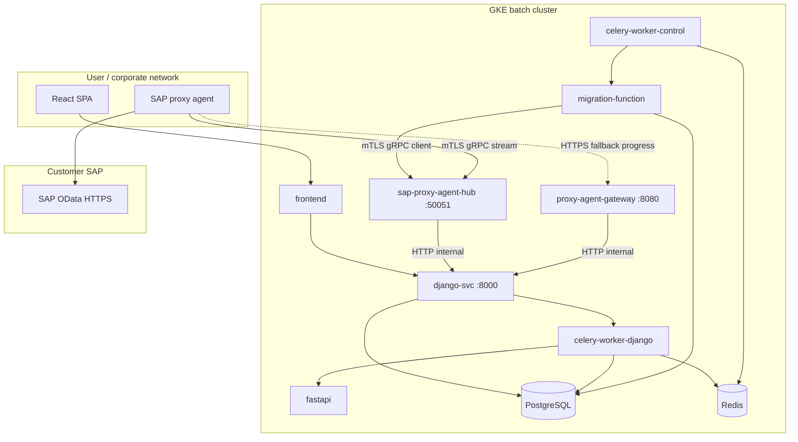
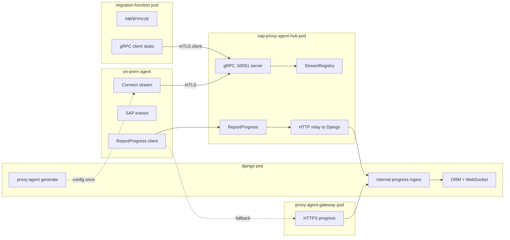
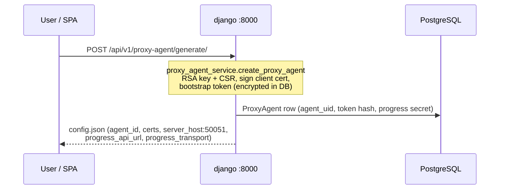
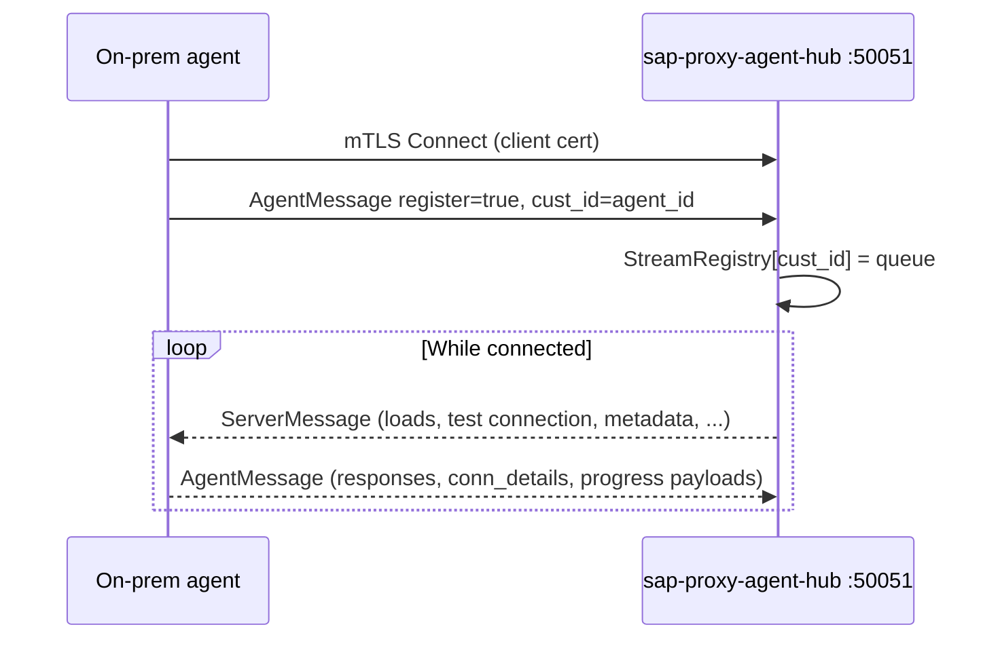
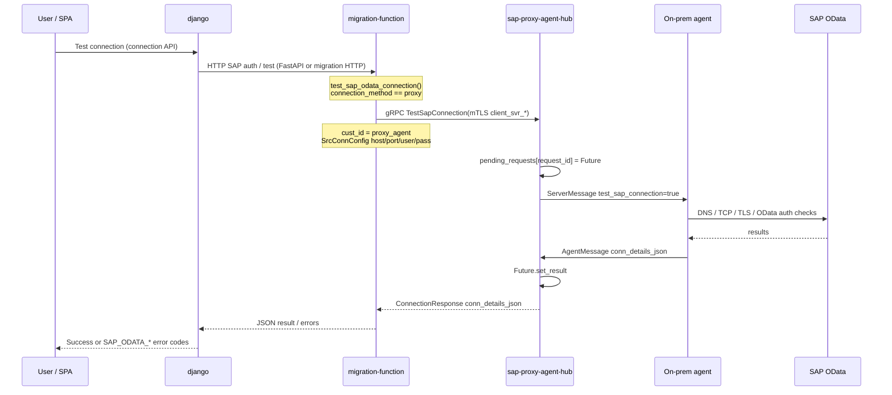
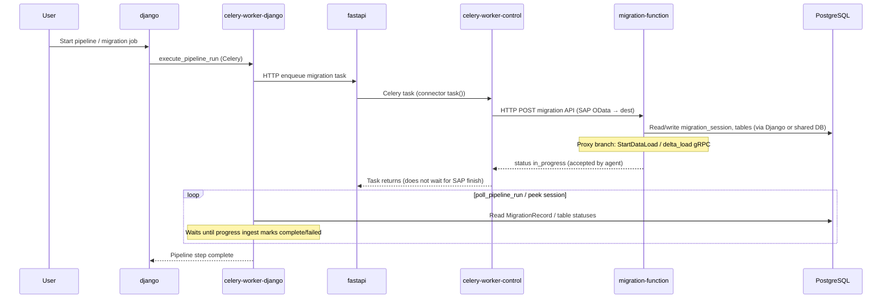
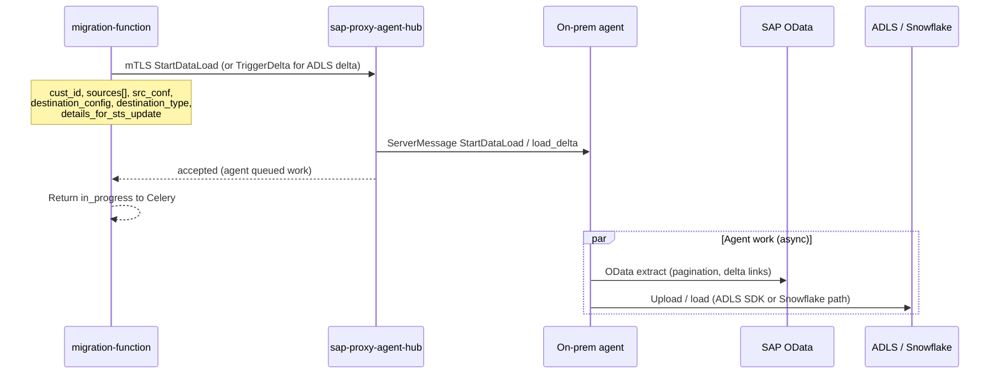
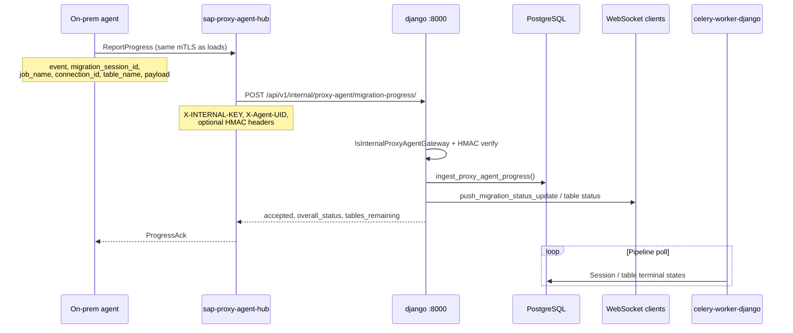
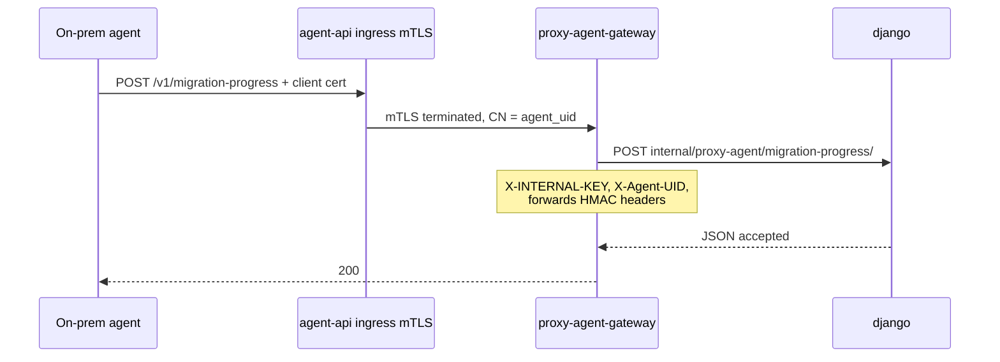

# SAP proxy agent — gRPC architecture (end-to-end)

Deep reference for how a **pipeline run**, **connection test**, and **progress updates** move through GKE pods, Django, migration-function, the **gRPC hub**, and the **on-prem agent**.  
Companion docs: [HUB.md](./HUB.md), [GATEWAY.md](./GATEWAY.md), [README-AGENT.md](./README-AGENT.md).

---

## 1. Actors and Kubernetes pods (batch cluster)

| Actor | Where it runs | Ports / ingress | Role |
|--------|----------------|-----------------|------|
| **Browser / SPA** | User machine | HTTPS → `frontend` | UI: connections, proxy agent generate, start pipeline |
| **django** | `deployment/django` | `:8000` (cluster), public via main ingress | DRF API, ORM, WebSockets, internal progress ingest |
| **celery-worker-django** | Django Celery | — | Pipeline DAG, `execute_pipeline_run`, polls DB for job completion |
| **fastapi** | `deployment/fastapi` | `:8001` | Enqueues migration Celery tasks, orchestration HTTP |
| **celery-worker-control** | FastAPI Celery | — | Runs migration tasks (connector `task()`), calls migration-function |
| **migration-function** | `deployment/migration-function` | `:8001` (migration-api ingress) | SAP auth/listing HTTP; **gRPC client** to hub for proxy loads |
| **celery-worker** (job pods) | Per-job workers | — | Table-level migration when not using proxy batch path |
| **sap-proxy-agent-hub** | `deployment/sap-proxy-agent-hub` | `:50051` gRPC (LB / dedicated host), `:8081` health | mTLS hub: agent stream + load RPCs + **ReportProgress** relay |
| **proxy-agent-gateway** | `deployment/proxy-agent-gateway` | `:8080`, **agent-api** ingress (mTLS) | HTTPS fallback for progress only |
| **PostgreSQL / Redis** | Managed / in-cluster | — | State, Celery broker, idempotency cache |
| **On-prem SAP proxy agent** | Customer network | Outbound to hub `:50051` (and optional HTTPS to agent-api) | SAP OData extract, optional ADLS/Snowflake upload, progress events |

Django **does not** listen for agent gRPC. There is no `unary_rpc.py` in `apps/elttool`. ODATA **`:50053`** services live in **`backend/sap_proxy_agent/unary/unary_rpc.py`** (separate pod/process with `django.setup()`); k8s deploy is optional — see [§9](#9-legacy-odata-unary_rpc-vs-this-stack) and [UNARY-RPC.md](./UNARY-RPC.md).

---

## 2. Pod-by-pod placement (what runs where)

This section maps **every proxy-agent concern** to the **Kubernetes workload** that owns it. Use it when debugging (“is this Django or migration-function?”) or when wiring env/secrets.

### 2.1 Master matrix — capability × pod

| Capability | django | celery-worker-django | fastapi | celery-worker-control | migration-function | sap-proxy-agent-hub | proxy-agent-gateway | On-prem agent |
|------------|:------:|:--------------------:|:-------:|:---------------------:|:------------------:|:-------------------:|:-------------------:|:-------------:|
| Issue agent `config.json` (certs, bootstrap, progress URL) | **Yes** | — | — | — | — | — | — | receives file |
| Store `ProxyAgent` in DB | **Yes** | reads | — | — | — | — | — | — |
| Sign agent client certificates (CA) | **Yes** (CA mount) | — | — | — | — | may sign on Enroll (hub CA) | — | stores cert |
| Public REST / UI API | **Yes** | — | partial | — | migration-api routes | — | — | — |
| Pipeline DAG / `execute_pipeline_run` | enqueues | **Yes** | — | — | — | — | — | — |
| Poll DB until proxy job completes | — | **Yes** | — | — | — | — | — | — |
| Enqueue connector Celery task | — | → fastapi | **Yes** | **Yes** (runs task) | — | — | — | — |
| SAP OData **connection test** (proxy) | routes HTTP | — | may route | calls MF HTTP | **gRPC client** → hub | **gRPC server** → agent stream | — | hits SAP |
| **StartDataLoad** / **TriggerDelta** | — | — | — | via MF HTTP | **gRPC client** → hub | **gRPC server** → agent stream | — | SAP + dest |
| Agent **Connect** stream (register `cust_id`) | — | — | — | — | — | **Yes** (registry) | — | **Yes** (client) |
| **ReportProgress** gRPC | — | — | — | — | — | **Yes** (servicer) | — | **Yes** (client) |
| Relay progress → ORM | — | — | — | — | — | HTTP **client** → django | HTTP **client** → django | — |
| Apply progress to DB + WebSocket | **Yes** (ingest view) | — | — | — | — | — | — | — |
| HTTPS progress fallback | — | — | — | — | — | — | **Yes** (public POST) | optional POST |
| Legacy `unary_rpc` :50053 (TableStatus*, token DB) | ORM via `django.setup()` in **unary pod** | — | — | — | — | **`sap-proxy-agent-unary-rpc`** | — | optional (prefer ReportProgress) |
| Direct SAP OData extract (non-proxy) | — | — | — | job workers / MF | **Yes** (in-cluster) | — | — | — |

**Rule of thumb**

- **Django** = tenant data, agent registration, **authoritative migration state**, internal ingest only (HTTP).
- **migration-function** = connector logic + **outbound gRPC to hub** (never accepts agent connections).
- **sap-proxy-agent-hub** = **only** place agent opens mTLS **inbound** for loads + progress gRPC.
- **proxy-agent-gateway** = progress HTTPS only (no loads).
- **Agent** = SAP network + executes work; reports progress back through hub or gateway.

### 2.2 `deployment/django` (image: `datasyncher-django-app`)

| In this pod | Not in this pod |
|-------------|-----------------|
| DRF: `POST /api/v1/proxy-agent/generate/`, `GET .../status/` | gRPC server (no `:50051`, no `:50053`) |
| `InternalProxyAgentMigrationProgressAPIView` — cluster HTTP ingest | Calling SAP OData directly for proxy mode |
| `ingest_proxy_agent_progress()` — updates `MigrationRecord`, tables, logs | `StartDataLoad` / agent stream |
| WebSocket pushes (`ws_utils`) after progress | Celery migration **execution** (that’s FastAPI workers) |
| `proxy_agent_service.py` — bootstrap token, cert issuance, progress signing secret | Hub `StreamRegistry` |

**Typical env / mounts (batch)**

- `INTERNAL_API_KEY` — shared with hub + gateway for internal POST.
- `PROXY_AGENT_CA_CERT_PATH` / `PROXY_AGENT_CA_KEY_PATH` — sign agent certs at generate time.
- `PROXY_AGENT_PUBLIC_API_HOST`, `PROXY_AGENT_PROGRESS_TRANSPORT` — written into generated config.

**Repo paths:** `apps/elttool/v1/sap_odata_views.py`, `proxy_agent_progress_views.py`, `services/proxy_agent_service.py`, `services/proxy_agent_migration_progress.py`.

### 2.3 `deployment/celery-worker-django`

| In this pod | Not in this pod |
|-------------|-----------------|
| `execute_pipeline_run` and pipeline polling | gRPC to hub or agent |
| Reads **PostgreSQL** for `MigrationRecord` / table status updated by progress ingest | HTTP to SAP |
| Decides pipeline success/failure when tables reach terminal state | Running `test_sap_connection` (delegates to MF via orchestration) |

Proxy jobs appear **accepted** (`in_progress`) quickly; this worker **waits on DB rows** that the agent updates via hub → Django ingest.

### 2.4 `deployment/fastapi` + `deployment/celery-worker-control`

| In this pod | Not in this pod |
|-------------|-----------------|
| FastAPI enqueues Celery; control worker runs connector `task()` | Agent mTLS termination |
| HTTP client to **migration-function** for SAP migration HTTP APIs | Direct gRPC to hub (unless code path explicitly in MF) |
| Same DB as Django for session metadata | `proxy-agent/generate` (Django only) |

For SAP OData proxy migrations, the **control worker** triggers migration-function; MF then uses **gRPC client** code in its own process/image.

### 2.5 `deployment/migration-function` (image: `datasyncher-migration-function`)

| In this pod | Not in this pod |
|-------------|-----------------|
| **gRPC client** (mTLS `client_svr_*`) to hub: `TestSapConnection`, `StartDataLoad`, `TriggerDelta` | gRPC **server** for agents |
| `sap_proxy_agent/client/` — hub gRPC client | Django ORM progress ingest (returns after accept) |
| `services/sap/proxy.py` — `is_proxy_connection`, `run_proxy_batch_load` | Storing `ProxyAgent` rows |
| `services/sap/client.py` — proxy branch of connection test | `ReportProgress` **server** (hub owns servicer) |
| Returns **`in_progress`** after hub accepts load | Waiting for agent to finish inside same HTTP request |

**Typical env (batch secrets example)**

- `PROXY_AGENT_SERVER_HOST` / `PROXY_AGENT_SERVER_PORT` — hub address (not `django-svc`).
- Hub mTLS client material: `PROXY_AGENT_HUB_*_PEM` or `sap_proxy_agent/dev/config.json` (local).

**Network:** outbound TCP **50051** to hub Service/LB; **no** inbound agent traffic.

### 2.6 `deployment/sap-proxy-agent-hub` (image: `datasyncher-sap-proxy-agent-hub`)

| In this pod | Not in this pod |
|-------------|-----------------|
| **Inbound** mTLS gRPC **:50051** from agents + from migration-function | Django ORM / PostgreSQL drivers for business logic |
| `AgentService.Connect` stream registry keyed by **`cust_id`** | Public user REST API |
| Unary hub RPCs: `TestSapConnection`, `StartDataLoad`, … (ODATA `Datasynchor` servicer — when bundled) | Issuing UI agent config (Django) |
| `ReportProgress` servicer (`grpc_progress.py`) | HTTPS progress from internet (gateway does that) |
| HTTP **client** to `django-svc:8000` internal progress URL (`progress_relay.py`) | Running SAP extract (agent does) |
| HTTP **:8081** `/healthz` for probes (`main.py`) | Celery |

**Typical env**

- `DJANGO_INTERNAL_BASE_URL=http://django-svc:8000`
- `INTERNAL_API_KEY` from `datasyncher-secrets`
- mTLS server certs: volume `/etc/sap-proxy-agent-hub/mtls`

**NetworkPolicy:** allowed to call **django:8000**; agents (external) call **hub:50051**.

**Production note:** batch image today is health + relay scaffolding; full ODATA load server must run **in this same pod** on `:50051` — see [§11](#11-production-gap-hub-image).

### 2.7 `deployment/proxy-agent-gateway` (image: `datasyncher-proxy-agent-gateway`)

| In this pod | Not in this pod |
|-------------|-----------------|
| Public `POST /v1/migration-progress` (ingress mTLS) | Load RPCs, agent `Connect` stream |
| Rate limit; forward to Django internal ingest with `X-INTERNAL-KEY` + `X-Agent-UID` | SAP connectivity |
| Same Django URL as hub relay | gRPC |

Use when agent `progress_transport` is `https` or gRPC progress fails.

### 2.8 `deployment/celery-worker` (per-job migration workers)

| In this pod | Not in this pod |
|-------------|-----------------|
| Non-proxy table migrations (in-cluster extract/load) | Proxy **batch** path (MF fires one gRPC batch to agent) |
| May run other connectors | Agent registry |

If `connection_method=proxy`, table work is **not** duplicated here; agent + progress ingest drive status.

### 2.9 On-prem **SAP proxy agent** (customer VM / service)

| In this process | Not in this process |
|-----------------|---------------------|
| Outbound mTLS to **hub `:50051`** — register, receive `ServerMessage` | Django or PostgreSQL |
| SAP OData calls on customer LAN | Issuing certificates (receives from config) |
| ADLS / Snowflake upload from agent code | Pipeline polling |
| `ReportProgress` or HTTPS progress to gateway | `StartDataLoad` **server** |

Reference implementation: `odata-agent/client/agent.py`.

### 2.10 Diagram — logic placement by pod

### 2.11 Where each **gRPC method** is implemented vs called

| gRPC (proto) | **Server** (handles RPC) | **Client** (calls RPC) |
|--------------|--------------------------|-------------------------|
| `AgentService.Connect` | **hub** | **agent** |
| `BootstrapService.Enroll` | **hub** `:50052` | **agent** (renewal) |
| `CertificateService.RenewCertificate` | **hub** | **agent** |
| `Datasynchor.TestSapConnection` | **hub** | **migration-function** |
| `Datasynchor.StartDataLoad` | **hub** | **migration-function** |
| `Datasynchor.TriggerDelta` | **hub** | **migration-function** (ADLS delta; not Snowflake) |
| `Datasynchor.Metadata` / `GetSourceDetail` | **hub** | **migration-function** (listing/auth flows) |
| `DatasynchorProgress.ReportProgress` | **hub** | **agent** |
| `TokenValidationService.*` | **`sap_proxy_agent/unary/unary_rpc.py` :50053** | **hub** during Enroll |
| `TableStatusService.*` (legacy) | same unary pod | old agents — prefer `ReportProgress` |

---

## 3. Identity, config, and long-lived agent connection

### 3.1 Generate agent config (one-time / rotate)

| Field in `config.json` | Meaning |
|------------------------|---------|
| `agent_id` | Same as **`proxy_agent`** / gRPC **`cust_id`** — hub registry key |
| `server_host` / `server_port` | Hub target (e.g. batch LB → **`:50051`**) |
| `client_cert` / `client_private_key` | Agent mTLS identity to hub |
| `bootstrap_token` | Enroll when operational cert expired (`:50052` bootstrap port on hub) |
| `progress_transport` | `grpc`, `grpc_with_https_fallback`, or `https` |

Company **`proxy_agent`** is injected into SAP credentials at runtime (`sap_odata_views._inject_proxy_agent`) — not stored inside `SourceConfig` alone.

### 3.2 Agent stays connected (bidirectional gRPC stream)

The hub implements **ODATA-style** `AgentService.Connect` (reference: `odata-agent/.../server/server.py`):

If **`cust_id` is not registered**, unary hub RPCs such as `TestSapConnection` / `StartDataLoad` fail with **`Agent for customer … is not connected`**.

**Bootstrap / Enroll** (cert renewal when expired): agent → hub **`:50052`** (no client cert) → hub may call a **token validation** service (ODATA used **`unary_rpc.py` :50053**; production should validate against **`ProxyAgent`** in DB — not yet a Django gRPC server).

---

## 4. Connection test flow (proxy mode)

Used when SAP source uses **`connection_method: proxy`**.

**Code paths**

| Step | Location |
|------|----------|
| Inject `proxy_agent` | `apps/elttool/v1/sap_odata_views.py` |
| HTTP to migration-function | Django / FastAPI routing (SAP OData auth) |
| gRPC client | `backend/migration-function/services/sap/client.py` → `dataynchor_client.test_sap_connection` |
| mTLS + target | `sap_proxy_agent/client/channel_factory.py`, `hub_target.py` (`PROXY_AGENT_SERVER_HOST`) |
| Hub → agent | Hub `Datasynchor.TestSapConnection` → `registry.send(cust_id, …)` |
| Agent → SAP | ODATA `client/odata_functions.test_connection` |

**Local smoke (no full agent):** `backend/sap_proxy_agent/scripts/local_proxy_agent_smoke.ps1` + mock agent.

---

## 5. Pipeline / batch load flow (proxy SAP → ADLS or Snowflake)

When **`is_proxy_connection(source_config)`** is true, migration-function **does not** pull OData itself. It **accepts** the job on the hub and returns **`in_progress`**; completion is driven by **progress events** updating Django ORM while **celery-worker-django** polls the DB.

### 5.1 Orchestration (control plane)

### 5.2 Data plane (gRPC load accept)

| Destination | gRPC policy (migration-function) |
|---------------|----------------------------------|
| **ADLS** | Initial: `StartDataLoad`; subsequent delta: **`TriggerDelta` / `delta_load`** |
| **Snowflake** | **`StartDataLoad` only** (initial and delta); no `TriggerDelta` on hub |

**Code paths**

| Step | Location |
|------|----------|
| Detect proxy | `services/sap/proxy.py` → `is_proxy_connection` |
| Batch dispatch | `run_proxy_batch_load`, `run_proxy_load_step` |
| Snowflake proxy | `services/sap/as_source/to_snowflake.py` → `_sap_snowflake_proxy_batch_load` |
| ADLS proxy | `services/sap/as_source/to_adls.py` |
| gRPC stubs | `sap_proxy_agent/client/dataynchor_client.py` (`startdataload`, `delta_load`) |

**Correlation IDs** in `details_for_sts_update` (must be echoed on every progress event):

- `migration_session_id`, `job_name`, `connection_id`
- optional: `cmp_id`, `user_id`, `log_id`

---

## 6. Progress flow (how the pipeline “finishes”)

The agent reports **events** (not legacy `TableStatusUpdate` gRPC to Django). Django updates **`MigrationRecord`**, **`SourceTableSelection`**, **`Data_Transfer`**, logs, and **WebSockets**.

### 6.1 Primary: gRPC ReportProgress → hub → Django

| Step | Location |
|------|----------|
| gRPC servicer | `backend/sap_proxy_agent/hub/grpc_progress.py` |
| HTTP relay | `backend/sap_proxy_agent/hub/progress_relay.py` → `DJANGO_INTERNAL_BASE_URL` |
| Internal API | `apps/elttool/v1/proxy_agent_progress_views.py` |
| ORM + WS | `apps/elttool/services/proxy_agent_migration_progress.py` |
| NetworkPolicy | `k8s/network-policies/allow-hub-to-django.yaml` (hub → django :8000) |

### 6.2 Fallback: HTTPS → gateway → same Django ingest

Used when `progress_transport` is `grpc_with_https_fallback` and gRPC fails, or `https` only.

### 6.3 Allowed progress events

| Event | Typical use |
|-------|-------------|
| `table_started` | Agent began a table |
| `table_progress` | Row counts / staging updates |
| `table_completed` | Table success |
| `table_failed` | Table error |
| `activity_log` | Human-readable log line |
| `batch_completed` | Job-level done signal |

Legacy ODATA unary RPC names map to these events — see [README-AGENT.md](./README-AGENT.md).

---

## 7. Response paths summary

| User action | Synchronous HTTP response | Async completion signal |
|-------------|---------------------------|-------------------------|
| **Generate proxy config** | `config.json` in API response | Agent must start and **Connect** to hub |
| **Test connection (proxy)** | Pass/fail after hub waits for agent (~30s timeout) | Agent returns `conn_details_json` on stream |
| **StartDataLoad / batch** | **`in_progress`** immediately from migration-function | **`ReportProgress`** (or HTTPS fallback) → Django DB → pipeline poll |
| **UI migration status** | REST reads DB | WebSockets from `ws_utils` after ingest |

**Failure modes**

| Symptom | Likely cause |
|---------|----------------|
| `Agent … is not connected` | Agent down, wrong `cust_id`, or duplicate agent id |
| gRPC UNAVAILABLE to hub | Wrong host/port, firewall, or hub pod not ready |
| Progress stuck `in_progress` | No progress events, wrong correlation IDs, or ingest auth failure |
| Django 403 on internal ingest | Missing/wrong `INTERNAL_API_KEY` or `X-Agent-UID` |

---

## 8. mTLS roles (who presents which certificate)

| Caller | Cert | Connects to |
|--------|------|-------------|
| **On-prem agent** | Agent client cert (CN often `agent-{cmp}-…`) | Hub `:50051` |
| **migration-function** | Platform **`client_svr_*`** (Datasyncher as gRPC client) | Hub `:50051` |
| **Hub → Django** | None (cluster HTTP) + **`X-INTERNAL-KEY`** | `django-svc:8000` |
| **Agent → gateway** | Agent client cert (ingress verifies) | `agent-api` → gateway |

Hub load RPCs and **`ReportProgress`** share the **agent ↔ hub** channel. Django never terminates agent mTLS directly.

---

## 9. Legacy ODATA `unary_rpc.py` vs this stack

Monorepo: [`backend/sap_proxy_agent/unary/unary_rpc.py`](../../../backend/sap_proxy_agent/unary/unary_rpc.py) — see [UNARY-RPC.md](./UNARY-RPC.md).  
ODATA reference: `odata-agent/.../grpc_files/unary_rpc.py` (**`:50053`**).

| ODATA unary service | Purpose in reference | DataSyncher monorepo |
|---------------------|----------------------|----------------------|
| `ValidateBootstrapToken` | Hub Enroll calls Django-side validator | **`proxy_agent_bootstrap.validate_and_rotate_bootstrap_token`** (unary pod + ORM) |
| `GetDownscopedToken` | GCP token for ADLS from agent | **`get_gcp_access_token.py`** (env bucket/project) |
| `TableStatus*` / `MigrationStatus*` / … | gRPC → `status_update()` stub | **`proxy_agent_legacy_status`** → same ORM as **`ReportProgress`**; prefer **`ReportProgress`** for new agents |
| `status_update()` in ODATA Django | ORM updates | **`pass`** stub in reference — replaced by progress ingest |

---

## 10. Deployment checklist (batch)

| Item | Command / manifest |
|------|---------------------|
| Hub + migration-function rollout | `k8s/batch-cluster/rollout-proxy-agent-batch.ps1 -Build -ApplyHubManifests` |
| Gateway + ingress (HTTPS progress) | [GATEWAY.md](./GATEWAY.md) |
| Hub env | `DJANGO_INTERNAL_BASE_URL`, `INTERNAL_API_KEY` from `datasyncher-secrets` |
| migration-function env | `PROXY_AGENT_SERVER_HOST`, `PROXY_AGENT_SERVER_PORT`, hub mTLS PEMs or mounted config |
| Agent firewall | Outbound **TCP 50051** to hub; **443** to agent-api if HTTPS fallback |
| Local smoke | [HUB.md](./HUB.md) — `local_proxy_agent_smoke.ps1` |

---

## 11. Production gap (hub image)

Current **`datasyncher-sap-proxy-agent-hub:batch`** image includes **health** and **ReportProgress relay** scaffolding. Full **load** RPC surface (ODATA `server.py` + agent stream on **one** `:50051` server) must be bundled in the hub image for production agent loads — see [HUB.md](./HUB.md). Until then, local ODATA `server.py` remains the reference for complete load behavior.

---

## Related files (quick index)

| Area | Path |
|------|------|
| Proto | `backend/sap_proxy_agent/proto/service.proto` |
| gRPC client | `backend/sap_proxy_agent/client/dataynchor_client.py` |
| Proxy orchestration | `backend/migration-function/services/sap/proxy.py` |
| Django generate | `apps/elttool/v1/sap_odata_views.py`, `services/proxy_agent_service.py` |
| Progress ingest | `apps/elttool/v1/proxy_agent_progress_views.py`, `services/proxy_agent_migration_progress.py` |
| Hub relay | `backend/sap_proxy_agent/hub/` |
| HTTPS gateway | `backend/sap_proxy_agent/gateway/app.py` |
| K8s hub | `k8s/deployments/sap-proxy-agent-hub.yaml`, `k8s/services/sap-proxy-agent-hub-svc.yaml` |
