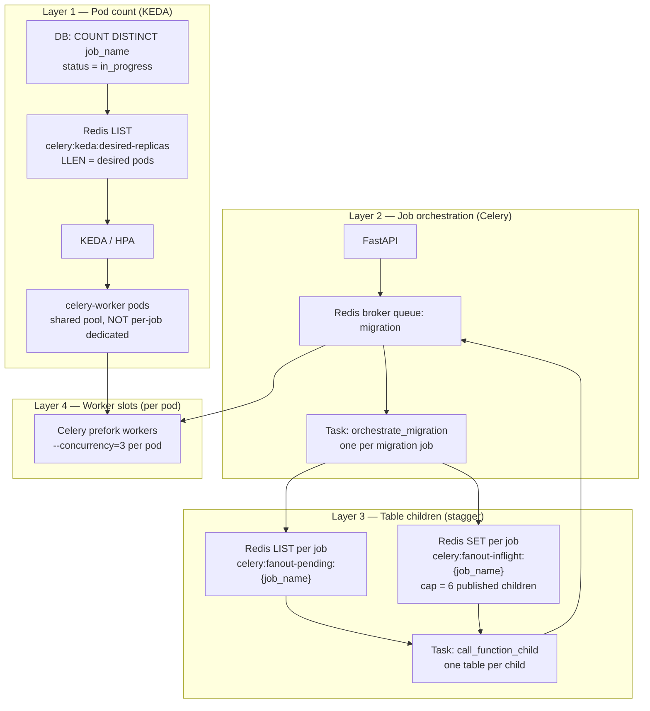
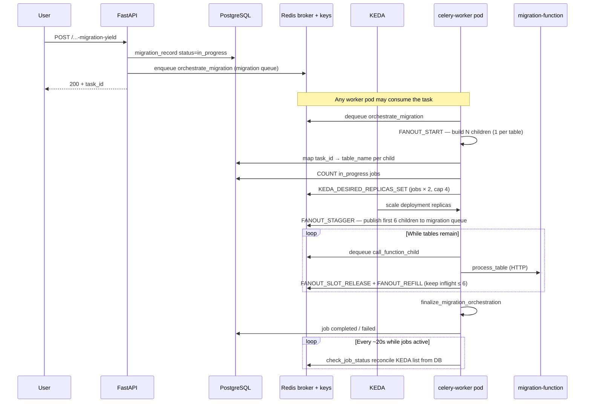
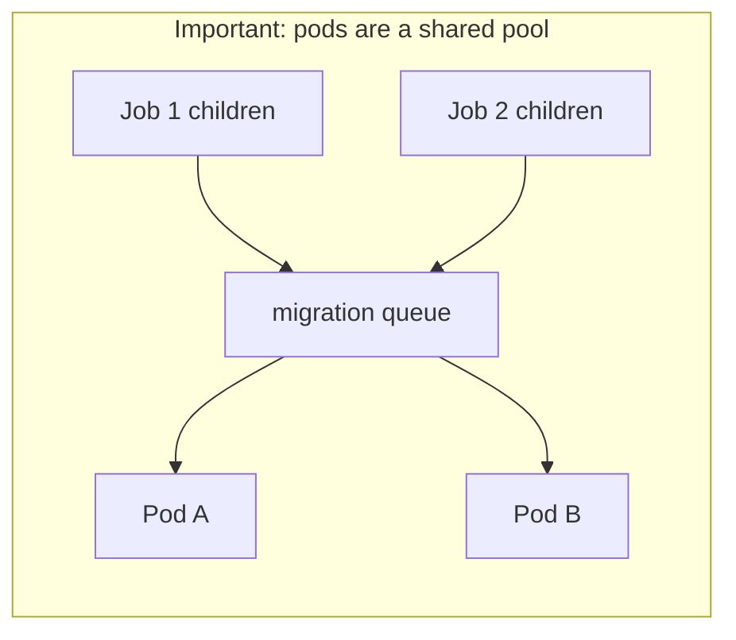
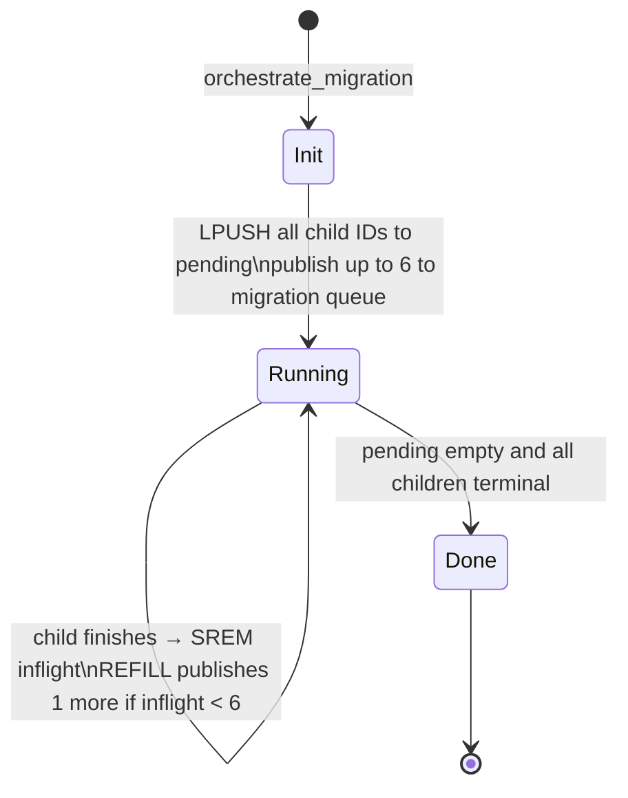
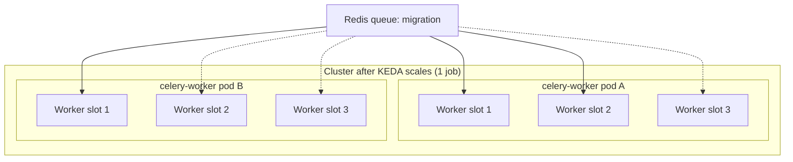
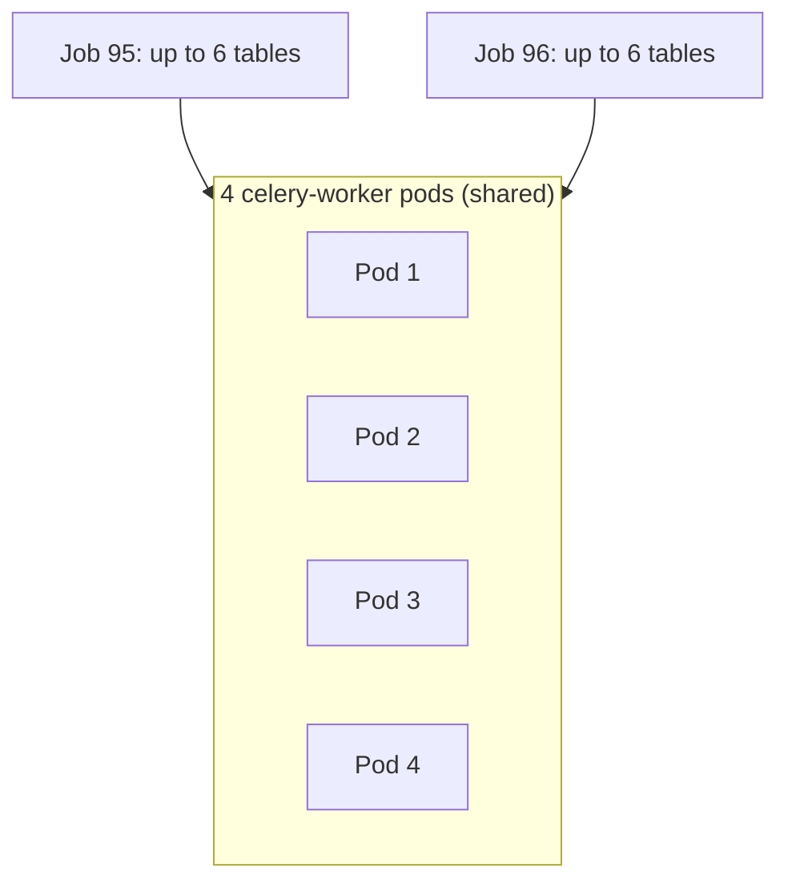
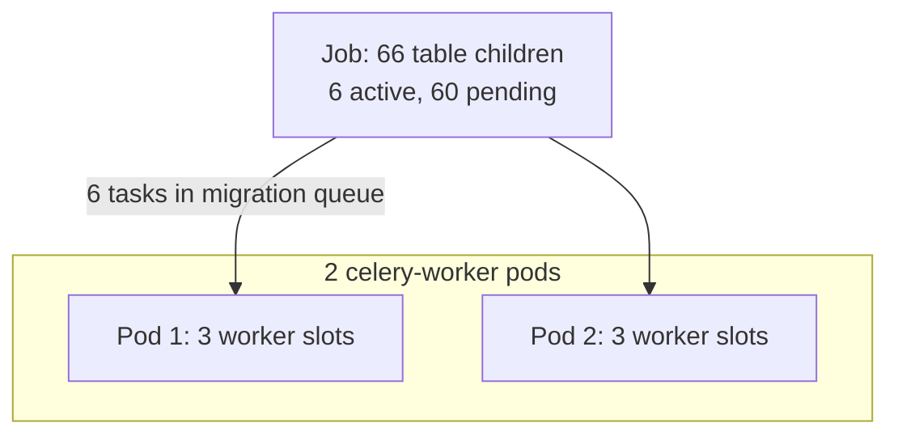
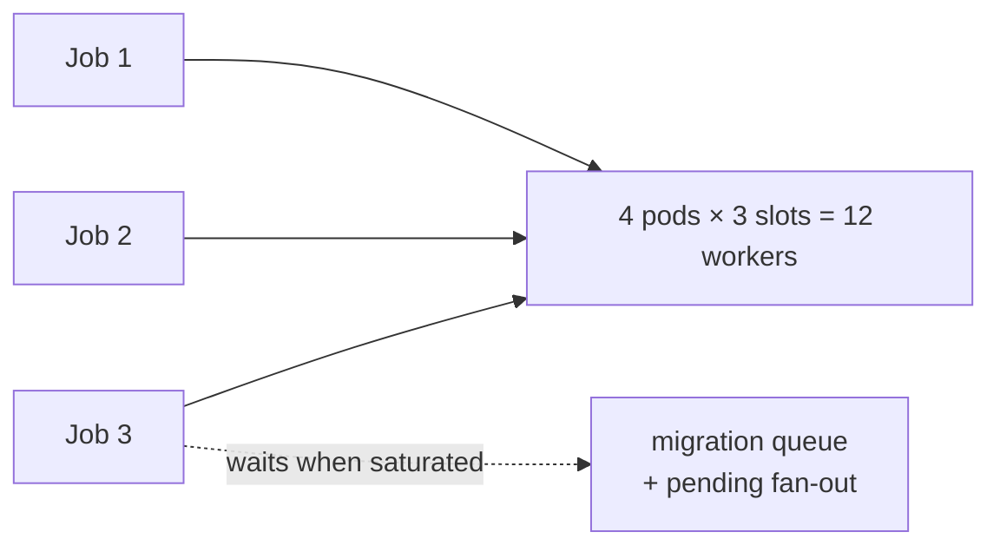

# Celery migration scaling — architecture and assignment model

This document explains **exactly** how **pods**, **Celery workers**, **migration jobs**, and **per-table child tasks** interact in the Datasyncher Kubernetes stack. It reflects the **current** design (KEDA + staggered fan-out), not legacy queue-based pod scaling.

**Primary files**

| File | Purpose |
|------|---------|
| `k8s/keda/celery-scaler.yaml` | KEDA `ScaledObject` → HPA replica count |
| `k8s/deployments/celery-worker.yaml` | Worker image, env, `--concurrency`, resources |
| `backend/fast-api/celery_worker.py` | Fan-out, KEDA counter, `check_job_status` reconcile |
| `backend/fast-api/app.py` | API enqueue (`orchestrate_migration`) |

---

## 1. Mental model — four layers

Scaling is **not** one knob. Four independent layers stack together:



| Layer | Question it answers | Default |
|-------|---------------------|---------|
| **1. Pods** | How many `celery-worker` **pods** run? | `min(jobs × 2, 4)`, floor **1** |
| **2. Jobs** | How is a **migration job** started? | API → `migration` queue → `orchestrate_migration` |
| **3. Tables** | How many **tables** run at once **per job**? | **6** (`CELERY_MAX_INFLIGHT_CHILDREN_PER_JOB`) |
| **4. Workers** | How many **tasks** run at once **per pod**? | **3** (`--concurrency=3`) |

---

## 2. End-to-end flow (one migration)



---

## 3. Layer 1 — Pod scaling (KEDA)

### Formula

```
desired_pods = min(
  sum_for_each_in_progress_job(
    min(base_pods_from_workload(table_count), plan_cap(company_plan))
  ),
  CELERY_KEDA_MAX_REPLICAS
)
```

| Env / KEDA field | Default | Meaning |
|------------------|---------|---------|
| `CELERY_KEDA_PODS_PER_JOB` | `2` | Target pods **per distinct in-progress job** |
| `CELERY_KEDA_MAX_REPLICAS` | `4` | Cluster-wide ceiling |
| `minReplicaCount` (KEDA) | `1` | Never scale below **1** pod when idle |
| `maxReplicaCount` (KEDA) | `4` | Hard cap on worker pods |

Plan caps:

- `Free` -> 1 pod/job max
- `Standard` -> 2 pods/job max
- `Enterprise` -> 3 pods/job max

Job metadata comes from:

- `migration_record.connection_id -> connection.cmp_id -> company.plan`

Table count still determines base workload pods per job, then the company plan applies a hard cap.
There is no jobs×N hybrid floor override in workload mode.

### How KEDA reads it

The app maintains Redis list **`celery:keda:desired-replicas`**:

1. `DEL` the list
2. If `desired_pods > 0`, `LPUSH` that many placeholder entries (`"1"`)
3. `LLEN` = desired replica count

KEDA trigger (`celery-scaler.yaml`):

```yaml
listName: celery:keda:desired-replicas
listLength: "1"   # replicas ≈ LLEN / 1
```

### Pod count table

| In-progress jobs | `desired_pods` | Typical HPA replicas |
|------------------|----------------|----------------------|
| 0 | 0 → **min 1** via KEDA | **1** |
| 1 | 2 | **2** |
| 2 | 4 | **4** |
| 3 | `min(6, max)=4` if max=4 | **4** (shared, not 2 per job) |
| 4+ | capped at **max** | **max** |



**Pods are not pinned to a job.** Any `celery-worker` pod can run `orchestrate_migration` or `call_function_child` for **any** job. KEDA only controls **how many pods exist**, not which job uses which pod.

### When the counter is updated

| Trigger | Code path | Log marker |
|---------|-----------|------------|
| Migration fan-out starts | `orchestrate_migration` | `KEDA_DESIRED_REPLICAS_SET \| trigger=fanout` |
| Periodic reconcile | `check_job_status` (~20s) | `KEDA_DESIRED_REPLICAS_SET \| trigger=reconcile` |

Reconcile re-reads the DB so a stuck or drifted Redis value self-heals.

### KEDA triggers (current)

| Trigger | Used for scaling? |
|---------|-------------------|
| `celery:keda:desired-replicas` | **Yes — primary** |
| CPU % of request | Yes — can add pods under load |
| Memory % of request | Yes — can add pods under load |
| `migration` queue depth | **No — removed** |
| `celery:keda:active` | **No — ops only** |

### Scale-up vs scale-down

| Direction | Behavior |
|-----------|----------|
| **Up** | Fast (burst policies; `stabilizationWindowSeconds: 0`) |
| **Down** | Slow: max **1 pod / 2 min**, **10 min** stabilization — avoids killing pods during long table runs |

---

## 4. Layer 2 — Job assignment (orchestrator task)

Each **migration job** (one `job_name`, many tables) gets:

1. One API call → one Celery task: **`celery_worker.orchestrate_migration`**
2. Enqueued on Redis list **`migration`** (broker queue name from `CELERY_MIGRATION_QUEUE`)

**Assignment rule:** whichever worker process is free on **whichever pod** pulls from `migration` next (fair scheduling `-Ofair`, `prefetch_multiplier=1`).

There is **no** “reserve pod 1–2 for job A” logic.

If all worker slots are busy, **`orchestrate_migration` waits in the `migration` queue** until a slot frees up.

---

## 5. Layer 3 — Table child tasks (staggered fan-out)

When `CELERY_ONE_TABLE_PER_CHILD=true` (default):

- **1 table = 1 child** = 1 `call_function_child` Celery task
- Example: 76 tables → **76 child task IDs**, but only **6 published at a time**

### Redis keys (per `job_name`)

| Key | Type | Role |
|-----|------|------|
| `celery:fanout-pending:{job_name}` | LIST | Child task IDs waiting to be published |
| `celery:fanout-inflight:{job_name}` | SET | Child IDs already sent to broker (governed by cap) |

### Stagger loop



| Step | Log (examples) |
|------|----------------|
| Start fan-out | `FANOUT_START \| max_inflight=6` |
| Initial publish | `FANOUT_STAGGER_START \| max_inflight=6` → `FANOUT_DONE \| published_now=6` |
| Steady state | `FANOUT_REFILL \| inflight=6 \| max_inflight=6` |
| Child done | `FANOUT_SLOT_RELEASE` then refill |

**Per-job table concurrency = 6**, independent of pod count.

---

## 6. Layer 4 — Worker processes inside each pod

Each `celery-worker` pod runs:

```text
celery -A celery_worker.celery_app worker --concurrency=3 -Q migration -Ofair
```

| Setting | Value | Effect |
|---------|-------|--------|
| `--concurrency=3` | 3 prefork workers | At most **3 concurrent Celery tasks** on this pod |
| `worker_prefetch_multiplier=1` | 1 | Each process takes **one** task at a time from `migration` |
| `task_acks_late=true` | | Task re-queued if pod dies mid-run |

**Cluster worker capacity** (upper bound):

```
max_parallel_celery_tasks ≈ pod_count × concurrency
                          ≈ maxReplicaCount × 3
                          ≈ 4 × 3 = 12  (with current defaults)
```

---

## 7. Detailed walkthrough — one connection, one job, “2 pods”

This section uses a **real-shaped example** (like `ATI_D365_PROD_auto_sync_95` on **connection_id = 1**) and walks second-by-second through what the system does and what each **restriction** enforces.

### 7.1 Example connection and job

| Field | Example value |
|-------|----------------|
| **Connection** | `connection_id = 1` (e.g. ATI D365 PROD Snowflake ↔ Dynamics) |
| **Job name** | `ATI_D365_PROD_auto_sync_95_custtrans->dataarea->...->vendtable` |
| **Session** | `migration_session_id = 95` |
| **Tables selected** | **66** tables, `execution_order = parallel` |
| **API path** | `/Snowflake-MicrosoftDynamics365_FO-migration-yield` |

One **job** = one `job_name` row set in `migration_record` (many table rows, one logical migration run).

### 7.2 What “1 job → 2 pods” actually means

**It does not mean:**

- Pod-A is owned by job 95 only  
- Pod-B is owned by job 95 only  
- Each pod runs exactly 3 tables for this job  

**It means:**

- KEDA sets **total** `celery-worker` replicas to **2** for the whole cluster  
- **Both pods** pull from the **same** Redis `migration` queue  
- **Any** free worker slot on **either** pod can run orchestrator or table tasks for **any** job  

The number **2** is a **capacity target** (`jobs_in_progress × 2`), not a hard partition.



**Total slots for this job’s era:** 2 pods × 3 concurrency = **6 parallel Celery tasks** — which matches **6 tables in flight** (stagger cap).

---

### 7.3 Timeline — step by step

#### T0 — User clicks “Run migration” (FastAPI)

1. FastAPI receives POST with `connection_id=1`, 66 `selected_tables`, `execution_order=parallel`.
2. DB: all 66 `migration_record` rows for this `job_name` → `status = in_progress`.
3. FastAPI generates `task_id = f240a34e-...` and enqueues **one** Celery task:

   ```text
   orchestrate_migration(
     url = http://migration-function-svc:8001/migrate,
     job_name = ATI_D365_PROD_auto_sync_95_...,
     connection_id = 1,
     ...
   )
   ```

4. Response to UI: `200` + `celery_task_id` (job is **queued**, not finished).

**Restriction:** API never runs `migrate()` itself — only Celery.

---

#### T1 — Orchestrator picked up (one worker slot on pod A)

Worker on **pod A** dequeues `orchestrate_migration`.

1. **FANOUT_START** — builds **66 children** (1 UUID per table), maps `task_id` → `table_name` in DB.
2. Writes child payloads to Redis (`celery:child-payload:{child_id}`).
3. **Pod scaling signal** (same moment):

   ```text
   SELECT COUNT(DISTINCT job_name) ... in_progress  → 1
   desired_pods = min(1 × 2, 4) = 2
   Redis DEL celery:keda:desired-replicas
   Redis LPUSH celery:keda:desired-replicas  "1" "1"   → LLEN = 2
   Log: KEDA_DESIRED_REPLICAS_SET | jobs=1 | desired_pods=2 | list_len=2
   ```

4. **Stagger start** — only **6** children published to `migration` queue first:

   ```text
   FANOUT_STAGGER_START | total_children=66 | max_inflight=6 | pending=66
   FANOUT_DONE        | published_now=6   | staggered=true
   ```

5. Redis per job:

   | Key | After T1 |
   |-----|----------|
   | `celery:fanout-pending:{job_name}` | 60 child IDs waiting |
   | `celery:fanout-inflight:{job_name}` | 6 child IDs published |
   | `celery:keda:desired-replicas` | LLEN **2** |

6. Orchestrator schedules `check_job_status` in ~10s, then returns (orchestrator task **ends**; work continues on children).

**Restrictions at T1:**

| Rule | Value |
|------|--------|
| Max tables published per job | **6** (`CELERY_MAX_INFLIGHT_CHILDREN_PER_JOB`) |
| Max pods from KEDA | **2** (`1 job × 2`) |
| Max pods absolute | **4** (`CELERY_KEDA_MAX_REPLICAS`) |

---

#### T2 — KEDA / HPA scales to 2 pods (~30s–2min)

1. KEDA reads `LLEN(celery:keda:desired-replicas) = 2`.
2. HPA event: `SuccessfulRescale | New size: 2`.
3. Second pod **pod B** starts; both join the same Celery worker pool.

If only one pod existed briefly at T1, the first **6** child tasks may all run on **pod A** until pod B is ready — then **-Ofair** scheduling spreads new tasks across A and B.

---

#### T3 — Steady state — 6 tables running across 2 pods

Example assignment (illustrative — **actual pod per task varies**):

| Worker slot | Pod | Celery task | Table |
|-------------|-----|-------------|--------|
| A-W1 | pod A | `call_function_child` | `custtrans` |
| A-W2 | pod A | `call_function_child` | `dataarea` |
| A-W3 | pod A | `call_function_child` | `vendtable` |
| B-W1 | pod B | `call_function_child` | `dirpartytable` |
| B-W2 | pod B | `call_function_child` | `inventtable` |
| B-W3 | pod B | `call_function_child` | `purchtable` |

Each child calls **`_execute_connector()`**:

1. **Default:** `_dispatch_direct_connector()` — runs `migrate()` **inside the celery-worker process** (no HTTP hop).
2. **Fallback only if enabled:** `POST http://migration-function-svc:8001/migrate`.

When **custtrans** finishes on pod A:

```text
FANOUT_SLOT_RELEASE | child_id=... | removed=1 | inflight=5
FANOUT_REFILL       | published=1 | pending_left=59 | inflight=6 | max_inflight=6
```

→ One new table child enters the `migration` queue; **inflight** stays at **6** until the job nears completion.

**Restrictions at T3:**

| Layer | Restriction | Effect |
|-------|-------------|--------|
| Stagger | `inflight ≤ 6` | Never more than 6 table tasks **published** for this job at once |
| Per pod | `concurrency = 3` | Max 3 tasks per pod at once |
| Cluster (2 pods) | 2 × 3 = **6 slots** | Matches stagger — **no idle over-provisioning** |
| Broker | `prefetch=1` | One task per worker process at a time |
| Time | `task_time_limit` / soft limit | Very long-running tables can still hit limits |

---

#### T4 — Reconcile tick every ~20s (`check_job_status`)

While any migration is `in_progress`:

```text
check_job_status (Celery beat-like loop)
  → COUNT(DISTINCT job_name) WHERE in_progress  → still 1
  → KEDA_DESIRED_REPLICAS_SET | jobs=1 | desired_pods=2 | list_len=2 | trigger=reconcile
```

**Why:** If Redis was wrong or a pod crashed, DB is **source of truth** and resets the list to **2**.

---

#### T5 — Job completes

1. All 66 children finish; `finalize_migration_orchestration` runs.
2. DB: `migration_record` → `completed` / `failed` per table; job no longer counted as `in_progress`.
3. Next reconcile:

   ```text
   jobs=0 → desired_pods=0 → LLEN=0 → KEDA minReplicaCount keeps 1 pod
   ```

4. HPA slowly scales down (1 pod removed every ~2 min, 10 min stabilization).

---

### 7.4 Same connection — second job while first is still running

User starts another migration on **connection_id = 1** (different `job_name`, session 96, 65 tables).

| Step | What happens |
|------|----------------|
| DB | **2** distinct `job_name` with `in_progress` |
| KEDA formula | `min(2 × 2, 4) = **4**` pods |
| Per job stagger | Still **6** tables each → up to **12** table tasks in flight |
| Worker capacity | 4 × 3 = **12** slots — **aligned** |



**Not** “job 95 gets pod 1–2, job 96 gets pod 3–4.” Both jobs’ tasks are **interleaved** on all 4 pods via the shared queue.

---

### 7.5 Third job on same connection — hitting the cap

| Step | What happens |
|------|----------------|
| DB | **3** `job_name` in_progress |
| Formula | `min(3 × 2, 4) = **4**` pods (not 6) |
| Table demand | 3 × 6 = **18** table tasks want to run |
| Worker slots | 4 × 3 = **12** only |
| Extra work | Waits in `migration` queue + `fanout-pending` until slots free |

**Restriction:** `CELERY_KEDA_MAX_REPLICAS=4` protects cost; jobs **share** pods, they do not each get 2 dedicated pods beyond the cap.

---

### 7.6 Restriction cheat sheet (all knobs)

| Knob | Default | What it restricts |
|------|---------|-------------------|
| `CELERY_KEDA_PODS_PER_JOB` | 2 | Pod **target** per in-progress job |
| `CELERY_KEDA_MAX_REPLICAS` | 4 | Max worker pods cluster-wide |
| `minReplicaCount` (KEDA) | 1 | Never zero workers when idle (unless manual pause) |
| `CELERY_MAX_INFLIGHT_CHILDREN_PER_JOB` | 6 | Max **tables** running per job |
| `--concurrency` | 3 | Max **Celery tasks** per pod |
| `CELERY_ONE_TABLE_PER_CHILD` | true | 1 table = 1 child task |
| `CELERY_FANOUT_ENABLED` + parallel + ≥1 table | — | Use orchestrator path (required for stagger; includes single-table reload) |
| `CELERY_DIRECT_CONNECTOR_EXECUTION` | true | Run migrate in-process on worker |
| `CELERY_HTTP_FALLBACK_ENABLED` | false | HTTP to migration-function only on failure |
| Scale-down policy | 1 pod / 2 min | Slow shrink after job ends |

**Design intent for 1 job + 2 pods + 6 tables:**

```text
  2 pods × 3 workers = 6 slots  ==  6 staggered tables
```

So you get parallelism without spawning 66 pods for 66 tables.

---

### 7.7 Common misconceptions (this example)

| Misconception | Reality |
|---------------|---------|
| “2 pods = pod1 for tables 1–33, pod2 for 34–66” | **No** — Celery assigns tasks dynamically from the queue |
| “66 tables → 66 pods or 66 workers” | **No** — 66 **child tasks**, only **6 active** at a time |
| “connection_id drives pod count” | **No** — only **count of in_progress job_name** matters |
| “URL means every table is HTTP” | **No** — default is **direct** `migrate()` on celery-worker |
| “Raising max replicas gives each job 2 dedicated pods” | **Only while** `jobs × 2 ≤ max`; otherwise **shared pool** |

---

### 7.8 Logs to verify this exact job

```bash
# Pod target
kubectl logs deployment/celery-worker --since=30m | grep KEDA_DESIRED_REPLICAS_SET

# Table stagger
kubectl logs deployment/celery-worker --since=30m | grep -E "FANOUT_START|FANOUT_DONE|FANOUT_REFILL"

# Which pod ran a child
kubectl logs deployment/celery-worker --since=30m | grep CHILD_ASSIGNED

# HPA scale
kubectl describe hpa keda-hpa-celery-worker-scaler | grep -A5 Events
```

---

## 8. How everything fits together (examples)

### Example A — 1 job, 66 tables, 2 pods

| Dimension | Value |
|-----------|--------|
| KEDA pods | **2** (`jobs=1 → desired_pods=2`) |
| Tables in flight | **6** (stagger) |
| Celery slots | 2 × 3 = **6** → matches stagger cap |



### Example B — 2 jobs, 2 pods each target, 4 pods max

| Dimension | Value |
|-----------|--------|
| KEDA pods | **4** (`2 jobs × 2`) |
| Tables in flight | up to **6 + 6 = 12** |
| Celery slots | 4 × 3 = **12** |

### Example C — 3 jobs, maxReplicaCount = 4

| Dimension | Value |
|-----------|--------|
| Formula | `min(3×2, 4) = 4` pods |
| **Not** 6 pods (not 2 per job) | Third job **shares** the 4-pod pool |
| Extra work | Waits in **`migration`** queue or fan-out **pending** |



### Raising `maxReplicaCount` only

| Change | Effect |
|--------|--------|
| `maxReplicaCount` 4 → 8 | Allows **more total pods** when `jobs × 2` needs it |
| `CELERY_KEDA_PODS_PER_JOB` still 2 | Still **2 pods per job** in the formula until cap |
| 5 jobs, max 8 | `min(10, 8) = 8` pods shared by all 5 jobs |

**Does not** assign dedicated pods per job — only raises the shared pool ceiling.

---

## 9. What queues what (summary table)

| Work unit | Queued where | Consumed by | Limit |
|-----------|--------------|-------------|-------|
| Start migration | `migration` (Celery) | Any pod, any of 3 slots | broker + workers |
| Orchestrator | `migration` | First free worker | 1 task per job at a time |
| Table child (active) | `migration` | Any free worker | **6 per job** (stagger) |
| Table child (waiting) | `celery:fanout-pending:{job}` | Published by refill | until cap allows |
| Pod count signal | `celery:keda:desired-replicas` | KEDA/HPA | **jobs×2**, cap max |

---

## 10. Why this approach is better

### Problem with the old design

Previously, KEDA also scaled on:

- **`migration` queue depth** — spikes to dozens/hundreds during fan-out (many child IDs enqueued in bursts)
- **`celery:keda:active`** — one entry per Celery task ID (orchestrator, children, retries, `check_job_status`), easily **50–400+** entries for one job

That caused:

| Symptom | Cause |
|---------|--------|
| **4 pods for 1 job** | Queue depth + active list >> threshold |
| Scaling tied to **table count** | More tables → more queue/active entries → more pods |
| Fighting the **6-table stagger** | Stagger limits **work** concurrency, not bogus metrics |
| Cost / churn | Unnecessary nodes, pending pods, scheduler pressure |

### What the new design optimizes for

| Goal | Mechanism |
|------|-----------|
| **Predictable pods per job** | `desired_pods = jobs × 2` from DB, not queue length |
| **Table count ≠ pod count** | 76 tables still → **2 pods** for 1 job |
| **Controlled connector load** | **6 tables/job** stagger + **3 slots/pod** |
| **Always-on worker** | `minReplicaCount: 1` — queue consumed when idle |
| **Safe scale-down** | Long stabilization + `preStop` drain + late acks |
| **Self-healing** | `check_job_status` reconcile every 20s from DB truth |

### Design trade-offs (intentional)

| Trade-off | Accept because |
|-----------|----------------|
| Pods shared across jobs | Simpler ops; Celery already fair-queues work |
| Cap at 4 pods default | Protects cluster cost; raise `maxReplicaCount` if needed |
| Slow scale-down | Migrations run 10s–hours; avoids duplicate work / SIGKILL |
| CPU/memory can still scale up | Safety valve for real resource pressure |

---

## 11. Observability — log markers

| Marker | Meaning |
|--------|---------|
| `KEDA_DESIRED_REPLICAS_SET \| jobs=N \| desired_pods=P \| list_len=P` | Pod target written |
| `ACTIVE_MIGRATION_COUNTER_SET \| trigger=fanout\|reconcile` | Same update, alternate log |
| `FANOUT_START \| tables=T \| max_inflight=6` | Orchestrator began |
| `FANOUT_DONE \| published_now=6` | Initial stagger publish |
| `FANOUT_REFILL \| inflight=6 \| max_inflight=6` | Steady-state table concurrency |
| HPA `SuccessfulRescale \| New size: N` | Kubernetes applied replica change |

**Verify pod scaling**

```bash
kubectl get hpa keda-hpa-celery-worker-scaler
kubectl logs deployment/celery-worker --tail=50 | grep KEDA_DESIRED
```

**Verify table concurrency**

```bash
kubectl logs deployment/celery-worker --tail=100 | grep FANOUT_REFILL
```

---

## 12. Tuning guide

| Want to change… | Variable | File |
|-----------------|----------|------|
| Pods per migration job | `CELERY_KEDA_PODS_PER_JOB` | `celery-worker.yaml` |
| Max worker pods | `CELERY_KEDA_MAX_REPLICAS` + `maxReplicaCount` | `celery-worker.yaml`, `celery-scaler.yaml` |
| Idle minimum pods | `minReplicaCount` | `celery-scaler.yaml` |
| Tables at once per job | `CELERY_MAX_INFLIGHT_CHILDREN_PER_JOB` | `celery-worker.yaml` |
| Tasks at once per pod | `--concurrency` | `celery-worker.yaml` command |
| Reconcile interval | `CELERY_CHECK_JOB_STATUS_INTERVAL` | `celery-worker.yaml` |

**Suggested alignment:**  
`jobs × tables_in_flight_per_job ≤ pod_count × concurrency` for balanced throughput.

With defaults: `1 job → 2×3 = 6` slots and **6** table inflight — aligned.  
`2 jobs → 4×3 = 12` slots and **12** table inflight — aligned.

---

## 13. Operations

### Pause autoscaling (maintenance)

```bash
kubectl annotate scaledobject celery-worker-scaler \
  autoscaling.keda.sh/paused=true --overwrite
kubectl scale deployment celery-worker --replicas=0   # optional
```

### Resume

```bash
kubectl annotate scaledobject celery-worker-scaler \
  autoscaling.keda.sh/paused- --overwrite
# KEDA restores replicas from minReplicaCount + metrics
```

### Apply config changes

```bash
kubectl apply -f k8s/keda/celery-scaler.yaml
kubectl apply -f k8s/deployments/celery-worker.yaml
# Rollout image/env changes:
kubectl rollout restart deployment/celery-worker
```

---

## 14. Related docs

- `k8s/keda/celery-scaler.yaml` — live KEDA triggers and comments  
- `k8s/deployments/celery-worker.yaml` — env defaults  
- `backend/fast-api/tests/test_celery_orchestration.py` — unit tests for counter + stagger  
- `k8s/README-SCALING-AND-INFRA.md` — **legacy** notes (queue/active triggers); prefer **this document** for current behavior  

---

## 15. Quick reference card

```
┌─────────────────────────────────────────────────────────────────┐
│  USER starts migration                                          │
│    → FastAPI enqueues orchestrate_migration (migration queue)   │
│    → DB: job_name in_progress                                   │
├─────────────────────────────────────────────────────────────────┤
│  PODS (KEDA)                                                    │
│    desired = min(distinct_in_progress_jobs × 2, max_replicas)   │
│    idle floor = 1 pod                                           │
│    pods = shared pool (not dedicated per job)                   │
├─────────────────────────────────────────────────────────────────┤
│  ORCHESTRATOR (one Celery task per job)                         │
│    → creates N children (1 per table)                           │
│    → publishes 6 at a time to migration queue                   │
├─────────────────────────────────────────────────────────────────┤
│  CHILDREN (call_function_child)                                 │
│    → any pod worker runs process_table                          │
│    → on done: release slot, publish next child (keep 6 inflight)│
├─────────────────────────────────────────────────────────────────┤
│  WORKERS                                                        │
│    each pod: 3 concurrent Celery tasks on queue migration       │
└─────────────────────────────────────────────────────────────────┘
```
