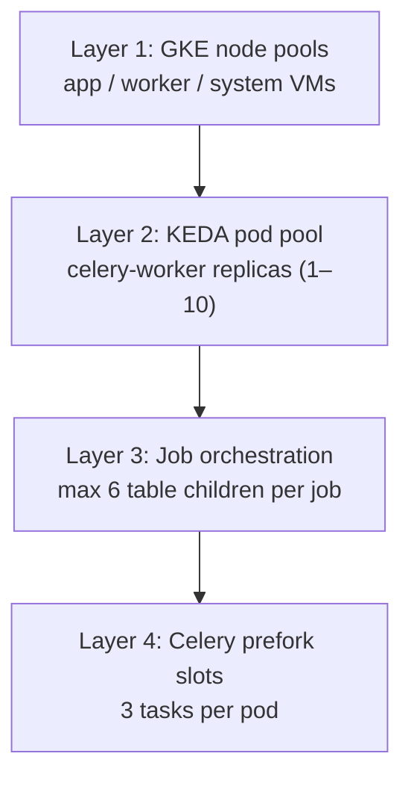
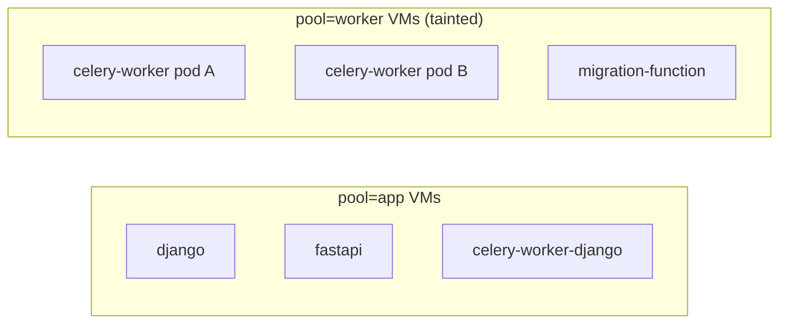
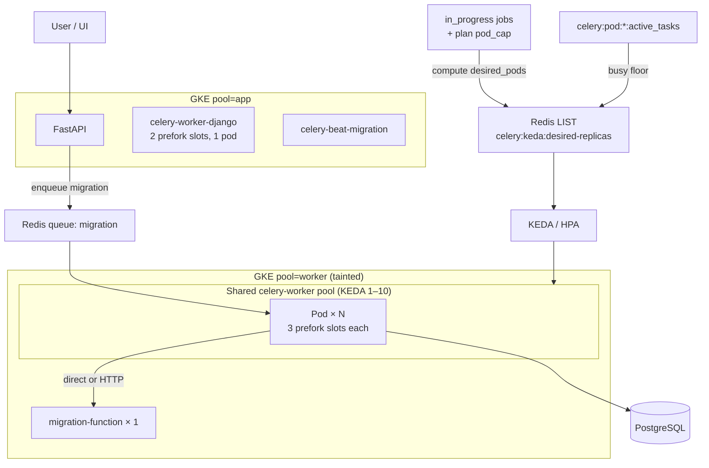

# Pool structure in Datasyncher

This document explains every **pool** concept in the application: GKE node pools, Celery worker pools, migration pod pools, plan caps, and scale-down behavior.

| Related docs | Topic |
|--------------|-------|
| [RFC-001: Per-job worker isolation](../docs/RFC-001-PER-JOB-WORKER-ISOLATION.md) | **Proposed** per-job Deployment model (replaces shared pool) |
| [README.md](./README.md) | Full K8s architecture |
| [README-CELERY-MIGRATION-SCALING.md](./README-CELERY-MIGRATION-SCALING.md) | Fan-out, KEDA, stagger |
| [README-SCALE-DOWN-PROTECTION.md](./README-SCALE-DOWN-PROTECTION.md) | Idle-first scale-down |
| [README-SCALING-AND-INFRA.md](./README-SCALING-AND-INFRA.md) | Node sizing, scaler tuning |

---

## 1. Big picture — four layers of “pool”



| Layer | What it limits | Current QA value |
|-------|----------------|------------------|
| **GKE node pool** | Which VMs run which workloads | `app` vs `worker` (tainted) |
| **KEDA pod pool** | How many `celery-worker` pods exist | 1–10 (`maxReplicaCount`) |
| **Table stagger** | How many tables per job run at once | 6 (`CELERY_MAX_INFLIGHT_CHILDREN_PER_JOB`) |
| **Prefork concurrency** | How many Celery tasks per pod | 3 (`--concurrency=3`) |

**Max theoretical parallel table tasks:**

```
pods × concurrency  →  up to 10 × 3 = 30 cluster-wide slots
```

---

## 2. GKE node pools (hardware isolation)

Cluster: `datasyncher-cluster` (GKE, `us-central1`).

| Node pool | Label | Machine | Autoscale | Taint | Purpose |
|-----------|-------|-----------|-----------|-------|---------|
| **system** | `pool=system` | e2-small | 1–2 | none | Ingress, cert-manager |
| **app** | `pool=app` | e2-standard-2 | 1–6 | none | Web tier, Django Celery, beats, scheduler, migration-function |
| **control** | `pool=control` | e2-standard-2 | 1–2 | none | Celery orchestration (`celery-worker-control`, reconcile) |
| **worker** | `pool=worker` | e2-standard-4 | 0–20 | `pool=worker:NoSchedule` | Migration Celery (legacy shared pool) |

### Workload placement

| Workload | Node pool | Manifest |
|----------|-----------|----------|
| `frontend`, `django`, `fastapi`, `migration-function` | **app** | `deployments/*.yaml` |
| `celery-worker-django` | **app** | `deployments/celery-worker-django.yaml` |
| `celery-beat-migration`, `celery-beat-django`, `apscheduler` | **app** | `deployments/`, `statefulsets/` |
| **`celery-worker-control`**, **`celery-worker-control-reconcile`** | **control** | `deployments/celery-worker-control*.yaml` |
| **`celery-worker`** (migration, legacy) | **worker** | `deployments/celery-worker.yaml` |

Worker pool scheduling (migration tier only):

```yaml
nodeSelector:
  pool: worker
tolerations:
  - key: pool
    operator: Equal
    value: worker
    effect: NoSchedule
```

### Can two pods share one VM?

**Yes.** `celery-worker` uses **soft** pod anti-affinity (`preferred`, not `required`). Kubernetes tries to spread pods across nodes, but when KEDA scales up and nodes are limited, **multiple celery pods can land on the same worker VM**.

Each worker VM is ~4 vCPU / 16 GB. Each celery pod requests 1 CPU / 4 Gi and limits 4 CPU / 12 Gi — one pod fits comfortably; two is possible under load.



**Worker pool scale-to-zero:** When KEDA scales `celery-worker` to the minimum and nothing else schedules on worker nodes, the cluster autoscaler can drain **worker-pool to 0 nodes** (cost saving when idle).

---

## 3. Celery worker pools (two separate apps)

Datasyncher runs **two independent Celery applications** — they do not share queues or worker processes.

### A. Migration pool — `celery-worker`

| Setting | Value |
|---------|-------|
| Image | `datasyncher-fast-api:qa` |
| Celery app | `celery_worker.celery_app` |
| Process pool | **prefork** (`--pool=prefork`) |
| Concurrency | **3** workers per pod |
| Queue | `migration` only |
| K8s node pool | **worker** |
| Scaling | **KEDA** 1–10 pods |
| Code | `backend/fast-api/celery_worker.py` |
| Manifest | `k8s/deployments/celery-worker.yaml` |

Tasks: `orchestrate_migration`, `call_function_child`, `finalize_migration_orchestration`, `call_function`. Reconcile (`check_job_status`) runs on `migration-control-reconcile` via `celery-worker-control-reconcile`.

Each prefork child resets DB/Redis connections after fork (`worker_process_init`) to avoid stale handles.

### B. Django pool — `celery-worker-django`

| Setting | Value |
|---------|-------|
| Image | `datasyncher-django-app:qa` |
| Celery app | `datasyncher.celery_app` |
| Process pool | **prefork** |
| Concurrency | **2** workers per pod |
| Replicas | **1** (fixed, no KEDA) |
| K8s node pool | **app** |
| Manifest | `k8s/deployments/celery-worker-django.yaml` |

Used for Django-side async work (ELT, notifications, etc.). Beat runs separately in `celery-beat-django` StatefulSet.

### C. Schedulers (not worker pools, but related)

| Workload | App | Pool | Replicas |
|----------|-----|------|----------|
| `celery-beat-migration` | `celery_worker.celery_app beat` | app | 1 |
| `celery-beat-django` | `datasyncher.celery_app beat` | app | 1 |
| `apscheduler` | `scheduler_service.py` | app | 1 |

---

## 4. Migration pod pool

### 4a. Shared mode (`CELERY_JOB_ISOLATION_MODE=shared`, default)

Migration workers form a **shared pod pool** — pods are not dedicated per job. Any `celery-worker` pod can pull from the `migration` queue.

See also [README-JOB-ISOLATION.md](./README-JOB-ISOLATION.md) for per-job mode.

### 4b. Per-job mode (`CELERY_JOB_ISOLATION_MODE=per_job`)

Each active migration gets an ephemeral Deployment `celery-worker-job-{hash}` with replicas = plan-capped pod count. A fixed `celery-worker-control` pod (queue `migration-control`) runs orchestration/finalizer tasks. Job workers tear down on finalize (~60s). KEDA on the legacy `celery-worker` Deployment is not used for job work in this mode.

### How desired pod count is computed

Mode: **`workload`** (`CELERY_KEDA_SCALE_MODE=workload` in `celery-worker.yaml`).

```
per_job_base = min(KEDA_MAX, max(1, ceil(table_count / CELERY_WORKER_CONCURRENCY)))
per_job_pods = min(per_job_base, plan_pod_cap)
workload_desired = min(KEDA_MAX, sum(per_job_pods for all in_progress jobs))
desired_pods = max(workload_desired, busy_pods)   # busy-pod floor
```

The app writes `desired_pods` to Redis list `celery:keda:desired-replicas`. KEDA reads `LLEN` → HPA target replicas.

**Source:** `backend/fast-api/celery_worker.py` → `_set_active_migration_pods()`.

### Plan pod caps (per customer)

From DB (`plans` table, migration `0058`) and code fallback in `celery_worker.py`:

| Plan | Max pods per job |
|------|------------------|
| Free | 1 |
| Standard | 2 |
| Enterprise | 3 |
| Discounted | 2 |

**Company override:** `company.pod_count` is used when it is **greater than** the plan catalog cap (`Company.get_effective_pod_count()` in `apps/elttool/models.py`).

### KEDA scaler limits

| Setting | Value | File |
|---------|-------|------|
| `minReplicaCount` | 1 | `k8s/keda/celery-scaler.yaml` |
| `maxReplicaCount` | 10 | same |
| `CELERY_KEDA_MAX_REPLICAS` | 10 | `celery-worker.yaml` |
| Scale-down | 1 pod / 120s, 600s stabilization | `celery-scaler.yaml` |
| Primary trigger | Redis `celery:keda:desired-replicas` LLEN | same |
| Secondary triggers | CPU 75%, Memory 85% (scale **up** only) | same |

### Table stagger (per-job concurrency cap)

| Setting | Value |
|---------|-------|
| `CELERY_MAX_INFLIGHT_CHILDREN_PER_JOB` | 6 |
| `CELERY_ONE_TABLE_PER_CHILD` | true |

At most **6 table child tasks** per job are published at once, regardless of pod count. Redis keys: `celery:fanout-inflight:{job}`, `celery:fanout-pending:{job}`.

### Worked examples (workload mode)

| Scenario | Plan | Tables | Per-job pods | Total desired |
|----------|------|--------|--------------|---------------|
| Single-table reload | Standard | 1 | 1 | 1 |
| 10-table manual job | Standard | 10 | min(4, **2**)=2 | 2 |
| 2 jobs, 1 table each | Standard | 1+1 | 1+1 | 2 |
| Large job | Enterprise | 20 | min(7, **3**)=3 | 3 |

---

## 5. Scale-down pool behavior (idle vs busy)

Deployed protections (`celery_scale_down_protection.py` + env in `celery-worker.yaml`):

| Mechanism | Behavior |
|-----------|----------|
| **Busy-pod floor** | `desired = max(workload, busy_pods)` — HPA cannot scale below pods with `active_tasks > 0` |
| **Pod deletion cost** | Idle pods = **0**, busy pods = **100** — Kubernetes evicts idle first |
| **Auto-requeue** | Orphaned tasks on dead pods are requeued after K8s confirms pod is gone |

**Intended flow:**

1. KEDA wants fewer pods → HPA removes **idle** pods (cost 0) first.
2. **Working** pods (cost 100) stay until their migration tasks finish.
3. When a working pod finishes → `active_tasks` → 0 → cost → 0 → eligible for scale-down.
4. Busy-pod floor prevents scaling below the count of still-working pods.

Redis key per pod: `celery:pod:{pod_name}:active_tasks`.

See [README-SCALE-DOWN-PROTECTION.md](./README-SCALE-DOWN-PROTECTION.md) for full detail.

---

## 6. Connection pools (DB / Redis)

Not Kubernetes pools, but relevant when reasoning about prefork workers.

### PostgreSQL (SQLAlchemy)

| Location | Config |
|----------|--------|
| `celery_worker.py` | `create_engine(..., pool_pre_ping=True)` — default pool size 5, overflow 10 |
| Prefork | Engine **disposed and recreated** in each child process |

### Redis

| Role | Usage |
|------|-------|
| Celery broker | Task queue (`migration`) |
| KEDA | `celery:keda:desired-replicas`, `celery:active-migration-count` |
| Scale-down | `celery:pod:*:active_tasks`, task heartbeats |
| Django Channels | WebSocket layer |

No explicit Redis pool size is configured; Celery/Kombu manage broker connections.

### In-process thread pools (inside a Celery child)

Connector code may use `ThreadPoolExecutor` for I/O within a single prefork worker (safe — no nested processes):

- `listing_tables_service.py`
- `microsoft_dynamics_migration_service.py`
- `salesforce_service.py`

---

## 7. Environment variables quick reference

### Pod scaling

| Variable | K8s value |
|----------|-----------|
| `CELERY_KEDA_SCALE_MODE` | `workload` |
| `CELERY_KEDA_MAX_REPLICAS` | `10` |
| `CELERY_KEDA_MAX_PODS_PER_JOB` | `2` |
| `CELERY_KEDA_PODS_PER_JOB` | `2` (legacy `jobs` mode) |
| `CELERY_KEDA_FLOOR_BY_BUSY_PODS` | `true` |
| `CELERY_WORKER_CONCURRENCY` | `3` |
| `CELERY_MAX_INFLIGHT_CHILDREN_PER_JOB` | `6` |
| `CELERY_MIGRATION_QUEUE` | `migration` |

### Scale-down protection

| Variable | K8s value |
|----------|-----------|
| `CELERY_SCALE_DOWN_PROTECTION_ENABLED` | `true` |
| `CELERY_POD_DELETION_COST_BUSY` | `100` |
| `CELERY_POD_DELETION_COST_IDLE` | `0` |
| `CELERY_ORPHAN_AUTO_REQUEUE_ENABLED` | `true` |

---

## 8. End-to-end diagram



---

## 9. Key files

| Topic | Path |
|-------|------|
| Migration worker deploy | `k8s/deployments/celery-worker.yaml` |
| Django worker deploy | `k8s/deployments/celery-worker-django.yaml` |
| KEDA scaler | `k8s/keda/celery-scaler.yaml` |
| Scaling logic | `backend/fast-api/celery_worker.py` |
| Scale-down protection | `backend/fast-api/celery_scale_down_protection.py` |
| Plan / company caps | `apps/elttool/models.py` |
| Cluster node pools | `README_CLUSTER_SETUP_LOG.md` §18 |

---

## 10. Local / Docker Compose pools (non-K8s)

For development, Celery uses **autoscale** instead of KEDA:

| Service | Pool | Concurrency |
|---------|------|-------------|
| `celery` (migration) | prefork | `--autoscale=10,2` (QA compose) |
| `celery_django` | prefork | `--autoscale=10,2` (QA compose) |

Local scripts may use `--pool=solo` (`setup.py`, `task_runner.py`) for single-process debugging.
