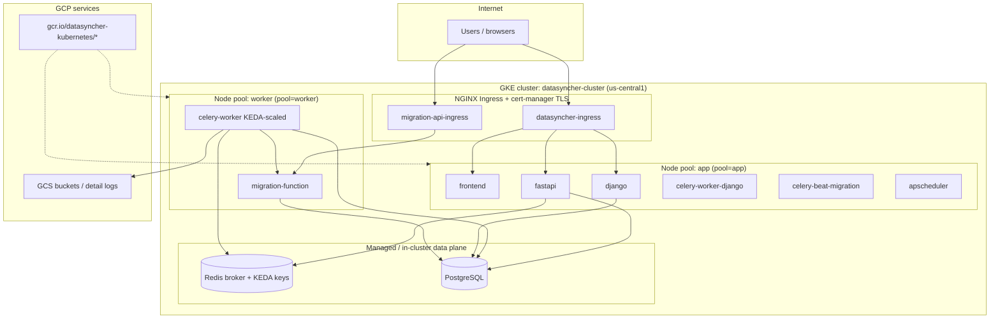
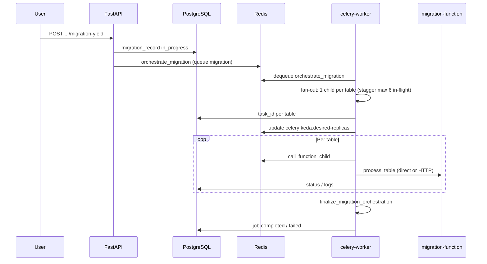
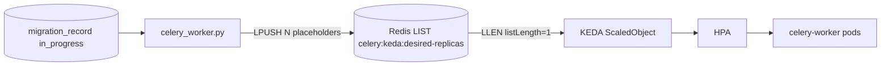

# Datasyncher Kubernetes architecture

This document describes how Datasyncher runs on **Google Kubernetes Engine (GKE)** in the `datasyncher-kubernetes` project. Manifests live under `k8s/`; application code is built into images in **Google Container Registry (GCR)** and rolled out with `kubectl`.

For deeper dives:

| Topic | Document |
|-------|----------|
| **RFC-001: Per-job worker isolation** (proposed architecture) | [../docs/RFC-001-PER-JOB-WORKER-ISOLATION.md](../docs/RFC-001-PER-JOB-WORKER-ISOLATION.md) |
| **Per-job isolation implementation** (flag, rollout, ops) | [README-JOB-ISOLATION.md](./README-JOB-ISOLATION.md) |
| **Pool structure** (node pools, Celery, KEDA, plan caps) | [README-POOL-STRUCTURE.md](./README-POOL-STRUCTURE.md) |
| Celery migration fan-out, KEDA, per-table children | [README-CELERY-MIGRATION-SCALING.md](./README-CELERY-MIGRATION-SCALING.md) |
| Changing scaler settings, pod vs node sizing | [README-SCALING-AND-INFRA.md](./README-SCALING-AND-INFRA.md) |
| Cluster bootstrap history | [../README_CLUSTER_SETUP_LOG.md](../README_CLUSTER_SETUP_LOG.md) |
| Build/push/rollout script | [../scripts/build-push-k8s.ps1](../scripts/build-push-k8s.ps1) |
| **QA API endpoints reference** | [../docs/QA_KUBERNETES_API_ENDPOINTS.md](../docs/QA_KUBERNETES_API_ENDPOINTS.md) |
| **Prometheus metrics** | [../docs/operations/PROMETHEUS_METRICS.md](../docs/operations/PROMETHEUS_METRICS.md) |
| **Pipeline scheduler reconcile** (flows, `apscheduler` rollout) | [../docs/operations/PIPELINE_SCHEDULER_RECONCILE.md](../docs/operations/PIPELINE_SCHEDULER_RECONCILE.md) |
| Frontend image (external repo) | [FRONTEND_EXTERNAL_REPO.md](./FRONTEND_EXTERNAL_REPO.md) |

---

## 1. Platform overview



**Design goals**

- **API tier** on smaller `app` nodes: UI, Django REST, FastAPI orchestration, schedulers.
- **Heavy work** on `worker` nodes: Celery migration workers (12 Gi RAM) and `migration-function` HTTP for connectors.
- **Elastic migration workers** via **KEDA** (not fixed `replicas` on `celery-worker`).
- **Secrets** centralized in `datasyncher-secrets` (not committed; see `k8s/secrets/`).

---

## 2. GKE cluster and node pools

| Item | Value |
|------|--------|
| Project | `datasyncher-kubernetes` |
| Cluster | `datasyncher-cluster` |
| Region | `us-central1` (regional) |
| Namespace (default) | `default` |

Node pools isolate cost and capacity by workload type:

| Pool | Label | Typical machine | Role |
|------|--------|-----------------|------|
| **system** | `pool=system` | `e2-small` | Cluster/system components |
| **app** | `pool=app` | `e2-standard-2` (8 GB) | Frontend, Django, FastAPI, `migration-function`, Celery beat, Django Celery, APScheduler |
| **control** | `pool=control` | `e2-standard-2` (8 GB) | `celery-worker-control`, `celery-worker-control-reconcile` |
| **worker** | `pool=worker` | `e2-standard-4` | `celery-worker` (deprecated shared pool) |

Worker pool nodes use a **taint** `pool=worker:NoSchedule`; only pods with matching **tolerations** schedule there (`celery-worker`).

---

## 3. Workloads (what runs where)

### 3.1 User-facing and API

| Deployment | Image | Pool | Replicas | Purpose |
|------------|-------|------|----------|---------|
| `frontend` | `datasyncher-frontend:qa` | app | 1–2 | React/static UI |
| `django` | `datasyncher-django-app:qa` | app | 2 (+ HPA) | `/api/v1/`, `/ws/`, `/admin/` |
| `fastapi` | `datasyncher-fast-api:qa` | app | 2 (+ HPA) | `/api/` — migration yield, Celery enqueue, WebSockets helpers |
| `proxy-agent-gateway` | `datasyncher-proxy-agent-gateway:qa` | app | 1 | SAP proxy agent HTTPS progress (`agent-api` mTLS) → Django internal ingest |
| `sap-proxy-agent-hub` | `datasyncher-sap-proxy-agent-hub:batch` | app | 1 | SAP proxy agent gRPC hub (`:50051` mTLS): loads + `ReportProgress` → Django relay |

Batch also runs **`sap-proxy-agent-unary`** (`:50053`, 1 replica) for bootstrap validation / legacy unary gRPC. Use **1 hub replica** while the Connect `StreamRegistry` is in-memory per pod (otherwise LB can split agent vs migration-function across pods). Optional: shared registry (e.g. Redis) or Session Affinity on the hub Service before scaling hub >1.

**Ingress** (`ingress/datasyncher-ingress.yaml`) terminates TLS for `qa-kubernetes.datasyncher.com` and routes:

| Path | Service | Port |
|------|---------|------|
| `/` | `frontend-svc` | 80 |
| `/api/v1/` | `django-svc` | 8000 |
| `/api/` | `fastapi-svc` | 9090 |
| `/ws/`, `/admin/` | `django-svc` | 8000 |

OAuth and some connector HTTP paths use **`migration-api-ingress`** → `migration-function-svc:8001` (`/api-new/...` rewrite).

SAP proxy agent progress uses **`agent-api-ingress`** (`agent-api.<domain>`, mTLS) → `proxy-agent-gateway-svc:8080`. Agent **loads** use **`sap-proxy-agent-hub-svc:50051`** (LB or dedicated host; see [HUB.md](../docs/operations/proxy-agent/HUB.md)). See [`docs/operations/proxy-agent/`](../docs/operations/proxy-agent/) and [`docs/security/proxy-agent-progress.md`](../../docs/security/proxy-agent-progress.md).

### 3.2 Migration execution

| Workload | Image | Pool | Scale | Purpose |
|----------|-------|------|-------|---------|
| **`celery-worker`** | `datasyncher-fast-api:qa` | worker | **KEDA** 1–4 pods | Runs `orchestrate_migration`, `call_function_child`, `check_job_status`, `finalize_migration_orchestration` on queue `migration` |
| **`migration-function`** | `datasyncher-migration-function:qa` | worker | 1 | FastAPI connectors (Dynamics, Salesforce, Snowflake, etc.); optional HTTP fallback from Celery |
| **`celery-beat-migration`** | `datasyncher-fast-api:qa` | app | 1 (Recreate) | Periodic schedule for `celery_worker.celery_app` (must stay single replica) |

Celery workers use **`CELERY_DIRECT_CONNECTOR_EXECUTION=true`** by default so table work runs in-process in the worker pod; `migration-function` remains for auth, listing, and HTTP fallback.

### 3.3 Background / Django Celery (non-migration queue)

| Workload | Image | Pool | Replicas | Purpose |
|----------|-------|------|----------|---------|
| `celery-worker-django` | `datasyncher-django-app:qa` | app | 1 | `datasyncher.celery_app` — Django-side tasks |
| `celery-beat-django` (StatefulSet) | `datasyncher-django-app:qa` | app | 1 | Django `DatabaseScheduler` beat |
| `apscheduler` (StatefulSet) | `datasyncher-django-app:qa` | app | 1 | `scheduler_service.py` (ELT tool schedules) |

These are **separate** from the migration Celery app (`backend/fast-api/celery_worker.py`).

### 3.4 Jobs and autoscaling (non-KEDA)

| Resource | Target | Notes |
|----------|--------|-------|
| `hpa/fastapi-hpa.yaml` | `fastapi` | CPU-based, 1–2 replicas |
| `hpa/django-hpa.yaml` | `django` | CPU-based |
| `jobs/db-migrate.yaml` | one-off Job | Database migrations |

---

## 4. Migration pipeline (logical architecture)

End-to-end flow for a connector migration (e.g. Dynamics → Snowflake):



**Key application modules**

| Component | Location |
|-----------|----------|
| Celery app, fan-out, KEDA counter, reconcile | `backend/fast-api/celery_worker.py` |
| HTTP API enqueue | `backend/fast-api/app.py` |
| Connector logic | `backend/migration-function/services/*` |

**Redis keys (migration)**

| Key | Role |
|-----|------|
| Broker list `migration` | Celery task queue |
| `celery:keda:desired-replicas` | LIST whose **LLEN** = desired worker pod count (KEDA primary trigger) |
| `celery:finalizer-ctx:{job_name}` | Finalizer state when all children finish |
| `celery:fanout-pending:{job}` / `celery:fanout-inflight:{job}` | Staggered child publish (cap 6 in-flight per job) |
| `celery:child-payload:{task_id}` | Requeue/recovery payloads |
| `celery:keda:active` | Ops/sentinel list (not a KEDA trigger in current scaler) |

---

## 5. KEDA autoscaling (`celery-worker`)

KEDA `ScaledObject` **`celery-worker-scaler`** (`k8s/keda/celery-scaler.yaml`) controls the `celery-worker` Deployment. The Deployment manifest **omits `replicas`**; live count comes from KEDA/HPA.



### 5.1 Desired pod count

The app writes desired replicas on **fan-out** and every **`check_job_status`** reconcile (~20s).

**Mode: `CELERY_KEDA_SCALE_MODE`** (see `deployments/celery-worker.yaml`)

| Mode | Formula |
|------|---------|
| `jobs` (legacy) | `min(in_progress_jobs × 2, 4)` |
| `workload` (current QA) | `min(4, sum per job of min(2, ceil(tables / 3)))` with hybrid floor `max(jobs×2, workload)` |

**Workload examples** (cap 4 cluster-wide):

| Scenario | Desired pods |
|----------|----------------|
| 1 job, 1 table (reload) | 1 |
| 1 job, 3 tables | 1 |
| 1 job, 4+ tables | 2 |
| 2 jobs, 1 table each | 2 |
| 2 jobs, many tables each | 4 (capped) |

Rollback without a new image: set `CELERY_KEDA_SCALE_MODE=jobs` and rollout.

### 5.2 KEDA triggers (max of all)

| Trigger | Effect |
|---------|--------|
| Redis `celery:keda:desired-replicas` (`listLength: "1"`) | **Primary** — replicas ≈ LLEN |
| Memory utilization 85% | Can add pods under RAM pressure |
| CPU utilization 75% | Can add pods under CPU pressure |

`minReplicaCount: 1`, `maxReplicaCount: 4`. Scale-down is slow (600s stabilization) so long migrations are not killed abruptly; pods use `terminationGracePeriodSeconds: 120` and `preStop sleep 60`.

### 5.3 Per-pod concurrency

| Setting | Value |
|---------|--------|
| Celery `--concurrency` | 3 |
| `CELERY_MAX_INFLIGHT_CHILDREN_PER_JOB` | 6 published children per job |
| Pod resources | request 4 Gi / limit 12 Gi memory on `e2-standard-4` |

**Preferred pod anti-affinity** spreads multiple `celery-worker` pods across nodes when possible.

---

## 6. Security, identity, and observability

### 6.1 Secrets

- **`datasyncher-secrets`** — DB, Redis, API keys, etc. (`k8s/secrets/` is gitignored; apply manually per environment).
- Workloads mount via `envFrom: secretRef`.

### 6.2 Service account and RBAC

| Resource | Purpose |
|----------|---------|
| `ServiceAccount` **`celery-gcs`** | Workload Identity → `celery-gcs-uploader@...` for GCS uploads (table detail logs, audit) |
| `Role` **`celery-worker-pod-read`** | Read pods/events in namespace — OOM/orphan detection (`CELERY_K8S_POD_STATUS_ENABLED`) |

`celery-worker` pods run as `serviceAccountName: celery-gcs`.

### 6.3 TLS

- **`ingress/cluster-issuer-letsencrypt-prod.yaml`** — cert-manager ClusterIssuer
- Ingress TLS secret `datasyncher-tls` for the QA host

---

## 7. Repository layout (`k8s/`)

```
k8s/
├── README.md                          ← this file
├── README-CELERY-MIGRATION-SCALING.md
├── README-SCALING-AND-INFRA.md
├── deployments/                       # Deployments (apps + celery-worker)
├── statefulsets/                      # apscheduler, celery-beat-django
├── services/                          # ClusterIP Services
├── ingress/                           # NGINX Ingress rules
├── keda/                              # celery-worker ScaledObject
├── hpa/                               # fastapi, django HPAs
├── rbac/                              # celery-worker pod read
├── serviceaccounts/                   # celery-gcs + WI annotation
├── jobs/                              # db-migrate Job
└── secrets/                           # template/local only (not in git)
```

Images (typical tags):

```
gcr.io/datasyncher-kubernetes/datasyncher-django-app:qa
gcr.io/datasyncher-kubernetes/datasyncher-fast-api:qa
gcr.io/datasyncher-kubernetes/datasyncher-migration-function:qa
gcr.io/datasyncher-kubernetes/datasyncher-frontend:qa
```

---

## 8. Deploy and operate

### 8.1 Apply manifests

`kubectl apply -f k8s/` does **not** work on the folder root (subdirectories only). Apply by category, for example:

```bash
kubectl apply -f k8s/deployments/
kubectl apply -f k8s/services/
kubectl apply -f k8s/ingress/
kubectl apply -f k8s/keda/
kubectl apply -f k8s/hpa/
kubectl apply -f k8s/rbac/
kubectl apply -f k8s/serviceaccounts/
# secrets: apply your environment-specific file separately
```

### 8.2 Build, push, rollout

```powershell
.\scripts\build-push-k8s.ps1 -Tag qa
```

Builds Django, FastAPI, and migration-function images, pushes to GCR, and restarts affected Deployments. Use `-IncludeFrontend` if the frontend repo is present. Cloud Build alternative: `backend/cloudbuild/qa/fastapi.yaml` (QA) or `backend/cloudbuild/batch/fastapi.yaml` (batch).

After changing only env/scaler YAML:

```bash
kubectl apply -f k8s/deployments/celery-worker.yaml
kubectl apply -f k8s/keda/celery-scaler.yaml
kubectl rollout restart deployment/celery-worker
```

### 8.3 Useful commands

```bash
# Nodes and pools
kubectl get nodes -L pool

# Migration workers (KEDA-owned)
kubectl get pods -l app=celery-worker -o wide
kubectl get scaledobject celery-worker-scaler
kubectl get hpa

# Logs
kubectl logs -l app=celery-worker -c celery --tail=100 -f
kubectl logs deploy/fastapi --tail=50

# KEDA desired count (Redis LLEN) — address must match your Redis Service/IP in celery-scaler.yaml
kubectl exec deploy/celery-worker -c celery -- python -c "
import os, redis
r = redis.from_url(os.environ['REDIS_URL'], decode_responses=True)
print('desired-replicas LLEN', r.llen('celery:keda:desired-replicas'))
print('active-migration-count', r.get('celery:active-migration-count'))
"
```

---

## 9. Operational notes

1. **Stuck `migration_record` rows** with `status = in_progress` inflate KEDA table counts in `workload` mode; clean up or fail stale jobs before enabling workload scaling in production.
2. **Rollouts during migrations** terminate worker pods (`SIGTERM`); long tasks rely on orphan requeue + Redis payloads — see `celery_worker.py` heartbeat and `CELERY_ORPHAN_REQUEUE_REQUIRE_K8S_CONFIRMATION`.
3. **Redis address** in `k8s/keda/celery-scaler.yaml` must match the cluster Redis endpoint for the environment you apply to.
4. **Memory trigger** can still push replicas toward `maxReplicaCount` under heavy Snowflake/Dynamics loads even when the desired-replicas list asks for fewer pods.
5. **Selective batch rollouts (safe by default)**  
   Use the scripts in `k8s/batch-cluster/`:
   - Guard: `assert-no-active-work.ps1` (blocks for groups `django` + `fastapi`, warns for `frontend` + `migration-function`)
   - Rollouts:
     - `rollout-frontend-batch.ps1` → `deployment/frontend`
     - `rollout-migration-function-batch.ps1` → `deployment/migration-function`
     - `rollout-fastapi-batch.ps1` → `deployment/fastapi`, `celery-worker-control`, `celery-worker-control-reconcile`, `celery-beat-migration` (guarded)
     - `rollout-django-batch.ps1` → `deployment/django`, `celery-worker-django`, `celery-beat-django`, `apscheduler` (guarded)
     - `rollout-selective-batch.ps1` orchestrator (recommended)

   Recommended rollout order: `frontend → migration-function → fastapi → django`.

   The GitHub workflow `.github/workflows/deploy-batch.yml` applies the same idea using path filters + a DB guard for `django` and `fastapi`.

   **Auto-deploy (this repo):**
   - Triggers on push to `core/batch_technique` (also `batch`, `production-batch`), or manual `workflow_dispatch`.
   - Deploys only changed groups: `django`, `fastapi`, `migration-function`.
   - Requires GitHub secret **`GCP_SA_KEY_BATCH`** for SA `github-actions-batch-deploy@datasyncher-batch.iam.gserviceaccount.com` (Cloud Build + GKE on `datasyncher-batch`). Do not reuse `GCP_SA_KEY` (that is the QA `datasyncher-kubernetes` key).
   - **Frontend auto-deploys from the frontend repo** (`data-syncher-ui`): push to `kubernetes-batch` / `core/batch_technique` runs Cloud Build (`datasyncher-frontend:batch`) + rolls out `deployment/frontend`. Same secret name `GCP_SA_KEY_BATCH` must exist on that repo. Manual fallback: `rollout-frontend-batch.ps1`, or Adapter `workflow_dispatch` with `force_groups=frontend` (restart only; image must already be in GCR).
   - If a migration/pipeline is active, django/fastapi auto-deploy **fails** (safe) until work finishes or you reconcile.

6. **Interrupt matrix (what can pause/stick)**  
   | Restart target | Typical work affected | Operator guidance |
   |---|---|---|
   | `rollout-frontend-batch.ps1` | None | Safe during migrations. |
   | `rollout-migration-function-batch.ps1` | Auth/listing/HTTP fallback | Usually safe; guard not required. |
   | `rollout-fastapi-batch.ps1` | Orchestration/reconcile of in-flight migrations | Guard blocks by default. If you must force, expect `MigrationRecord` rows to stay `in_progress` until reconcile recovers. |
   | `rollout-django-batch.ps1` | Pipeline run status + some orchestration via Django Celery | Guard blocks by default. Forced restarts can leave pipeline runs showing `running` until the stale session is reconciled. |

   If a rollout was forced or a run stays stuck:
   - Dry run the cleanup first:
     - `kubectl --context=<batch-cluster> exec deployment/django -n default -- python manage.py reconcile_stale_migrations --dry-run --hours=6`
   - Then reconcile a specific stuck session (example):
     - `kubectl --context=<batch-cluster> exec deployment/django -n default -- python manage.py reconcile_stale_migrations --session-id=<migration_session_id>`

   This marks stale `in_progress` `MigrationRecord` rows as `failed` and closes matching `log` rows so the UI can clear the stuck “Migration in progress” state.

---

## 10. Related documentation outside `k8s/`

| Path | Content |
|------|---------|
| `docs/operations/CELERY_SCALING_MONITORING_RUNBOOK.md` | Monitoring and incident checks |
| `backend/fast-api/celery_worker.py` | Source of truth for fan-out, KEDA, reconcile |
| `backend/scripts/cleanup_resume_manual_393.py` | Example manual child requeue after rollout |
