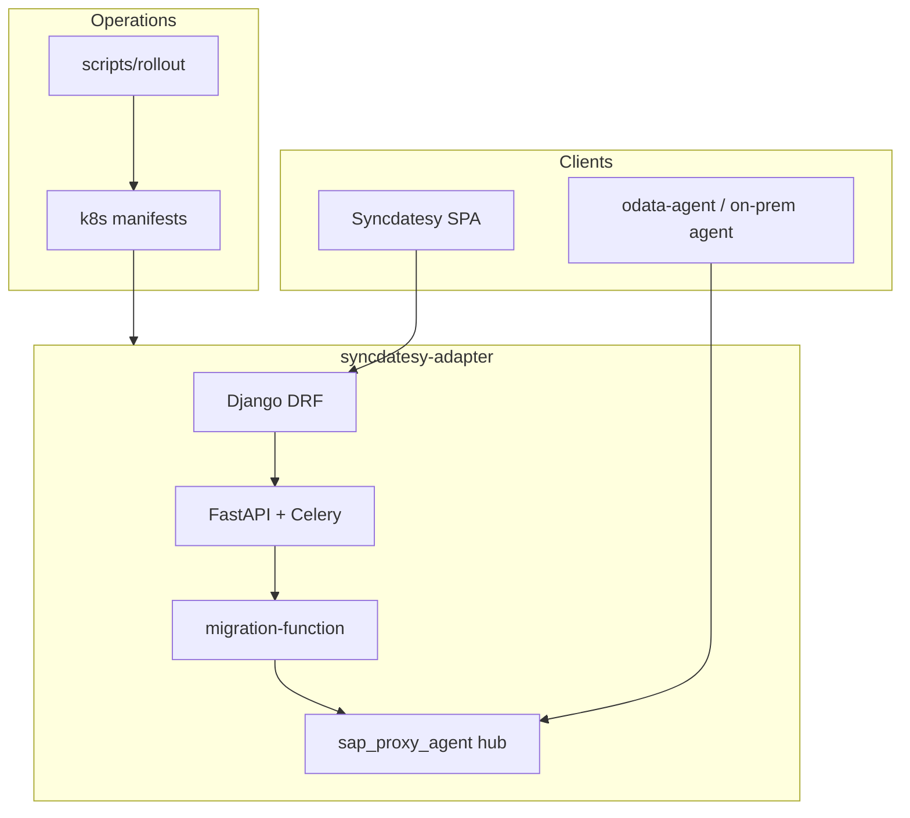

# Syncdatesy

**Syncdatesy** is a monorepo for the DataSyncher data integration platform: connectors, pipelines, scheduling, SAP proxy agents, and the customer web UI. This repository is the canonical **akashaku32/syncdatesy** workspace—organized for local development and **GCP batch** (`datasyncher-batch`) rollouts.

| | |
|---|---|
| **Remote** | [github.com/akashaku32/syncdatesy](https://github.com/akashaku32/syncdatesy.git) |
| **Default branch** | `main` |
| **Batch UI** | https://gcp.datasyncher.com (when deployed) |

---

## What’s in this repo



| Path | Purpose |
|------|---------|
| [`syncdatesy-adapter/`](syncdatesy-adapter/) | Backend: Django, FastAPI/Celery, `migration-function`, `sap_proxy_agent`, **k8s**, Cloud Build |
| [`frontend/data-syncher-ui/`](frontend/data-syncher-ui/) | **Syncdatesy** React UI (Vite, Chakra)—see [UI README](frontend/data-syncher-ui/README.md) |
| [`frontend/`](frontend/) | Docker/nginx image wrapper for batch frontend |
| [`odata-agent/`](odata-agent/) | Reference ODATA on-prem proxy agent |
| [`docs/`](docs/) | Architecture, security, cross-cutting docs |
| [`scripts/`](scripts/) | Workspace rollout helpers → [`scripts/rollout/`](scripts/rollout/) |

**Agent guides:** [`AGENTS.md`](AGENTS.md) · [`syncdatesy-adapter/AGENTS.md`](syncdatesy-adapter/AGENTS.md) · [`frontend/data-syncher-ui/AGENTS.md`](frontend/data-syncher-ui/AGENTS.md)

---

## Quick start

### Prerequisites

Python 3.10+, Node 18+, Docker (optional), `gcloud` + `kubectl` (batch), `gh` (GitHub).

### Backend

```powershell
cd syncdatesy-adapter
# Tests — see syncdatesy-adapter/AGENTS.md
python manage.py test apps.elttool.tests
cd backend\migration-function; pytest tests/ -q
```

### Frontend (Syncdatesy UI)

```powershell
cd frontend\data-syncher-ui
npm ci
npm run dev
```

Branding lives in `src/constants/branding.ts` and `src/theme/theme.ts` (teal/sky palette, new logo).

### Secrets (never commit)

| Need | Action |
|------|--------|
| Batch cluster | Copy `syncdatesy-adapter/k8s/batch-cluster/secrets/secrets.example.yaml` → `secrets.local.yaml` |
| Django / services | Copy `syncdatesy-adapter/.env.example` → `.env` |
| ODATA reference agent | Copy `odata-agent/**/config.example.json` → `config.json` |

Details: [`docs/security/secrets-and-settings.md`](docs/security/secrets-and-settings.md). **Rotate** any credentials that ever lived only in local secret files you deleted.

---

## Git workflow

| Branch | Use |
|--------|-----|
| `main` | Integration; safe-to-clone snapshot (no secrets) |
| `feature/sap-proxy-agent-hub` | Hub, mTLS, gateway |
| `feature/migration-function-connectors` | Connector routes & tests |
| `feature/frontend-data-syncher-ui` | SPA, UX, branding |
| `feature/batch-kubernetes-deploy` | k8s, rollouts, ingress examples |
| `feature/netsuite-connectors` | NetSuite paths |
| `feature/odata-agent` | `odata-agent/` parity |
| `feature/databricks-dynamics-load` | Databricks / Dynamics load |

```powershell
git fetch origin
git switch feature/frontend-data-syncher-ui
```

---

## Batch cluster (reference)

- **Context:** `gke_datasyncher-batch_us-central1_datasyncher-batch-cluster`
- **K8s entry:** [`syncdatesy-adapter/k8s/README.md`](syncdatesy-adapter/k8s/README.md)
- **Rollout scripts:** [`scripts/rollout/README.md`](scripts/rollout/README.md) or adapter `k8s/batch-cluster/rollout-*-batch.ps1`

**SAP proxy (high level):** UI → migration-function (mTLS) → `sap-proxy-agent-hub` → on-prem agent. Architecture: [`syncdatesy-adapter/docs/operations/proxy-agent/ARCHITECTURE.md`](syncdatesy-adapter/docs/operations/proxy-agent/ARCHITECTURE.md).

---

## Security & quality

- Policies: [`docs/security/`](docs/security/)
- Before PR: `pre-commit run` in `syncdatesy-adapter`; `npm run lint` + `npm run audit:deps` in UI
- No `.env`, `*.key`, live `secrets.yaml`, or agent `config.json` in git—see [`.gitignore`](.gitignore)

---

## Contributing

1. Branch from `main` or the matching `feature/*` branch.
2. Minimal diffs; follow [`AGENTS.md`](AGENTS.md).
3. Run checks for trees you touch.
4. Open PR to `main` on GitHub.

---

## License

Proprietary DataSyncher / Spectra work product. Credentials and production Secret manifests belong in your secret store—not this repository.
