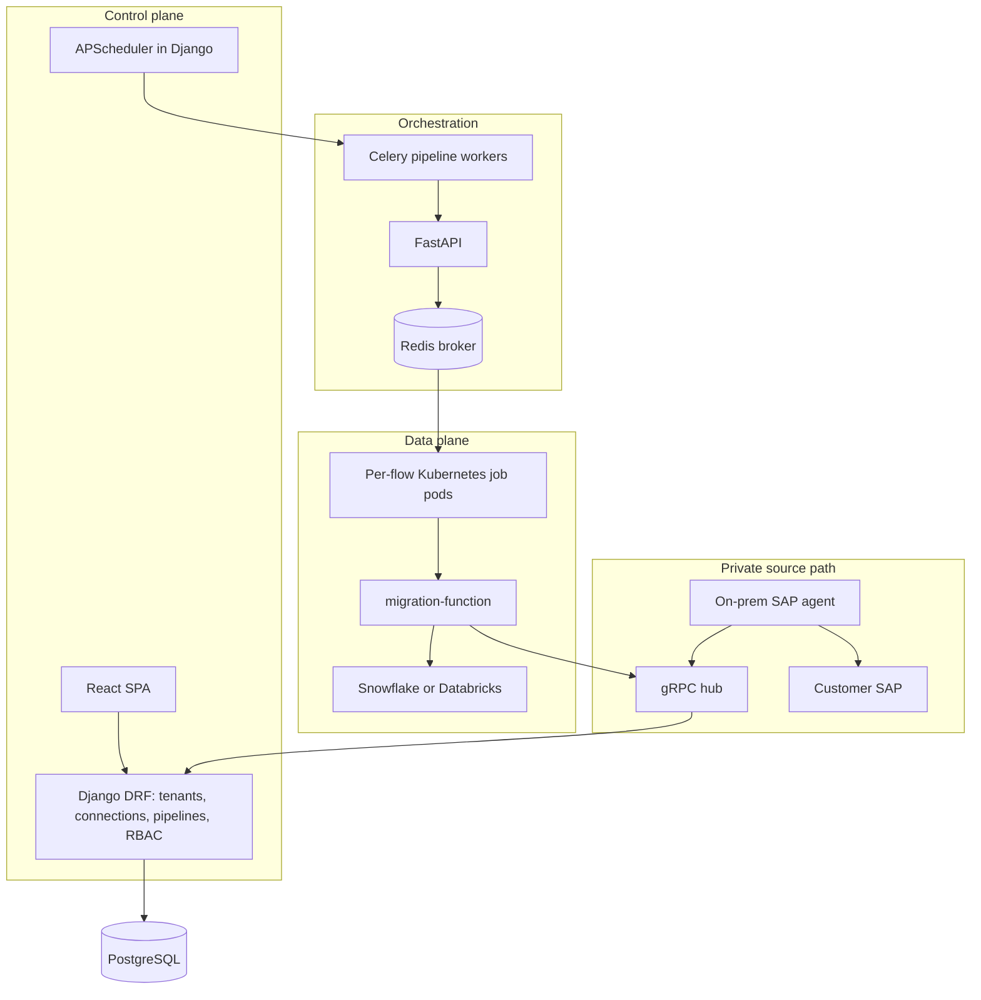
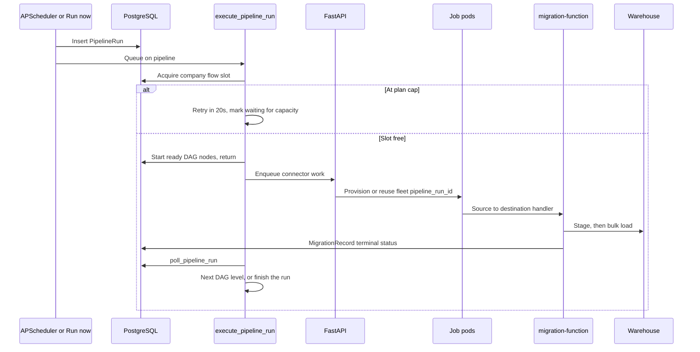

# DataSyncher high-level and low-level design

How the product is structured, how one pipeline run moves through the system, and how that compares with Fivetran.

This is a design note for the whole monorepo: the React SPA, the Django control plane, Celery and FastAPI orchestration, migration workers, and the SAP proxy agent. Operational detail stays in the linked runbooks.

**Scale target:** about 100 customer accounts on the current architecture. See [SCALE_100_ACCOUNTS.md](../../syncdatesy-adapter/docs/operations/SCALE_100_ACCOUNTS.md).

## Verdict

DataSyncher is a small Fivetran-shaped ELT system: a control plane that stores connections and schedules, and a separate data plane that extracts and bulk-loads into a warehouse. That shape is efficient for the 100-account target. It is not in Fivetran’s class for fleet size, change-data capture, or scheduler scale.

## High-level design

The browser never talks to source systems. It talks to Django. Django records what should run. Other services perform the sync.



| Plane | What it owns | Where it lives |
|-------|----------------|----------------|
| React SPA | Connections, pipeline canvas, run status. HTTP goes through `src/queryOptions` and one axios client. Live status comes over WebSockets. | `frontend/data-syncher-ui/` |
| Django / DRF | Companies, users, connections, pipeline graph, run rows, billing, RBAC. Source of truth. | `syncdatesy-adapter/apps/elttool/` |
| APScheduler | One process. Jobs stored in Postgres. A Redis lock so only one scheduler runs. A pipeline is a job named `pipeline_<id>`. | `apps/elttool/apps.py` — [SCHEDULER_PRODUCTION_SETUP.md](../../syncdatesy-adapter/docs/operations/SCHEDULER_PRODUCTION_SETUP.md) |
| Celery + FastAPI | Turns a saved pipeline into work. Pipeline workers stay short. FastAPI enqueues the migration. | `apps/elttool/tasks/pipeline_tasks.py`, `backend/fast-api/` |
| migration-function | Source-to-destination handlers. Extract, stage, then bulk-load. | `backend/migration-function/` |
| Job pods | Short-lived `celery-worker-job-*` pods. One fleet per pipeline run, shared by every node in that run. | `backend/fast-api/celery_job_worker_pool.py` |
| SAP proxy | Sources that cannot be reached from GKE. The agent dials out over mTLS. The hub does not open an inbound hole into the customer network. | [proxy-agent ARCHITECTURE.md](../../syncdatesy-adapter/docs/operations/proxy-agent/ARCHITECTURE.md) |
| PostgreSQL | Tenants, pipelines, migration status, scheduler job store. | — |
| Redis | Celery broker, scheduler lock, per-flow job queues. | — |

Security is layered on this same split: browser to ingress, Django for tenant and role checks, `X-INTERNAL-KEY` between internal services. See [security overview](../security/overview.md).

### What a pipeline is

A pipeline is a directed graph, not a single connector.

| Model | Table | Role |
|-------|--------|------|
| `Pipeline` | `pipeline` | Company-scoped flow: name, status, schedule, validated graph. Unique on `(company, name)`. |
| `PipelineNode` | `pipeline_node` | `start` or `batch`. A batch node points at one `Connection` and one `MigrationBatch`. A batch appears on at most one canvas. |
| `PipelineEdge` | `pipeline_edge` | Directed edge. Unique on `(pipeline, from_node, to_node)`. |
| `PipelineRun` | `pipeline_run` | One execution: `queued`, `running`, `completed`, `failed`, or `deleted`. |

The graph is validated and stored on the pipeline (`validated_graph`) before a scheduled run is allowed to use it.

## Low-level design of one run



1. **Schedule or Run now.** APScheduler fires `pipeline_<id>`, or the UI calls the run-now API. A `PipelineRun` row is created. Schedule starts are spread across 5 minutes (`PIPELINE_SCHEDULE_JITTER_SECONDS=300`) so many accounts do not hit the cluster at the same second.
2. **Orchestrator.** `execute_pipeline_run` runs on the `pipeline` Celery queue (`apps/elttool/tasks/pipeline_tasks.py`). If that company is already at its plan’s concurrent-flow cap, the task retries in 20 seconds and the run is marked waiting for capacity. Other companies keep their slots.
3. **Non-blocking DAG.** With `PIPELINE_NONBLOCKING_ORCHESTRATION` (default on), the worker starts the nodes whose parents are finished, then returns. It does not hold a worker for the whole load. `poll_pipeline_run` wakes up, reads migration status from Postgres, and either waits or starts the next level (`start_pipeline_level`).
4. **Capacity.** The cluster allows about 200 job pods (100 standard, 50 premium, 50 enterprise) and about 60 new pods per minute (6 per company). One accepted flow holds one job slot until teardown.
5. **Fleet.** With `PIPELINE_FLOW_FLEET_REUSE_ENABLED` (default on), every node in that run shares one Redis queue and one set of job pods named from `pipeline_run_<id>`. Pods are not torn down and recreated between nodes of the same run.
6. **Extract and load.** FastAPI enqueues a connector task. `services.migration_common.registry` maps a function path to a `(source, destination)` handler. Registered pairs include Salesforce and Salesforce sandbox, Dynamics 365 F&O, NetSuite, Snowflake, and Databricks, in both warehouse-bound and warehouse-to-Salesforce directions. Loaders stage files, then use warehouse bulk load (Snowflake copy, Databricks volume or Spark).
7. **Status.** Table rows and logs land in Postgres. Django pushes updates over WebSockets. When every node is terminal, the run is completed or failed. A run left `running` with no executor is alerted at 10 minutes and reaped at 15 minutes. Active table rows left behind after a finished run are treated as orphans after 10 minutes.

### SAP proxy path

SAP proxy loads do not extract inside the cluster.

1. migration-function calls the hub over mTLS gRPC (`TestSapConnection`, `StartDataLoad`, `TriggerDelta`).
2. The on-prem agent, already connected to the hub, reads SAP OData and can write the destination.
3. Progress returns through the hub (or the HTTPS gateway fallback) into Django’s internal ingest.
4. The pipeline worker only watches Postgres for terminal table rows.

Django does not accept agent gRPC. The hub is the only inbound mTLS endpoint for agents. See [proxy-agent ARCHITECTURE.md](../../syncdatesy-adapter/docs/operations/proxy-agent/ARCHITECTURE.md).

### Postgres connection budget at the design point

At 2 Django orchestrator replicas × concurrency 8, a small ops worker, and about 100 job pods at concurrency 3:

```text
connections ≈ 16 + 2 + 300 + ~20 ≈ 340
```

Cloud SQL `max_connections` needs headroom above that. PgBouncer in transaction mode is the documented next step as the count approaches the limit. Keep Django `CONN_MAX_AGE` modest so idle workers do not pin connections.

## Comparison with Fivetran

The data path for a SaaS or OData source matches the usual ELT pattern: isolate the sync, stage files, bulk-load the warehouse. The on-prem agent matches hybrid deployment: outbound only, so customer SAP does not accept inbound connections from the control plane. Plan caps, provision rate limits, and schedule jitter are the right controls for a shared cluster.

The control plane is sized for about 100 accounts. Past that, the mechanisms below dominate cost and operability.

| | DataSyncher | Fivetran |
|---|---|---|
| Designed scale | About 100 accounts. ~340 Postgres connections at that size. PgBouncer recommended. | Thousands of customers, sharded control plane. |
| Scheduler | One APScheduler process plus a Redis lock. Jobs in Postgres. | Distributed scheduler. |
| Completion | Workers poll Postgres on a Celery countdown until table rows are terminal. | The sync reports completion. Orchestration is event-driven. |
| Unit of work | User-drawn DAG of batches, then a pod fleet per run. | One connector sync. Tables are parallelized inside that sync. |
| Change capture | API, OData, and ODBC pulls, plus delta where a connector implements it (SAP `TriggerDelta`). | Log-based CDC for databases (binlog, WAL, change tracking) when the source allows it. API cursors for SaaS. |
| Cold start | Kubernetes pod create and image pull. Fleet reuse avoids repeating that between nodes of one run. | Long-lived or serverless extractors. Sync start does not wait on a pod boot. |
| Connector platform | `migration_common` registry plus a map of one-off function paths (`registry.py`). | One SDK: cursors, schema drift, retries, history mode, metering. |

Polling is the main runtime cost Fivetran does not pay. Every in-flight run keeps a Celery message and a database read until the tables finish. That is acceptable at this size. It gets expensive if many long SAP loads are polled together.

Pod-per-flow is the other cost. The first node of a run still waits on scheduling and image pull. Fleet reuse removes that wait for later nodes in the same run.

For Salesforce, Dynamics, and NetSuite, an API extractor plus a warehouse loader is the same class of work Fivetran does. For a SQL database, a query or OData pull moves more data than a log reader. Fivetran’s advantage on databases is reading the change log once and merging.

Two structural costs show up in the repo and do not show up in a single COPY:

- Pipeline behavior is concentrated in `apps/elttool/v1/pipeline_views.py`, and domain models are concentrated in `apps/elttool/models.py`.
- [gaps-and-roadmap.md](../security/gaps-and-roadmap.md) still lists a missing shared `tenant_scope` helper and a `FIELD_ENCRYPTION_KEY` that is not enabled in cluster secret templates.

## Related docs

| Topic | Doc |
|-------|-----|
| 100-account caps, jitter, fleet reuse | [SCALE_100_ACCOUNTS.md](../../syncdatesy-adapter/docs/operations/SCALE_100_ACCOUNTS.md) |
| Scheduler | [SCHEDULER_PRODUCTION_SETUP.md](../../syncdatesy-adapter/docs/operations/SCHEDULER_PRODUCTION_SETUP.md) |
| SAP proxy pods and RPCs | [ARCHITECTURE.md](../../syncdatesy-adapter/docs/operations/proxy-agent/ARCHITECTURE.md) |
| Migration handler registry | [migration-services.md](../security/migration-services.md) |
| Security layers | [overview.md](../security/overview.md) |
| Open hardening gaps | [gaps-and-roadmap.md](../security/gaps-and-roadmap.md) |
