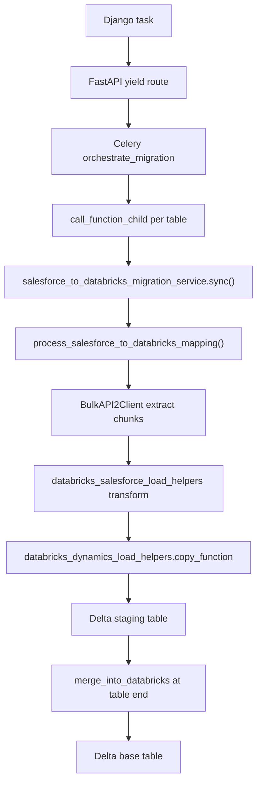

# Salesforce → Databricks Migration (mirror Dynamics pattern)

## Goal

Add a full connector path for **Salesforce → Databricks** and **Salesforce Sandbox → Databricks**, structurally matching [`microsoft_dynamics_to_databricks_migration_service.py`](Datasyncher-React-Adapter/backend/migration-function/services/microsoft_dynamics_to_databricks_migration_service.py) while keeping Salesforce extract logic from [`salesforce_service.py`](Datasyncher-React-Adapter/backend/migration-function/services/salesforce_service.py).

**Confirmed scope:** Production + Sandbox, full parity (deferred MERGE, `staging_table_details`, Celery fan-out, `drop_and_reload`, incremental sync).

**Important correction:** Intermediate staging files remain **CSV** (same as Dynamics today), loaded into **Delta** staging/base tables via `COPY INTO`. This is not a Parquet migration.

---

## Architecture



**Reuse boundaries**

| Layer | Reuse from | New code |
|-------|------------|----------|
| Extract / SOQL / incremental | `salesforce_service` (`BulkAPI2Client`, `get_all_salesforce_fields`, `salesforce_connection`, watermarks) | Thin wrapper only |
| Databricks connect / COPY / MERGE | `databricks_dynamics_load_helpers` (`destination_connection_function`, `copy_function`, `merge_into_snowflake`) | SF-specific DDL + transform |
| Orchestration pattern | Dynamics Databricks service | SF object loop instead of Azure folder scan |
| Progress / resume | `utils/staging_table_details` | Wire for SF object names |

---

## New files

### 1. [`backend/migration-function/services/salesforce_to_databricks_migration_service.py`](Datasyncher-React-Adapter/backend/migration-function/services/salesforce_to_databricks_migration_service.py)

Main orchestrator (async `sync_salesforce_to_databricks(request, environment)` + `migrate()` alias for router parity).

**Structure (mirror Dynamics service):**

- `sync_salesforce_to_databricks()` — top-level: unpack request, force sequential in `celery_child_mode`, connection preflight (SF + Databricks), `drop_and_reload` table drops via `drop_databricks_table`, fan-out/sequential table execution, failure emails, completion summary
- `process_salesforce_to_databricks_mapping()` — per SF object:
  - Read watermarks (`get_last_checked_dates_and_fields`, safety interval cutoff — same as SF→Snowflake)
  - Object describe + field type map
  - Incremental SOQL (`SystemModstamp` / `LastModified` / `CreatedDate`)
  - Bulk API 2.0 job + chunk loop (`process_salesforce_results_in_chunks`)
  - **Deferred merge pattern:** create/resume staging via `staging_table_details`; per chunk call `databricks_load_chunk()`; at end call `merge_into_databricks()`
- `databricks_load_chunk()` — dedupe within chunk if needed, call `copy_function()`
- `transform_salesforce_chunk()` — delegate to helpers

**Imports from existing code (do not duplicate):**

```python
from services.salesforce_service import (
    BulkAPI2Client, get_all_salesforce_fields, salesforce_connection,
    process_salesforce_results_in_chunks, get_last_checked_dates_and_fields,
    update_last_synced_date, update_table_status_sf_to_snowflake,
    normalize_name, ...
)
from services.databricks_dynamics_load_helpers import (
    destination_connection_function, copy_function,
    merge_into_snowflake as merge_into_databricks,
    drop_databricks_table, drop_staging_table, ...
)
```

### 2. [`backend/migration-function/services/databricks_salesforce_load_helpers.py`](Datasyncher-React-Adapter/backend/migration-function/services/databricks_salesforce_load_helpers.py)

SF-specific destination logic:

- `SALESFORCE_TO_DATABRICKS_TYPE` — map SF describe types to Delta DDL (based on existing `SALESFORCE_TO_SNOWFLAKE_TYPE` in [`salesforce_service.py:4704`](Datasyncher-React-Adapter/backend/migration-function/services/salesforce_service.py))
- `build_attributes_details_field(describe_meta, fields)` — `{COL: databricks_type}` for `copy_function`
- `ensure_databricks_table_from_salesforce_describe()` — create/alter base Delta table from SF metadata + `_FIVETRAN_SYNCED` / `_FIVETRAN_DELETED`
- `transform_salesforce_chunk_to_dataframe(chunk, fields, column_types, is_updated, is_deleted, exclude_deleted_rows)` — pandas coercion (dates, booleans, JSON/complex → STRING)
- `salesforce_upload_to_bucket(df, table_name, connection_id)` — GCS blob name `temp_data_salesforce_{table}_{connection_id}.csv` (avoid collision with Dynamics blobs)

**Note:** `copy_function` today calls Dynamics `upload_to_bucket`. Either:
- Add optional `blob_prefix` / `upload_fn` param to `copy_function`, **or**
- Have SF service upload before `copy_function` when using volume path, and patch GCS path inside helper

Prefer **small extension** to `copy_function` with optional `staging_blob_name` to keep one COPY path.

### 3. [`backend/migration-function/routers/databricks_salesforce_migration_router.py`](Datasyncher-React-Adapter/backend/migration-function/routers/databricks_salesforce_migration_router.py)

HTTP fallback endpoints (mirror [`databricks_dynamics_migration_router.py`](Datasyncher-React-Adapter/backend/migration-function/routers/databricks_dynamics_migration_router.py)):

- `POST /Databricks-Salesforce-migrate` → `sync_salesforce_to_databricks(..., "production")`
- `POST /Databricks-SalesforceSandbox-migrate` → `sync_salesforce_to_databricks(..., "sandbox")`

### 4. Model addition in [`backend/migration-function/models/salesforce_models.py`](Datasyncher-React-Adapter/backend/migration-function/models/salesforce_models.py)

Add `SalesforceDatabricksMigration` — same fields as `SalesforceSnowflakeMigration` (lines 107–136) plus `celery_fanout_mode` if needed. Keeps payload contract aligned with Celery/Django.

---

## Modified files

### Migration-function app

[`backend/migration-function/app.py`](Datasyncher-React-Adapter/backend/migration-function/app.py) — `include_router(databricks_salesforce_migration_router)`.

### FastAPI gateway

[`backend/fast-api/app.py`](Datasyncher-React-Adapter/backend/fast-api/app.py):

| Addition | Value |
|----------|-------|
| Yield routes | `POST /Databricks-Salesforce-migration-yield`, `POST /Databricks-SalesforceSandbox-migration-yield` |
| `CLOUD_FUNCTION_URLS` | Map to `Databricks-Salesforce-migrate`, `Databricks-SalesforceSandbox-migrate` |
| `MIGRATION_FUNCTION_PATHS` | Add both paths |
| `CONNECTOR_TYPE_BY_PATH` | `salesforce_to_databricks`, `salesforce_sandbox_to_databricks` |

Django already builds URLs as `{dest}-{source}-migration-yield` ([`views.py:12841`](Datasyncher-React-Adapter/apps/elttool/v1/views.py)) — no Django URL change required.

### Celery dispatch

[`backend/fast-api/celery_worker.py`](Datasyncher-React-Adapter/backend/fast-api/celery_worker.py) — extend `_dispatch_direct_connector()`:

```python
if function_path == "/Databricks-Salesforce-migration-yield":
    ...
    return _execute_async(sync_salesforce_to_databricks(SalesforceDatabricksMigration(**payload), "production"))
if function_path == "/Databricks-SalesforceSandbox-migration-yield":
    ...
    return _execute_async(sync_salesforce_to_databricks(SalesforceDatabricksMigration(**payload), "sandbox"))
```

Fan-out: SF→Databricks uses **flat table names** (same as SF→Snowflake), not reverse-ETL mapping pairs — no change to `_is_snowflake_to_salesforce_path` logic.

### Resource profiles

[`backend/fast-api/celery_resource_config.py`](Datasyncher-React-Adapter/backend/fast-api/celery_resource_config.py):

```python
"salesforce_to_databricks": {
    "memory_estimate_bytes": 8 * 1024 ** 3,
    "preferred_concurrency": 2,
    "max_pods": 4,
},
"salesforce_sandbox_to_databricks": { ... same ... },
```

Mirror existing `salesforce_to_snowflake` profile.

### Chunk limits (DB seed)

Add `source_model.max_count` for `Salesforce` and `SalesforceSandbox` (Bulk API practical batch ceiling, e.g. 150k–200k) via new Django migration, following [`0100_enterprise_chunk_pct_75.py`](Datasyncher-React-Adapter/apps/elttool/migrations/0100_enterprise_chunk_pct_75.py).

### Minor helper extension

[`databricks_dynamics_load_helpers.copy_function`](Datasyncher-React-Adapter/backend/migration-function/services/databricks_dynamics_load_helpers.py) — add optional `staging_blob_name: str | None = None` passed through to upload step so SF and Dynamics do not overwrite each other's GCS objects on shared connections.

---

## Per-object ETL flow (full parity)

For each selected SF object (e.g. `Account`):

1. **Resume check** — `staging_table_details` lookup; if `load_phase=loading`, reuse staging table name
2. **Extract** — Bulk API 2.0 query job; stream/chunk results (fix: prefer streaming path for large objects; Bulk 2.0 currently loads all rows in memory in [`get_job_results`](Datasyncher-React-Adapter/backend/migration-function/services/salesforce_service.py) — keep same behavior as SF→Snowflake for v1, note as follow-up)
3. **Transform chunk** — pandas + SF→Delta type coercion; filter `IsDeleted` on initial load
4. **Load chunk** — `copy_function()` → CSV to GCS/volume → `COPY INTO` staging Delta; update `staging_records_count` / progress
5. **End of object** — `merge_into_databricks()` staging → base; `drop_staging_table`; clear `staging_table_details`; update `last_synced`
6. **drop_and_reload** — drop base + staging tables before extract (reuse Dynamics drop helpers)

Audit columns: keep `_FIVETRAN_SYNCED` / `_FIVETRAN_DELETED` defaults from request model (same as SF→Snowflake).

Primary key: `Id` (normalized to `ID` in Databricks uppercase convention).

---

## Tests

| File | Coverage |
|------|----------|
| [`backend/fast-api/tests/test_databricks_salesforce_dispatch.py`](Datasyncher-React-Adapter/backend/fast-api/tests/test_databricks_salesforce_dispatch.py) | Celery direct dispatch + `app.py` URL mapping (mirror [`test_databricks_dynamics_dispatch.py`](Datasyncher-React-Adapter/backend/fast-api/tests/test_databricks_dynamics_dispatch.py)) |
| [`backend/migration-function/tests/test_databricks_salesforce_load_helpers.py`](Datasyncher-React-Adapter/backend/migration-function/tests/test_databricks_salesforce_load_helpers.py) | Type mapping, transform, blob naming |
| [`backend/migration-function/tests/test_salesforce_to_databricks_mapping.py`](Datasyncher-React-Adapter/backend/migration-function/tests/test_salesforce_to_databricks_mapping.py) | Mocked Bulk API + copy_function + deferred merge orchestration |

---

## Deployment / rollout

No new K8s deployment needed — same `fast-api` and `migration-function` images. After merge:

1. Cloud Build both images
2. Rollout batch cluster (`rollout-fastapi-batch.ps1`, migration-function deployment)
3. Smoke test: create SF→Databricks connection, sync one small object (`User` or custom small object), verify Delta base row count

---

## Out of scope (follow-ups)

- Spark integration (on hold per prior discussion)
- Parquet staging (CSV remains for v1 parity with Dynamics)
- Bulk API 2.0 locator pagination (memory fix for 10M+ objects)
- Frontend changes (Django URL convention should work if connection pairing already allows SF + Databricks in UI)

---

## Implementation order

1. Models + router + app registration (skeleton endpoints)
2. `databricks_salesforce_load_helpers.py` (types, transform, upload)
3. `salesforce_to_databricks_migration_service.py` (core ETL)
4. FastAPI + Celery wiring + resource profiles
5. `copy_function` blob name extension
6. DB migration for SF `max_count`
7. Unit tests + manual smoke on batch cluster
